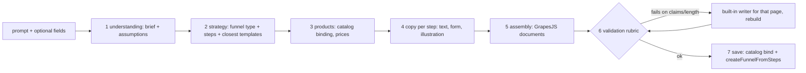

# AI funnel builder and builder assistant

Status of the real-model path: **verified with fakes only.** Every test uses the built-in writer or a scripted fake model (`server/test/support/fakellm.ts`); nothing here was run against the real Anthropic API. `server/scripts/ai-smoke.ts` runs three briefs against the real API when you set `ANTHROPIC_API_KEY` yourself and prints a rubric report; it was not run by the authors.

Related: [AI.md](AI.md) (providers and the older single-call features), [ARCHITECTURE.md](ARCHITECTURE.md#page-builder), [PRODUCTS.md](PRODUCTS.md), [TEMPLATES.md](TEMPLATES.md), [RATE-LIMITING.md](RATE-LIMITING.md), ADRs [0040](adr/0040-ai-funnel-builder-pipeline.md) and [0041](adr/0041-builder-assistant-edit-operations.md).

## Pipeline

`server/src/ai/builder/`. `POST /api/ai/builds` stores a generation record (`ai_generations`, migration 040), enqueues the job `ai.build` and answers `202`. The job runs the stages below, checkpointing after each one, then saves a normal funnel in **test** status.

| Stage | What it does | Who decides |
|---|---|---|
| understanding | business, offer, audience, tone, goal, industry, currency, price range, constraints, language, regulated topic, **assumptions list** | rules (`brief.ts`); the model may refine, structured fields always win; prices must appear in the text |
| strategy | funnel type and page sequence from the template taxonomy (`strategy.ts`); the 3 closest native templates and the look (accent, hero gradient) of the best one | code validates the model's choice (`strategyProblems`); the thank-you page is always last |
| products | product slots per role (main, bump, upsell, downsell), prices inside the author's range, binding to existing catalog products | code (`products.ts`); the model never sets a price |
| copy | headline, sub-headline, bullets, button text, FAQ, **placeholder** testimonial prompts, form fields, illustration kind and alt text | model or built-in writer; checked by `copyProblems` |
| assembly | the page document from fixed building blocks (`assemble.ts`) through `normalizeDoc` (the same cleaner and sanitiser as any save) | code |
| validation | structure, wiring, reachability, one call to action, contrast, lengths, claims, no external hosts, products bound, forms, fake proof, alt text (`validate.ts`) | code |
| saving | binds products with `bindTemplateProducts`, creates the funnel with `createFunnelFromSteps` | code |

The model never produces component JSON, HTML or CSS. It returns plain text for named fields. Pages are assembled from the same DSL the templates use, so a generated page is an ordinary project the author can edit.

### Funnel types and the template taxonomy

`lead_magnet` (opt-in, thank-you), `waitlist`, `webinar`, `sales_page` (sales with order bump, one-click upsell, thank-you), `product_launch` and `saas_trial` (landing, checkout, thank-you), `booking`, `application`, `event`, `donation`, `local_lead`. Page kinds are the ones of [TEMPLATES.md](TEMPLATES.md) (`landing`, `optin`, `sales`, `upsell`, ...). Without catalog products (`options.products: "none"`, the default) offer pages become enquiry forms and upsell steps are dropped, so no funnel claims to take payment that nothing can process.

### Products and pricing

* `products: "none"` (default): the catalog is not touched.
* `products: "create"`: every role becomes a **draft** product on save (a normal catalog product that is not synced to Stripe; the funnel is in test status, so nothing can be bought). Needs `products:write`. A price the author gave is used exactly (single price) or the middle of the range; with only a maximum or minimum the industry default is clamped; with nothing given the default is used and the assumptions say so. Bump, upsell and downsell are fractions of the main price and never exceed a given maximum.
* `products: "existing"`: roles bind to catalog products the author selected (`productIds`) or named in the description; roles without a product are dropped together with their pages.
* The copy never states that the author already sells something: the offer is a placeholder unless the brief names one, and the assumptions list says which.

### Safety

* The brief is untrusted data. Prompts wrap it in `<untrusted_input>` blocks with angle brackets defused; the system text never changes with it. Injection phrases are detected (`redact.ts`), flagged in the record and the assumptions, and the text is still used only as subject matter. Tests feed injection, `</untrusted_input>` break-outs and "respond with" payloads and assert that the output and the prompts hold.
* Output is plain text: tags, links, control and bidi characters are stripped (`plainOut`), then the page cleaner and sanitiser run as for any save. No external hosts can appear (rubric check).
* Claims (`claims.ts`): no guarantees, rankings, endorsements, press mentions, customer counts, ratings, invented scarcity or statistics; numbers must come from the brief; health, finance and legal topics add cure, return, income and outcome rules. Clauses of the author's own description that make such claims are dropped before they can become copy. Profanity is not echoed onto pages. Testimonials are always labelled **placeholders**.
* Forms ask only for what is needed; sensitive fields (card numbers, ID numbers, passwords, diagnoses, income) are refused; an email field always exists.
* **PII redaction option** (`options.redactPii`): emails, phone numbers, card-like and ID-like numbers are replaced by `[email]`, `[phone]` ... before the prompt is stored or sent. The unredacted prompt is not written down.
* Budgets and quotas: `AI_BUILD_INPUT_TOKENS` per call (estimated), `AI_BUILD_OUTPUT_TOKENS` per build, `AI_REQUEST_TIMEOUT_MS` per call, `AI_BUILD_MAX_REPAIRS` repair retries. A build counts once against `ai.minute` and `ai.daily` (the existing per-workspace policies); one build runs per workspace at a time (`409 BUILD_IN_PROGRESS`).
* Model name from `ANTHROPIC_MODEL` (default `claude-sonnet-5-5`), key from `ANTHROPIC_API_KEY`; nothing is hard-coded.

### Repair loop and fallback

Per stage the model's answer is parsed, checked against its zod schema and the semantic rules above. On failure the model is asked again with the reasons (bounded by `AI_BUILD_MAX_REPAIRS`). After that, or on a refusal, timeout, empty or malformed answer, an outage or the output budget, **that stage uses the built-in writer** and the stage is marked `fallback` with the reason. If the finished pages fail the rubric on claims or length, the offending page is rebuilt with the built-in writer and checked again. The record's `source` is `model`, `heuristic` (no provider configured) or `fallback`, and `degraded` is set when anything fell back. The UI says so.

The built-in writer is deterministic: it picks phrase variants with a generator seeded from the brief, so the same description always produces the same funnel.

### Progress, cancel, resume

* `GET /api/ai/builds/{id}` returns the stages (`understanding`, `strategy`, `products`, `copy:<step>`, `assembly`, `validation`, `saving`) with status and detail, assumptions, token use and, when finished, the brief, strategy, report and the funnel.
* Each checkpoint also publishes an `ai.build` event on the workspace SSE stream (`/api/events/stream`). The wizard listens and polls every 2.5 seconds as a fallback.
* `POST /api/ai/builds/{id}/cancel` stops the job at the next stage (and aborts the model call in the same process). Nothing is created.
* The wizard keeps the id in `localStorage`; after a refresh it shows the running or finished build. A restarted server re-queues a stale job and the pipeline resumes after the last finished stage.
* `POST /api/ai/builds/{id}/steps/{key}/regenerate` rewrites one page's copy (optional instruction), rebuilds it with the stored brief, strategy and product links, and saves it with a page backup.
* Records are kept for `AI_GENERATION_RETENTION_DAYS` (default 90), then purged by the maintenance job.

## Builder assistant (edit operations)

Builder > AI tab. The author types an instruction ("make the hero shorter", "add an FAQ about shipping", "change the tone to playful", "add a testimonial section", "translate to Spanish"); with an element selected the instruction applies to it.

1. The browser sends an **outline** of the live page (element ids, types, short texts; no styles, no HTML) to `POST /api/ai/edit`.
2. The model returns `{summary, ops}`. Operations are `insert`, `replace`, `delete`, `move`, `setText`, `restyle`, defined by a zod schema shared by server and browser (`server/src/pagemodel/shared/edit.ts`): allow-listed node types (heading, text, button, list, FAQ, illustration, divider, spacer, testimonial placeholder, card, columns, section), 20 style properties, at most `AI_EDIT_MAX_OPS` operations, 60 new elements, depth 4, text 1,500 characters, https/mailto/tel/path links only. No forms, checkouts, scripts, raw HTML or external hosts can be expressed. Targets must exist in the outline; inserted text passes the claim and number checks.
3. The server repairs or replaces bad output exactly like the funnel pipeline (`source: model | heuristic | fallback`, with a message).
4. The panel lists the changes (before and after text for text edits). **Preview on the page** applies them synchronously, which GrapesJS records as **one undo step**; **Keep changes** leaves them, **Undo changes** reverts the step (or says so when the page was edited in between). The browser validates every operation again and skips what no longer matches.
5. "Write a section" (`POST /api/ai/section`) returns one section spec that goes through the same preview.

Without a model the built-in assistant handles: shorten, change tone, add an FAQ, add testimonial placeholders, centre, enlarge; anything else answers with what it can do (translation needs a model). The older entry points (rewrite, 5 headline ideas, alt text) keep using the same provider and fallbacks ([AI.md](AI.md)).

## Quality evals

`server/test/ai.evals.test.ts`, briefs in `server/src/ai/builder/evals/briefs.ts`, rubric in `evals/rubric.ts`. 24 golden briefs: bakery, dentist, SaaS trial, webinar, coaching, e-commerce product, nonprofit, real estate, course, B2B agency, event, waitlist, structured fields, existing products, and adversarial ones: prompt injection, 70 KB input, empty, Spanish, Japanese, profanity, regulated health, finance and legal claims. Each runs with the built-in writer (twice: same output) and with a scripted model that answers well, with banned claims and invented numbers, with injected and profane text, with malformed JSON and with provider failures. The rubric (structure, wiring, reachability, one call to action per page, contrast AA, length limits, banned claims, products bound, no external hosts, plain text, no echo of injected or profane or claim text, price inside the range, goal, industry, language, regulated reading) must hold in every mode: a bad model lowers `source` to `fallback`, never the quality of what is saved. The evals found real defects while being written (a decorative ring showing "72%", the word "pounds" read as a price, a Japanese brief detected as Chinese, claims in the author's own wording echoed into headlines); each is fixed and covered.

Limits: the rubric checks structure and safety, not whether the copy is good. Real-model quality, latency and cost are unmeasured.
