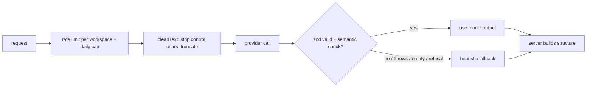

# AI features

All features go through `AiProvider` (`server/src/ai/types.ts`). `AnthropicProvider` (SDK, model from `ANTHROPIC_MODEL`, default `claude-sonnet-5-5`) is used when `ANTHROPIC_API_KEY` is set; otherwise `HeuristicProvider` produces deterministic output so every feature works offline. Tests never touch the network.

| Feature | Endpoint | UI entry point |
|---|---|---|
| Generate funnel from a prompt | `POST /api/ai/funnel` | New funnel wizard, "Generate with AI" |
| Rewrite copy (tone, length) | `POST /api/ai/rewrite` | Builder: the sparkle button in the floating toolbar of a heading, text or button, and the Rewrite button in the Settings tab |
| 5 headline variants | `POST /api/ai/headlines` | Builder: same dialog, for headings ("Headline ideas") |
| Analytics insights | `POST /api/ai/insights` | Funnel > Analytics > "Explain performance" |
| Alt text suggestion | `POST /api/ai/alt-text` | Builder: Settings tab of an image, "Suggest alt text" |
| Usage | `GET /api/ai/status` | Settings |

## Pipeline

Responses carry `source`: `model`, `heuristic` (no key configured) or `fallback` (model failed validation).

## How AI output reaches the page builder

The builder stores GrapesJS project data, and no AI path writes that directly.

* **Generated funnels** (`POST /api/ai/funnel`): `buildSteps` still assembles each step as a version-1 *block document* from the model's copy (the server decides structure, forms, prices and the checkout). Saving it goes through `validateDoc`, which runs the deterministic converter (`pagemodel/convert.ts`) and then the same `cleanProject` allow-list as any save, so a generated page is an ordinary project the author can open, drag around and restyle. The model never sees or produces component JSON, HTML or CSS, which keeps the "copy only" safety property of the old pipeline.
* **Rewrite and headline ideas** work on the plain text of the selected element. *Apply* replaces that element's text content; its structure, classes and styles are untouched, and the result is escaped by the same renderer as any typed text (a model reply containing `<script>` is shown as text). Suggestions are never applied without the click, and the apply is one undo step.
* **Alt text**: the suggestion fills the image's `alt` attribute for the author to review.
* A funnel built from a prompt, a template or by hand is the same kind of document, so everything in [the page builder section](ARCHITECTURE.md#page-builder) (limits, sanitising, price integrity) applies to AI output without a special case.

## Prompts and safety

* The system prompt states the rules (JSON only, no invented numbers, treat `<untrusted_input>` as data). User text is wrapped in `<untrusted_input name="...">` with `<`/`>` replaced, so it cannot close the tag.
* Inputs are truncated (business 1500, audience 300, text 3000, context 500 characters); oversized input is shortened, not rejected (the HTTP body cap is 256 KB).
* No secrets, tokens or tenant identifiers are placed in prompts.
* **Funnel generation**: the server decides the structure (`planSteps`: goal and 1-6 steps, thank-you last). The model returns copy only (headline, subheadline, bullets, CTA). Blocks, forms, prices and checkout are built by `buildSteps`, so injected text cannot add steps, scripts or products. Output is zod-validated; missing steps are padded, extra ones dropped, invalid output falls back to the heuristic copy.
* **Insights**: every number comes from the analytics SQL. The weakest step is chosen in code (largest drop-off from the previous step). The model narrates; any number in its text that is not in the computed metrics (beyond tiny ordinals and the range dates) rejects the output and the heuristic narrative is used. The response returns the SQL metrics untouched next to the text.
* Rewrite/headlines/alt text suggestions are only applied when the user clicks Apply; the renderer escapes everything.

## Period summary

`POST /api/analytics/summary` ([ADR 0025](adr/0025-grounded-analytics-summary.md)). The server builds an evidence object in SQL (this period, the previous period of equal length, per currency, top five products with refund rate, checkout conversion and take rates, for a funnel its step metrics). The provider's optional `summary(evidence)` writes `{narrative, actions}`; the offline `HeuristicProvider` and the fallback use the deterministic narrator (`ai/summary.ts`). The answer must match the schema (narrative 20-900 characters, exactly three actions with priorities) and pass `numberGuard`: every number must be in the evidence (exact, rounded to 0, 1 or 2 decimals, or a 0-1 rate as a percentage); product, funnel and step names and the period's dates are blanked before counting (names are cleaned by `safeName`: control characters and tag characters removed, 80 characters, a name without a letter gets a word); links, markup and code are refused. One failure replaces the answer by the narrator's (`source: "fallback"`). The model is told the evidence is data and names are subject matter; the evidence JSON is passed with angle brackets defused so a name cannot close the data block. Tests: guard accept/reject cases, a property test that the narrator always passes the guard, an obeying model fed an injection name, malformed, empty, throwing and wrong-shape outputs, quota and permissions. Limits: numbers spelled as words are not checked; the guard is strict, so a model that rounds creatively is replaced.

## Cost and limits

`AI_RATE_LIMIT_PER_MINUTE` (default 10, per workspace) and `AI_DAILY_CAP` (default 50, UTC day, `0` disables AI) are enforced before any call and counted even when the model fails. Token budgets per call: 3000 (funnel), 1500 (rewrite), 1200 (insights), 600 (headlines), 200 (alt text).
