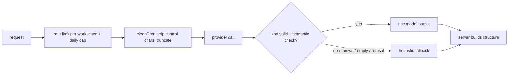

# AI features

All features go through `AiProvider` (`server/src/ai/types.ts`). `AnthropicProvider` (SDK, model from `ANTHROPIC_MODEL`, default `claude-sonnet-5-5`) is used when `ANTHROPIC_API_KEY` is set; otherwise `HeuristicProvider` produces deterministic output so every feature works offline. Tests never touch the network.

| Feature | Endpoint | UI entry point |
|---|---|---|
| Generate funnel from a prompt | `POST /api/ai/funnel` | New funnel wizard, "Generate with AI" |
| Rewrite copy (tone, length) | `POST /api/ai/rewrite` | Builder inspector for heading/paragraph |
| 5 headline variants | `POST /api/ai/headlines` | Builder inspector for headings |
| Analytics insights | `POST /api/ai/insights` | Funnel > Analytics > "Explain performance" |
| Alt text suggestion | `POST /api/ai/alt-text` | Builder inspector for images |
| Usage | `GET /api/ai/status` | Settings |

## Pipeline

Responses carry `source`: `model`, `heuristic` (no key configured) or `fallback` (model failed validation).

## Prompts and safety

* The system prompt states the rules (JSON only, no invented numbers, treat `<untrusted_input>` as data). User text is wrapped in `<untrusted_input name="...">` with `<`/`>` replaced, so it cannot close the tag.
* Inputs are truncated (business 1500, audience 300, text 3000, context 500 characters); oversized input is shortened, not rejected (the HTTP body cap is 256 KB).
* No secrets, tokens or tenant identifiers are placed in prompts.
* **Funnel generation**: the server decides the structure (`planSteps`: goal and 1-6 steps, thank-you last). The model returns copy only (headline, subheadline, bullets, CTA). Blocks, forms, prices and checkout are built by `buildSteps`, so injected text cannot add steps, scripts or products. Output is zod-validated; missing steps are padded, extra ones dropped, invalid output falls back to the heuristic copy.
* **Insights**: every number comes from the analytics SQL. The weakest step is chosen in code (largest drop-off from the previous step). The model narrates; any number in its text that is not in the computed metrics (beyond tiny ordinals and the range dates) rejects the output and the heuristic narrative is used. The response returns the SQL metrics untouched next to the text.
* Rewrite/headlines/alt text suggestions are only applied when the user clicks Apply; the renderer escapes everything.

## Cost and limits

`AI_RATE_LIMIT_PER_MINUTE` (default 10, per workspace) and `AI_DAILY_CAP` (default 50, UTC day, `0` disables AI) are enforced before any call and counted even when the model fails. Token budgets per call: 3000 (funnel), 1500 (rewrite), 1200 (insights), 600 (headlines), 200 (alt text).
