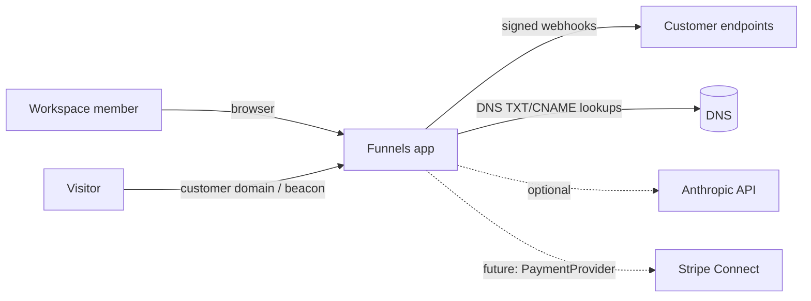
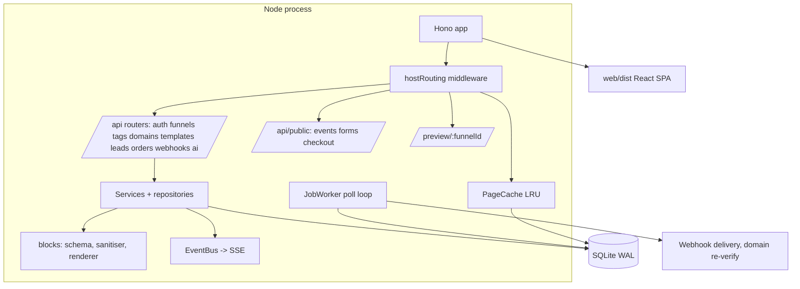
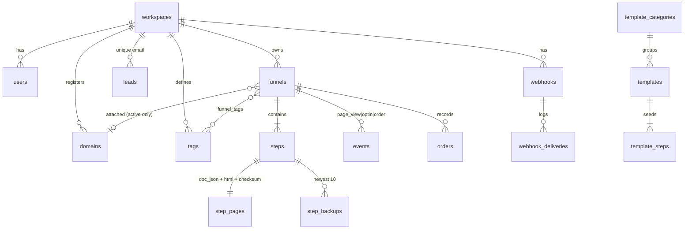
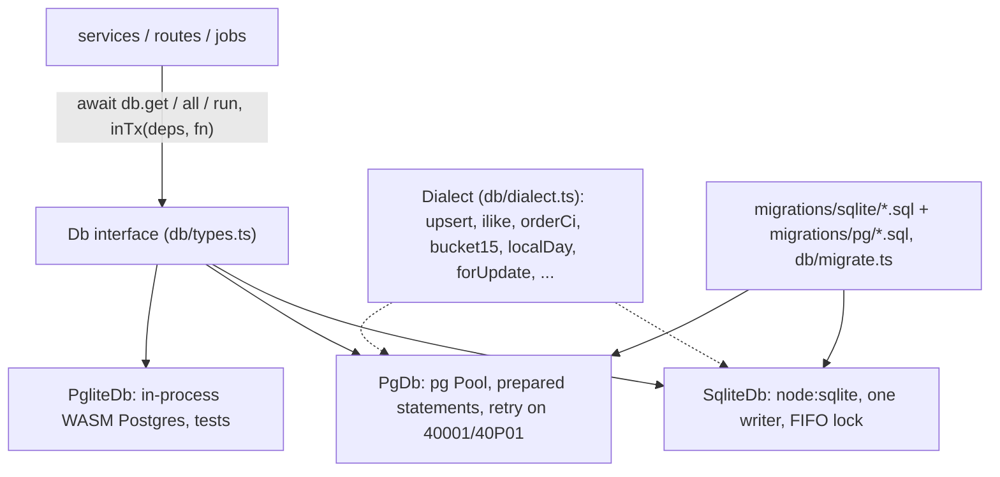
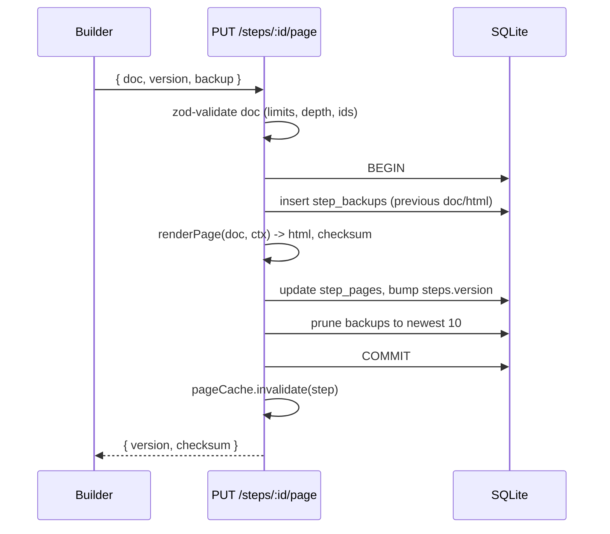
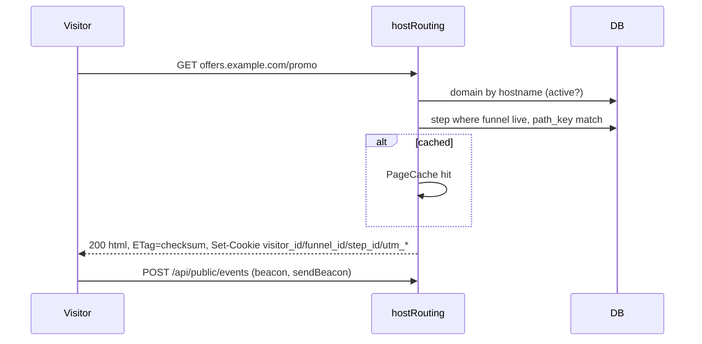
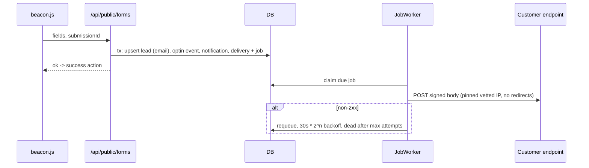
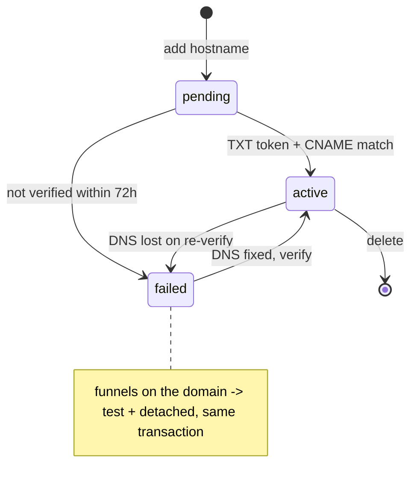
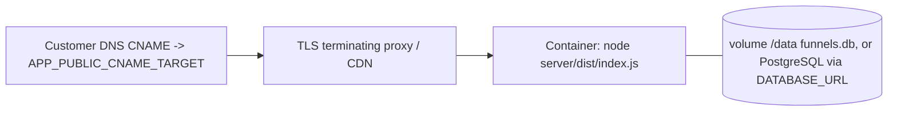
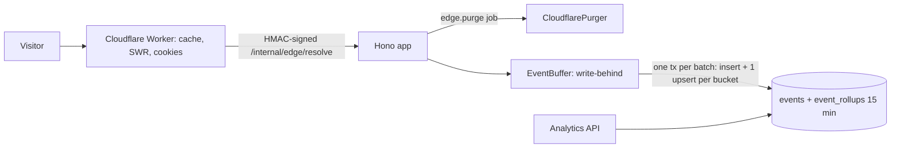

# Architecture

Funnels is one Node process (Hono + `node:sqlite`) that serves the JSON API, the built React app, published funnel pages (by `Host` header) and signed previews. A small in-process worker drains a SQLite-backed job queue.

## Context

## Containers

* `server/src/blocks` is pure TypeScript (only `zod` imported). The server renders with it and the web builder imports the very same files through a Vite alias, so the canvas is the same renderer that publishes.
* Everything with side effects is injected through `Deps` (`DnsResolver`, `PaymentProvider`, `HttpClient`, `AiProvider`, clock, rate limiter, job queue). Tests swap fakes in.

## Data model

Every business table has `workspace_id`; repositories and services always filter by it. `templates`, `template_steps` and `template_categories` are global, workspace-less tables. `jobs`, `notifications`, `ai_usage` back the queue, the feed and the daily AI cap.

Rows are portable between SQLite and PostgreSQL by construction: ids are app-generated text (`newId`, time-sortable, so `ORDER BY created_at, id` replaces SQLite's `rowid` tiebreak), timestamps are ISO-8601 text, booleans are 0/1 integers, JSON is text, and epoch-millisecond/version columns are `BIGINT` on PostgreSQL (32-bit `INTEGER` would overflow).

## Data layer

* **One async interface.** SQL is written with `?` placeholders; the PostgreSQL drivers rewrite them to `$n`. `DATABASE_URL=postgres://...` selects `PgDb`; unset selects `SqliteDb` (file or `:memory:`). `PgliteDb` is only constructed by tests. Nothing outside `src/db/` imports a driver (a test enforces it, see TESTING.md).
* **Dialect helpers instead of inline dialect SQL.** `db.dialect` names every difference: upsert `ON CONFLICT`, `onConflictDoNothing`, `returning`, `ilike`, `orderCi` (case-insensitive, byte-wise: PostgreSQL's locale collation would sort differently), `greatest`, `boolInt`, `groupConcat`, `jsonText`, `bucket15`, `localDay(col, tz)`, `nowIso`, and the lock suffixes `forUpdate`, `forShare`, `forNoKeyUpdate`, `forUpdateSkipLocked` (empty on SQLite, whose single writer already serialises transactions).
* **Transactions are scoped, not ambient.** `inTx(deps, fn)` runs `fn` with a copy of `Deps` whose `db` and job queue are the transaction handle, so every service called with it joins the transaction. Page-cache invalidations and SSE notifications queued inside are held back and run only after COMMIT (a reader could otherwise re-cache stale HTML between invalidate and commit). Nested `inTx` becomes a `SAVEPOINT`. Isolation is `READ COMMITTED` on PostgreSQL (override per call); deadlocks (`40P01`) and serialization failures (`40001`) are retried up to 3 times before the error surfaces.
* **SQLite stays correct with `await` inside a transaction.** The connection is single and synchronous, so a transaction owns it from `BEGIN IMMEDIATE` to `COMMIT`; statements issued on the root handle meanwhile queue (FIFO) instead of running inside it. Using the root `db` inside a transaction callback therefore deadlocks by design on SQLite (and on a single-connection PGlite): always use the handle you were given.
* **Errors are domain errors.** `UniqueViolation` and `ForeignKeyViolation` come from SQLite extended result codes (2067/1555/787) and PostgreSQL SQLSTATEs (23505/23503); services catch those, never driver messages. A failed statement aborts the surrounding PostgreSQL transaction, so expected conflicts are written as `ON CONFLICT DO NOTHING` (jobs dedupe, events dedupe, lead upsert, seed) and only unexpected ones throw.
* **Lock order** (deadlock-safe by construction): workspace (`FOR NO KEY UPDATE`, only for name-derivation such as "copy of") → domain → funnel → steps (by id) → everything else. `lockFunnel` takes the funnel's domain first, then the funnel, and re-checks the attachment. Funnel structure changes (create/update/delete/reorder/duplicate steps, save page, attach domain) all go through it, which is what makes "10 parallel saves from one base version" produce exactly one winner and "3 funnels attaching the same path to one domain" produce one attachment on a real multi-connection pool.
* **Optimistic concurrency** (`steps.version`): `savePage` locks funnel then step row, compares the expected version against the committed latest, and also updates `WHERE version = old` and requires one changed row.
* **Migrations.** `migrations/sqlite/NNN_*.sql` and `migrations/pg/NNN_*.sql` share names and numbering. Each file runs in its own transaction with its bookkeeping row; on PostgreSQL under `pg_advisory_xact_lock`, so replicas booting together apply each exactly once. `test/schema-equivalence.test.ts` migrates both engines and compares tables, columns (name, nullability, type family) and indexes.
* **Rollups.** `event_rollups` (15-minute UTC buckets) and every `events` insert go through `insertEvents` (`services/rollups.ts`): one multi-row insert (`ON CONFLICT DO NOTHING RETURNING id`), then one upsert per bucket for the rows that were really inserted, in the same transaction. The event buffer calls it once per batch, so the aggregate cost is per batch, not per row. SQLite triggers were removed (migration 004); see PERFORMANCE.md for the measurements behind that.
* **Events at scale.** On PostgreSQL `events` is partitioned by month (partitions created ahead by the maintenance job, a DEFAULT partition as safety net, retention by detaching). Idempotency keys are claimed in `event_dedupe`, first views in `visitor_steps`, both with `ON CONFLICT DO NOTHING RETURNING` inside the batch transaction, so they hold across partitions, processes and replicas (ADR 0013). Analytics read `event_rollups` and bound every raw query by time so partitions prune.
* **Case-insensitive uniqueness** without `citext` or `COLLATE NOCASE`: `tags.name_lower` (case-folded by the app) with `UNIQUE (workspace_id, name_lower)` on both engines.

## Key flows

### Save a page

### Serve a live page

### Form submit to webhook

## Domain state machine

Funnel rules: `live` needs an attached **active** domain; `status: test` detaches the domain; attaching runs the cross-funnel path conflict check and accepts a resolution payload that must be a subset of the server's own conflicts.

## Deployment

One container with a volume (SQLite) or any number of containers on a PostgreSQL database (see Scaling). TLS for customer domains is terminated in front (Caddy on-demand TLS, a CDN, or Cloudflare for SaaS). Scaling beyond one node needs a shared database and rate limiter; see APPROACH.md.

## Scaling and limits

With SQLite (WAL, single writer) run one replica. With `DATABASE_URL` the data layer is ready for several replicas: transactions, row locks, migrations and job claiming (`FOR UPDATE SKIP LOCKED`) are multi-connection safe. What is still per-process: the rate limiter, the page cache (invalidation is not fanned out), the SSE bus and the event buffer's "seen" sets (first-view uniqueness is decided against the database and the local queue, so two replicas can both count a visitor's first view). The ingest queue, outbox and event bus move event ingestion off the request path (ADR 0015); capacity model and measurements in [SCALING.md](SCALING.md). Analytics read rollups; funnel-level distinct visitors scan raw events (see PERFORMANCE.md).

## Edge and performance layer

See docs/CLOUDFLARE.md and docs/PERFORMANCE.md. Domains can be managed by a `DomainProvider` (`manual` DNS checks by default, `cloudflare` for Cloudflare for SaaS). `/metrics` (Prometheus), `/readyz`, request timeouts and gzip are in `app.ts`.
