# Architecture

Funnels is one Node process (Hono + `node:sqlite`) that serves the JSON API, the built React app, published funnel pages (by `Host` header) and signed previews. A small in-process worker drains a SQLite-backed job queue.

## Context

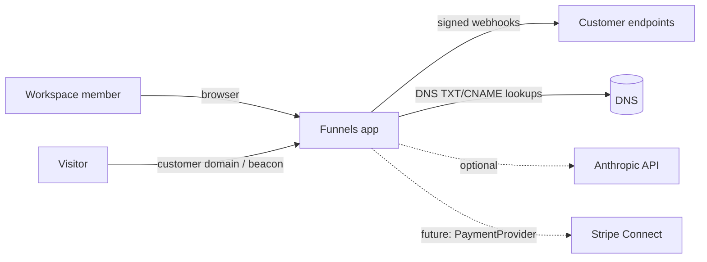

## Containers

* `server/src/pagemodel/shared` is pure TypeScript (only `zod` imported). The server renders and sanitises with it and the web builder imports the very same files through a Vite alias (`@pagemodel`), so the canvas shows exactly what is published. See [Page builder](#page-builder). `server/src/blocks` keeps the legacy block-document schema and builders: they guard the old input paths (API clients, the AI generator, older templates), and a block document is only ever converted, never rendered.
* Everything with side effects is injected through `Deps` (`DnsResolver`, `PaymentProvider`, `HttpClient`, `AiProvider`, clock, rate limiter, job queue). Tests swap fakes in.

## Data model

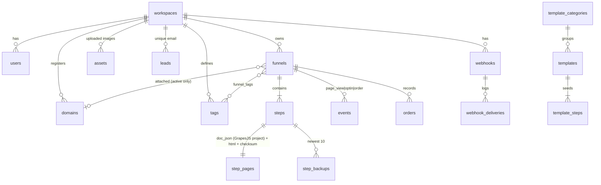

Every business table has `workspace_id`; repositories and services always filter by it. `templates`, `template_steps` and `template_categories` are global, workspace-less tables. `jobs`, `notifications`, `ai_usage` back the queue, the feed and the daily AI cap.

Rows are portable between SQLite and PostgreSQL by construction: ids are app-generated text (`newId`, time-sortable, so `ORDER BY created_at, id` replaces SQLite's `rowid` tiebreak), timestamps are ISO-8601 text, booleans are 0/1 integers, JSON is text, and epoch-millisecond/version columns are `BIGINT` on PostgreSQL (32-bit `INTEGER` would overflow).

## Data layer

```mermaid
flowchart TB
  S[services / routes / jobs] -->|"await db.get / all / run, inTx(deps, fn)"| I["Db interface (db/types.ts)"]
  I --> Q[SqliteDb: node:sqlite, one writer, FIFO lock]
  I --> P[PgDb: pg Pool, prepared statements, retry on 40001/40P01]
  I --> L[PgliteDb: in-process WASM Postgres, tests]
  D["Dialect (db/dialect.ts): upsert, ilike, orderCi, bucket15, localDay, forUpdate, ..."] -.-> Q
  D -.-> P
  M["migrations/sqlite/*.sql + migrations/pg/*.sql, db/migrate.ts"] --> Q
  M --> P
```

* **One async interface.** SQL is written with `?` placeholders; the PostgreSQL drivers rewrite them to `$n`. `DATABASE_URL=postgres://...` selects `PgDb`; unset selects `SqliteDb` (file or `:memory:`). `PgliteDb` is only constructed by tests. Nothing outside `src/db/` imports a driver (a test enforces it, see TESTING.md).
* **Dialect helpers instead of inline dialect SQL.** `db.dialect` names every difference: upsert `ON CONFLICT`, `onConflictDoNothing`, `returning`, `ilike`, `orderCi` (case-insensitive, byte-wise: PostgreSQL's locale collation would sort differently), `greatest`, `boolInt`, `groupConcat`, `jsonText`, `bucket15`, `localDay(col, tz)`, `nowIso`, and the lock suffixes `forUpdate`, `forShare`, `forNoKeyUpdate`, `forUpdateSkipLocked` (empty on SQLite, whose single writer already serialises transactions).
* **Transactions are scoped, not ambient.** `inTx(deps, fn)` runs `fn` with a copy of `Deps` whose `db` and job queue are the transaction handle, so every service called with it joins the transaction. Page-cache invalidations and SSE notifications queued inside are held back and run only after COMMIT (a reader could otherwise re-cache stale HTML between invalidate and commit). Nested `inTx` becomes a `SAVEPOINT`. Isolation is `READ COMMITTED` on PostgreSQL (override per call); deadlocks (`40P01`) and serialization failures (`40001`) are retried up to 3 times before the error surfaces.
* **SQLite stays correct with `await` inside a transaction.** The connection is single and synchronous, so a transaction owns it from `BEGIN IMMEDIATE` to `COMMIT`; statements issued on the root handle meanwhile queue (FIFO) instead of running inside it. Using the root `db` inside a transaction callback therefore deadlocks by design on SQLite (and on a single-connection PGlite): always use the handle you were given.
* **Errors are domain errors.** `UniqueViolation` and `ForeignKeyViolation` come from SQLite extended result codes (2067/1555/787) and PostgreSQL SQLSTATEs (23505/23503); services catch those, never driver messages. A failed statement aborts the surrounding PostgreSQL transaction, so expected conflicts are written as `ON CONFLICT DO NOTHING` (jobs dedupe, events dedupe, lead upsert, seed) and only unexpected ones throw.
* **Lock order** (deadlock-safe by construction): workspace (`FOR NO KEY UPDATE`, only for name-derivation such as "copy of") → domain → funnel → steps (by id) → everything else. `lockFunnel` takes the funnel's domain first, then the funnel, and re-checks the attachment. Funnel structure changes (create/update/delete/reorder/duplicate steps, save page, attach domain) all go through it, which is what makes "10 parallel saves from one base version" produce exactly one winner and "3 funnels attaching the same path to one domain" produce one attachment on a real multi-connection pool.
* **Optimistic concurrency** (`steps.version`): `savePage` locks funnel then step row, compares the expected version against the committed latest, and also updates `WHERE version = old` and requires one changed row.
* **Migrations.** `migrations/sqlite/NNN_*.sql` and `migrations/pg/NNN_*.sql` share names and numbering. Each file runs in its own transaction with its bookkeeping row; on PostgreSQL under `pg_advisory_xact_lock`, so replicas booting together apply each exactly once. `test/schema-equivalence.test.ts` migrates both engines and compares tables, columns (name, nullability, type family) and indexes.
* **Rollups.** `event_rollups` (15-minute UTC buckets) and every `events` insert go through `insertEvents` (`services/rollups.ts`): one multi-row insert (`ON CONFLICT DO NOTHING RETURNING id`), then one upsert per bucket for the rows that were really inserted, in the same transaction. The event buffer calls it once per batch, so the aggregate cost is per batch, not per row. SQLite triggers were removed (migration 004); see PERFORMANCE.md for the measurements behind that.
* **Events at scale.** On PostgreSQL `events` is partitioned by month (partitions created ahead by the maintenance job, a DEFAULT partition as safety net, retention by detaching). Idempotency keys are claimed in `event_dedupe`, first views in `visitor_steps`, both with `ON CONFLICT DO NOTHING RETURNING` inside the batch transaction, so they hold across partitions, processes and replicas (ADR 0013). Analytics read `event_rollups` and bound every raw query by time so partitions prune.
* **Case-insensitive uniqueness** without `citext` or `COLLATE NOCASE`: `tags.name_lower` (case-folded by the app) with `UNIQUE (workspace_id, name_lower)` on both engines.

## Key flows

### Save a page

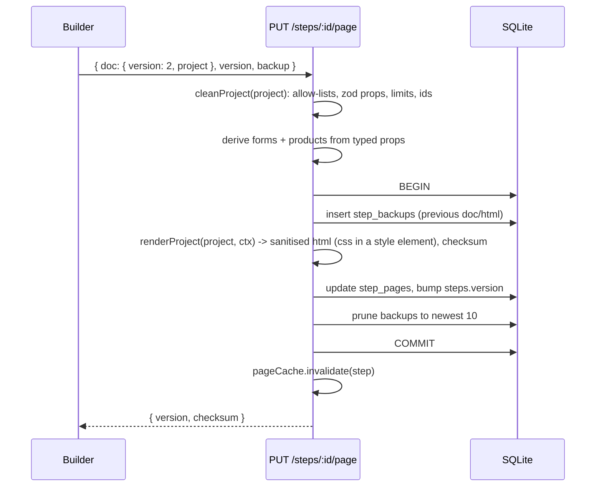

### Serve a live page

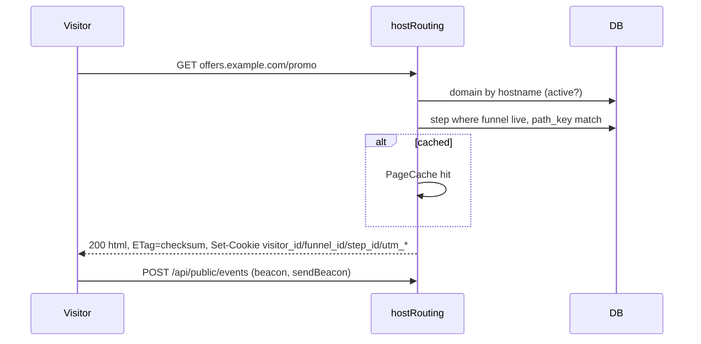

### Form submit to webhook

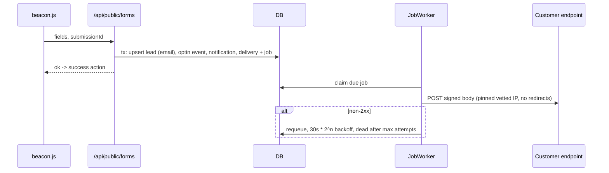

## Page builder

The builder is [GrapesJS](https://grapesjs.com) (npm `grapesjs`, pinned, loaded as its own lazy chunk) with all of its panels switched off: the interface is React (Radix primitives, Tailwind) and talks to the editor through its API. The canvas is GrapesJS's own iframe, so dragging from the Blocks panel, reordering, nesting, resizing and inline text editing are real canvas interactions. Decision record: [ADR 0022](adr/0022-grapesjs-page-builder.md); where parts of the old builder were carried over: [PROVENANCE.md](PROVENANCE.md).

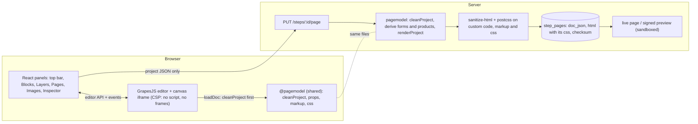

* **Source of truth.** `step_pages.doc_json` is `{ version: 2, project, forms, products }`: the GrapesJS project (`editor.getProjectData()`, cleaned by the server before it is stored) plus two lists the **server derives** from typed component props on every save. The request never carries `forms`, `products`, HTML or CSS; the public form and checkout endpoints read the derived lists, so a client cannot invent a field, a price or a success URL (price integrity: the order amount comes from `products`, never from the browser).
* **Typed dynamic components.** Forms, checkouts (offer, order bump, one-click upsell), video, countdown, progress bar, custom code and button actions are component types (`fn-form`, `fn-checkout`, ...) whose behaviour lives in one typed prop (`fnForm`, `fnProduct`, `fnVideo`, `fnCountdown`, `fnProgress`, `fnCode`, `fnAction`) validated with zod in `shared/props.ts`. The builder, the canvas and the server render the inner markup from the same function (`shared/markup.ts`), so there is nothing to keep in sync.
* **Structure.** Section (small / medium / wide / full) > Row > Column > elements, as in the old builder. Content dropped on the page or into a section is wrapped in the scaffolding it needs, in the same undo step. One rule table (`web/src/builder/editor/rules.ts`, `canDrop`) is used by the canvas, the Layers panel and click-to-insert, so the three cannot disagree.
* **Rendering.** `renderProject` walks the *cleaned* project only. Layers, in order: (1) `cleanProject` rebuilds every node from allow-lists (tags, attributes, classes, ids, style properties and values, selectors, media text) and enforces limits (3,000 nodes, depth 24, 2 MB, 6,000 rules); (2) the renderer escapes text and attribute values; (3) a final `sanitize-html` pass over the whole body; (4) `postcss` for free-form CSS; (5) custom code HTML and CSS are sanitised too unless the saver may author scripts. Base page CSS is written with `:where()` so any rule of the author wins; dark and accent sections flip the inherited text colour, which is what fixes the old dark-on-dark text (the converter also drops explicit text colours below 4.5:1 on their section).
* **Persistence and concurrency** are unchanged: optimistic version per step (`PUT .../page` with the expected version, `409 VERSION_CONFLICT`), newest 10 backups, restore, checksum as ETag. `GET .../html` and `GET /api/templates/:id/html` return the stored/rendered page for thumbnails; the web app shows them in `sandbox=""` iframes with scripts and players removed.
* **Migration.** `convertDocument` turns a version-1 block document into a project deterministically (same input, same ids, never throws; unknown blocks are skipped with a note). At start-up `migrateLegacyPages` converts every stored page and template step once, keeping the original in `legacy_doc_json`; backups and old documents also convert lazily when read or restored. Details and the GrapesJS mapping: [MIGRATION-NOTES.md](MIGRATION-NOTES.md).
* **Assets.** `/api/assets` stores uploaded images in the database (PNG, JPEG, GIF, WebP sniffed by magic bytes, SVG refused, 1.5 MB each, 200 per workspace) and `/uploads/:id/:name` serves them with `nosniff`, a restrictive CSP and long caching; customer domains reach them through the same edge passthrough as `/beacon.js`.
* **Bundle.** The builder (about 380 KB gzip with GrapesJS) loads only on the builder route; the rest of the app is the entry chunk plus per-page chunks. Budgets are enforced by `npm run build` (`web/scripts/check-bundle-size.mjs`): entry 125 KB, shared UI vendor chunk 90 KB, builder chunk 450 KB, total 700 KB (gzip).

## Publishing to Cloudflare Pages

A funnel's **publish target** is `origin` (above) or `cloudflare-pages` ([ADR 0030](adr/0030-publish-targets-cloudflare-pages.md), [CLOUDFLARE-PAGES.md](CLOUDFLARE-PAGES.md)). Anything that changes what a live funnel serves (page save, step or settings change, status, domain, pixels, workspace suspension) calls `onFunnelChanged`, which queues one debounced deployment for funnels on Pages.

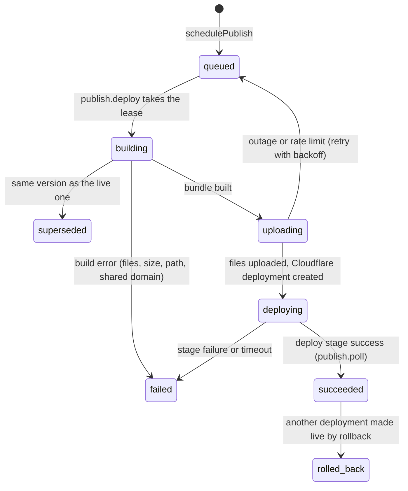

* **Bundle** (`publish/bundle.ts`): pure and deterministic; paths validated after percent-decoding; CSP per page from SHA-256 hashes of the platform's own inline scripts; `_headers`, `_redirects`; version id = hash of files + headers + redirects.
* **Client** (`publish/cfclient.ts`): Direct Upload over an injectable `fetch` (`deps.outbound`, the SSRF-guarded fetch); `CloudflareApiError` classifies retryable, rate limited, permission and not found.
* **State** lives in `funnel_publish` (target, owner, project, host, active deployment, custom domain, lease, hold) and `publish_deployments` (history and log); credentials in `publish_credentials` (encrypted). Jobs: `publish.deploy`, `publish.poll`, `publish.domain`, `publish.destroy`.
* **Single flight, last wins:** one lease per funnel; one queued deployment per funnel that builds from the database when it runs.

## Ads: pixels, conversions, attribution

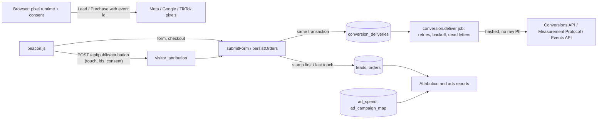

See [ADS.md](ADS.md) and [ADR 0031](adr/0031-ads-conversions-attribution.md). The pixel runtime (`ads/runtime.ts`) is one inline script generated from validated ids (`ads/snippets.ts`) and injected into the head by the renderer (`services/adtags.ts`), both for the origin and for Pages bundles. The page cache and the edge are invalidated when pixels change because they are part of the stored page HTML.

## Commerce: templates, catalog, product analytics

Templates (`templates`, `template_steps`) and the product catalog (`products`, `prices`) are described in [TEMPLATES.md](TEMPLATES.md) and [PRODUCTS.md](PRODUCTS.md). The checkout path with the catalog:

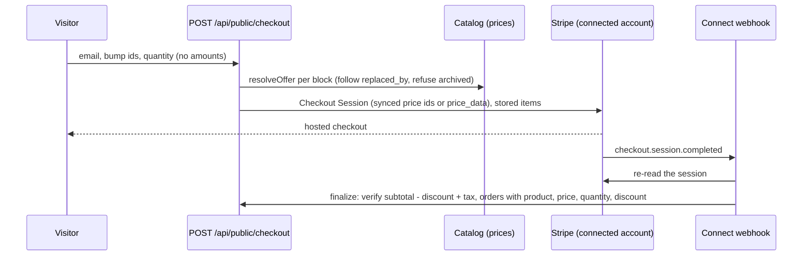

Product analytics (`services/productanalytics.ts`) reads `orders` (grouped by product, currency, role, funnel, step and 15-minute bucket, folded to local intervals in the requested zone) and the sales rollups (unique visitors of checkout steps); the AI summary (`services/analyticssummary.ts`) builds an evidence object from the same engine ([ADR 0025](adr/0025-grounded-analytics-summary.md)).

## Domain state machine

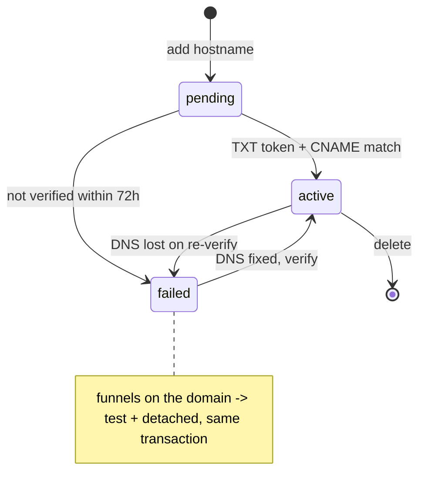

Funnel rules: `live` needs an attached **active** domain; `status: test` detaches the domain; attaching runs the cross-funnel path conflict check and accepts a resolution payload that must be a subset of the server's own conflicts.

## Deployment

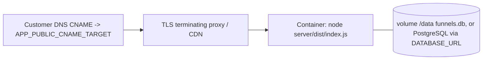

One container with a volume (SQLite) or any number of containers on a PostgreSQL database (see Scaling). TLS for customer domains is terminated in front (Caddy on-demand TLS, a CDN, or Cloudflare for SaaS). Scaling beyond one node needs a shared database and rate limiter; see APPROACH.md.

## Scaling and limits

With SQLite (WAL, single writer) run one replica. With `DATABASE_URL` the data layer is ready for several replicas: transactions, row locks, migrations and job claiming (`FOR UPDATE SKIP LOCKED`) are multi-connection safe. What is still per-process: the rate limiter, the page cache (invalidation is not fanned out), the SSE bus and the event buffer's "seen" sets (first-view uniqueness is decided against the database and the local queue, so two replicas can both count a visitor's first view). The ingest queue, outbox and event bus move event ingestion off the request path (ADR 0015); capacity model and measurements in [SCALING.md](SCALING.md). Analytics read rollups; funnel-level distinct visitors scan raw events (see PERFORMANCE.md).

## Edge and performance layer

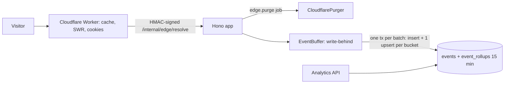

See docs/CLOUDFLARE.md and docs/PERFORMANCE.md. Domains can be managed by a `DomainProvider` (`manual` DNS checks by default, `cloudflare` for Cloudflare for SaaS). `/metrics` (Prometheus), `/readyz`, request timeouts and gzip are in `app.ts`.
