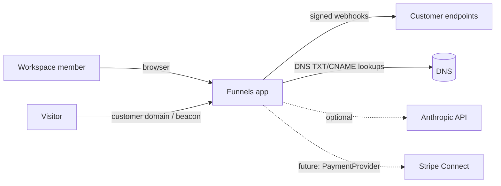
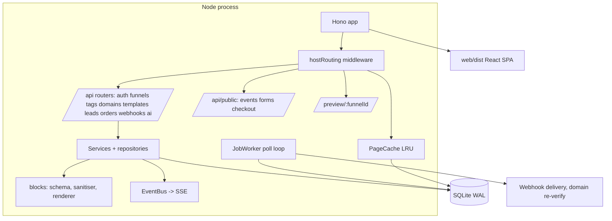
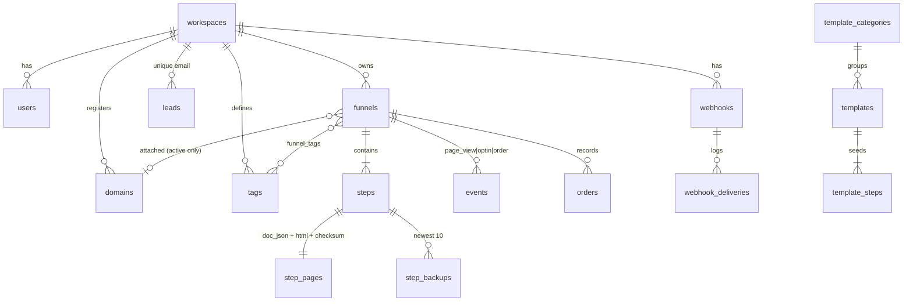
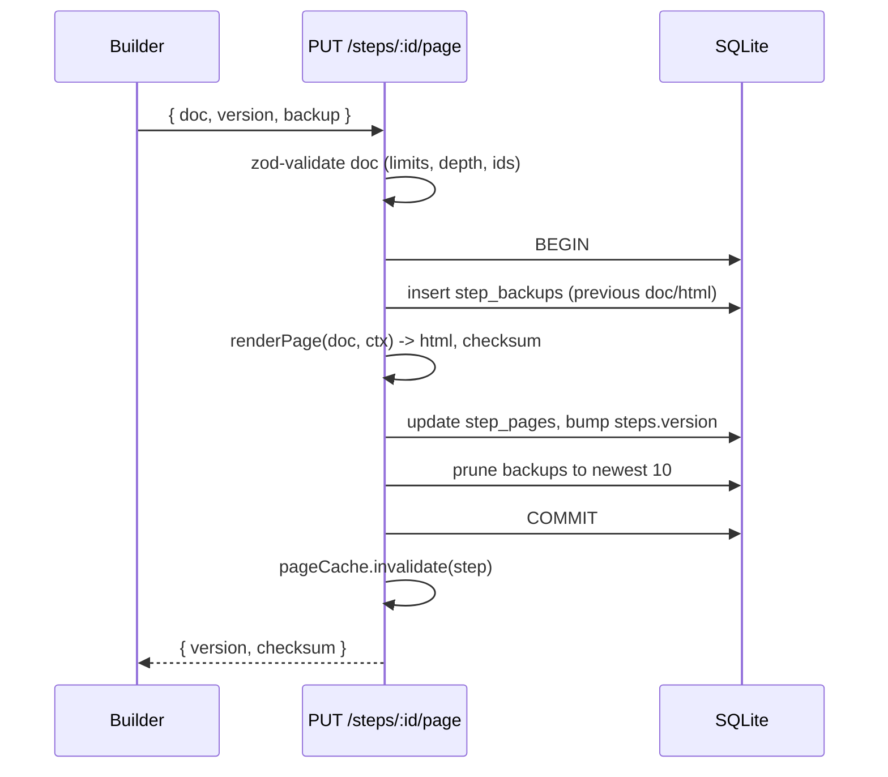
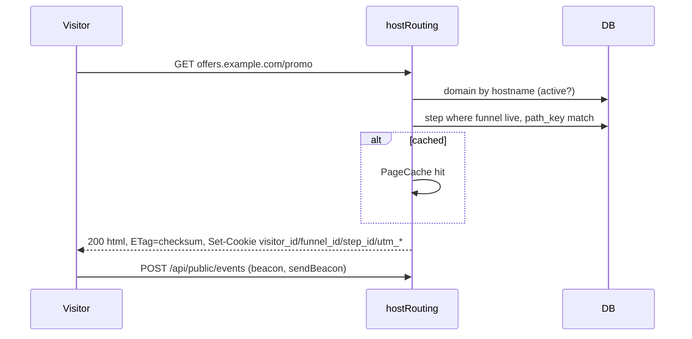
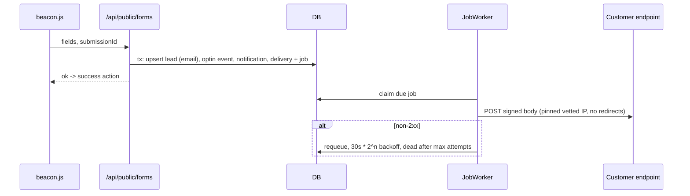
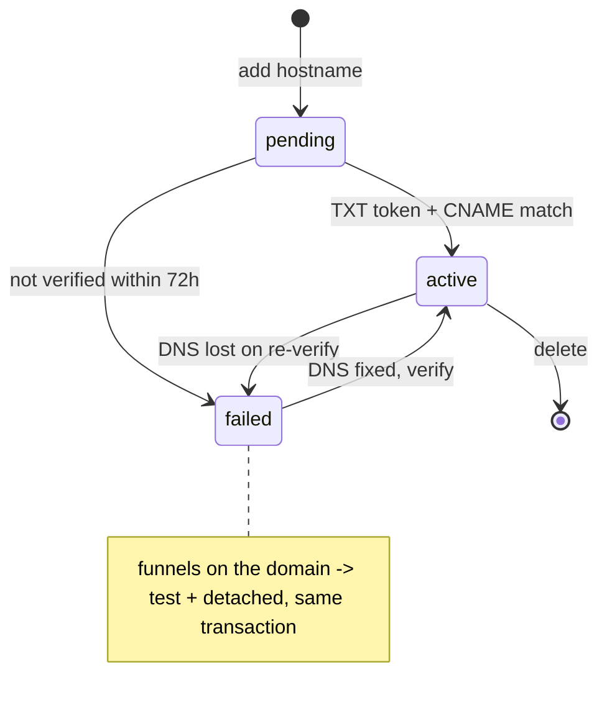
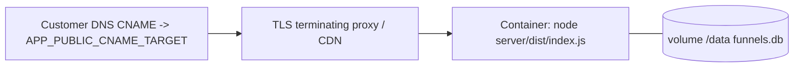
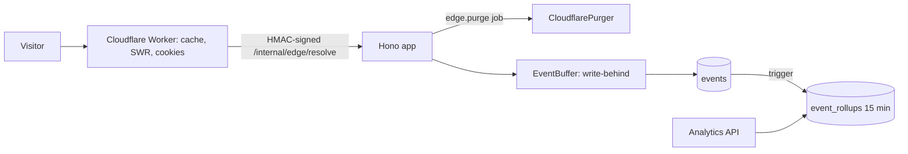

# Architecture

Funnels is one Node process (Hono + `node:sqlite`) that serves the JSON API, the built React app, published funnel pages (by `Host` header) and signed previews. A small in-process worker drains a SQLite-backed job queue.

## Context

## Containers

* `server/src/blocks` is pure TypeScript (only `zod` imported). The server renders with it and the web builder imports the very same files through a Vite alias, so the canvas is the same renderer that publishes.
* Everything with side effects is injected through `Deps` (`DnsResolver`, `PaymentProvider`, `HttpClient`, `AiProvider`, clock, rate limiter, job queue). Tests swap fakes in.

## Data model

Every business table has `workspace_id`; repositories and services always filter by it. `templates`, `template_steps` and `template_categories` are global, workspace-less tables. `jobs`, `notifications`, `ai_usage` back the queue, the feed and the daily AI cap.

## Key flows

### Save a page

### Serve a live page

### Form submit to webhook

## Domain state machine

Funnel rules: `live` needs an attached **active** domain; `status: test` detaches the domain; attaching runs the cross-funnel path conflict check and accepts a resolution payload that must be a subset of the server's own conflicts.

## Deployment

One container, one volume. TLS for customer domains is terminated in front (Caddy on-demand TLS, a CDN, or Cloudflare for SaaS). Scaling beyond one node needs a shared database and rate limiter; see APPROACH.md.

## Scaling and limits

SQLite in WAL mode with a single writer is the deliberate single-node choice. Rate limiting, the page cache and the SSE bus are in memory, per process. Analytics scan the `events` table (indexed by funnel and time); rollups would be the first optimisation at volume.

## Edge and performance layer

See docs/CLOUDFLARE.md and docs/PERFORMANCE.md. Domains can be managed by a `DomainProvider` (`manual` DNS checks by default, `cloudflare` for Cloudflare for SaaS). `/metrics` (Prometheus), `/readyz`, request timeouts and gzip are in `app.ts`.
