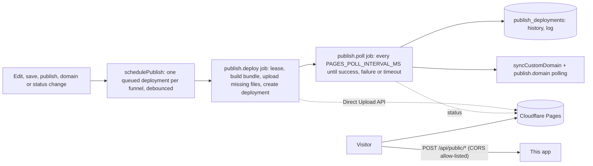

# Publishing funnels to Cloudflare Pages

**Status: the go-live path is verified on a real Cloudflare account; the rest only against a fake.** The maintainer connected a real account and went live on a `pages.dev` address; the run found that Cloudflare rejects `per_page=100` when listing projects (fixed, see the [CHANGELOG](../CHANGELOG.md)). The client (`server/src/publish/cfclient.ts`) and the deployment state machine are otherwise tested against an in-memory implementation of the documented endpoints (`server/test/support/fakecf.ts`): rollback, unpublish, custom domains on a project, the project limits and the platform-account mode have no recorded real run. `server/scripts/cf-pages-smoke.ts` is the check you run once with your own token (below). Overview of every integration: [VERIFIED.md](VERIFIED.md). Decision record: [ADR 0030](adr/0030-publish-targets-cloudflare-pages.md).

## The free address: you do not need a domain

Every Pages funnel has a free address, `https://<project>.pages.dev`, and it counts as the funnel's **domain**: it is stored as a *system domain* record (`domains.kind = 'pages'`, one per funnel; its name is a synthetic `<funnel id>.pages.invalid`, the real host is `funnel_publish.pages_host`). It never appears in the Domains page, cannot be deleted or verified by hand, and `*.pages.dev` / `*.workers.dev` can not be registered as customer domains.

State machine (see also [GO-LIVE.md](GO-LIVE.md)):

| Event | Funnel | System domain | Visible state |
|---|---|---|---|
| Go live > Cloudflare Pages address (`POST /api/funnels/{id}/go-live`) | `live`, `domain_id` = the pages domain | `pending` | **publishing** |
| First deployment succeeds | unchanged | `active` | **live** |
| Deployment fails and nothing is online yet | stays `live` (the intent is kept) | stays `pending` | **publishing failed**: fix the cause, then *Try again* (Redeploy) |
| A later deployment fails | stays `live` | `active` | **live** (the previous version stays online; the failure is in the history) |
| Unpublish (pause) | `live` | `active` | **paused** until Redeploy |
| Funnel set to `test` | `test`, domain detached | unchanged | **test mode**; the site shows the paused page; Go live again re-attaches |
| Target switched to *This server*, connection removed, or project deleted | `test`, domain detached | **removed** | pick a new address in Go live |
| Target switched to another project name | unchanged | back to `pending` (new host) | **publishing** |
| A custom domain is chosen in Go live | `live`, `domain_id` = the custom domain | kept | the project is served at both addresses |

A custom domain stays an optional upgrade: DNS, one funnel per domain, `syncCustomDomain` and everything below are unchanged.

## What it does

A funnel has a **publish target**: `origin` (default, the funnel is served by this app by Host header, optionally behind the edge Worker, see [CLOUDFLARE.md](CLOUDFLARE.md)) or `cloudflare-pages`. With Pages, the app builds the funnel into a static site and deploys it with the Direct Upload API into one Pages project per funnel (`fn-<8 hex>` by default). Visitors are then served by Cloudflare's network without touching this server; forms, checkout, events, attribution and the consent-gated server conversions keep calling this app's public API at an absolute `API_PUBLIC_URL`.



## Setting it up

1. **Connect** (Settings > Publishing): your Cloudflare account id (32 hex characters, Workers & Pages > account details) and an API token with the account permission **Cloudflare Pages: Edit** and nothing else. The app verifies it with a read call (`GET /accounts/{id}/pages/projects`), stores it encrypted (`DATA_ENCRYPTION_KEY`, AES-256-GCM bound to the workspace), shows only `••••` + the last four characters, and never logs it. *Verify* repeats the read call. A read call cannot prove write access: a read-only token connects and then fails at the first deployment with an explanation.
2. **Choose the target** in the funnel's Settings > Publishing: *This server* or *Cloudflare Pages*. The app creates the project (`POST /accounts/{id}/pages/projects`). If a project with that name already exists it **refuses** unless you confirm that this funnel may overwrite it; a project it did not create is never deleted. Hosted installations can offer a **platform account** (`CF_PAGES_ACCOUNT_ID`, `CF_PAGES_API_TOKEN`): projects are then named `fn-<id>` in that account and limited per plan (`pagesProjects`: 1 on Free, 10 on Pro, 100 on Business, enforced with `BILLING_ENFORCE_LIMITS`).
3. **Go live** (funnel > Settings > Go live, or `POST /api/funnels/{id}/go-live`). Choose *Cloudflare Pages address (free)*: no domain is needed. The project is created, the funnel is set live on its `pages.dev` address and the first deployment starts at once. A verified custom domain is the optional upgrade: choose it in Go live (or in Settings > Domain).
4. **Point DNS** at the project: `CNAME <your hostname> -> <project>.pages.dev` (the domain screen shows it; an apex domain needs Cloudflare DNS for the zone). The app attaches the hostname to the project (`POST .../domains`), polls its status until Cloudflare reports `active` or an error (shown with Cloudflare's message), and **domain verification accepts a CNAME to the Pages project** as well as to `APP_PUBLIC_CNAME_TARGET`. Set `API_PUBLIC_URL` to the public origin of this app.

A Pages project serves **one funnel per domain**: if another live funnel is attached to the same domain, deployment fails with that explanation (the origin server can serve many funnels on one host; a static project cannot).

## What gets built

Deterministic: the same funnel state gives byte-identical files, the same manifest and the same 12-hex **version id** (shown in the history like a commit id).

| Path | Content |
|---|---|
| `/<path>/index.html` (`/index.html` for `/`) | every step, rendered by the same renderer and sanitiser as the origin, with `apiBase = API_PUBLIC_URL` and the bundled beacon |
| `/index.html` | the domain's *home* step when no step has the path `/` |
| `/404.html` | the domain's *404* step, or a plain page |
| `/uploads/<id>/<name>` | the uploaded images the pages use (copied; the URLs in the HTML are unchanged) |
| `/_fn/beacon.<hash>.js` | the beacon (immutable, `max-age=31536000`) |
| `_headers` | security headers for all paths; per page: a **Content-Security-Policy** and `Cache-Control: public, max-age=60, stale-while-revalidate=300`; immutable caching for `/_fn/*` and `/uploads/*` |
| `_redirects` | `/lowercase -> /Stored-Case/ 301` for paths with capitals |

**Paths** are validated *after* percent-decoding, one segment at a time: `/` `\` `..` `.`, control characters, a leading `_` or `.`, `% ? # * : " < > |` and over-long names are refused (`/%2e%2e` is syntactically a valid stored path and would otherwise climb out of the site). Unicode paths become Unicode file names (NFC). Two pages that would land on the same file (including case-folded and normalisation twins) fail the build with `PATH_COLLISION`.

**CSP.** The page's own inline scripts (the countdown runtime and the pixel runtime) are allowed by SHA-256 hash; the pixel networks you configured add their script/connect/image hosts; `connect-src` and `form-action` allow `API_PUBLIC_URL`. If the page contains **owner-authored code** (custom code blocks, tracking snippets, event-handler attributes, `javascript:` links, scripts from other hosts), a hash list cannot describe it and the page gets `script-src 'self' 'unsafe-inline' https:`. `style-src` always has `'unsafe-inline'` (pages carry a `<style>` element and style attributes). The 404 response and any unlisted path get no CSP (Pages applies `_headers` by request path), as on the origin. Pages caps `_headers` at **100 rules**: three are fixed, so a funnel of more than 97 pages falls back to one relaxed rule set and a warning.

**Dynamic parts** call the public API: forms (`/api/public/forms/...`), checkout (`/api/public/checkout/...`), events and attribution. CORS is **allow-listed** (`PUBLIC_API_CORS=allowlist`, default): the origin of a registered customer domain, the `<project>.pages.dev` host of a published funnel and its deployment-preview subdomains, this app, and `null` (sandboxed previews) are echoed; other sites get no `Access-Control-Allow-Origin`. Rate limits still apply per client IP. Reviews and other future runtime widgets are not part of the bundle (they do not exist in this app).

## The deployment

Each deployment is a row (`publish_deployments`) with a status `queued -> building -> uploading -> deploying -> succeeded | failed | superseded | rolled_back`, a version id, file count, size, the Cloudflare deployment id and URL, a short log and the error. Steps of the job:

1. **Lease** the funnel (`funnel_publish.lease_until`): one deployment at a time. Changes that arrive meanwhile reuse one queued row; when it runs it builds from the *then-current* database, so **the last change wins** and intermediate states may never be deployed. A job that finds the lease taken re-queues itself 3 s later.
2. **Build** the bundle. A build error (too many files, a file over 25 MiB, a path collision, a shared domain) fails the deployment with the reason; nothing is uploaded.
3. **No-op check:** same version id as the live one (and no `force`) -> `superseded`, "nothing changed", no Cloudflare deployment is created.
4. Ensure the project exists (creates it again if it was deleted), `GET upload-token`, `POST check-missing` with the BLAKE3-based hashes (publish/hash.ts), upload only the missing files in batches of up to 500 files / 20 MB, `POST upsert-hashes`, then `POST deployments` as multipart (`manifest`, `branch`, `_headers`, `_redirects`, commit hash and message).
5. **Poll** with a separate job every `PAGES_POLL_INTERVAL_MS` (so the worker is never blocked) until the `deploy` stage succeeds (status `succeeded`, lease released, `active_deployment_id` set, custom domain synced), a stage fails (status `failed`, Cloudflare's stage named), or `PAGES_DEPLOY_TIMEOUT_SECONDS` pass.
6. **Failures.** Network errors, 5xx and 429 are retried with the job queue's backoff (30 s, 60 s, ... up to 5 attempts); 429 honours `Retry-After`. 401/403 fail at once with "give the API token the permission Cloudflare Pages: Edit". Everything is persisted: a restart in the middle is finished by the next worker. Token strings are redacted from every stored message (a test makes Cloudflare echo the token).

Save-triggered deployments are debounced by `PAGES_DEBOUNCE_SECONDS` (5 s default). The history keeps the newest `PAGES_KEEP_DEPLOYMENTS` (20) rows.

### Rollback, redeploy, unpublish

* **Rollback** (`POST .../rollback/{deployment}`) calls Cloudflare's rollback on an earlier *successful* deployment (it makes it the production one) and records it as a new history entry. Only succeeded deployments of this funnel qualify. **Semantics:** Cloudflare rolls back the *production alias*; it does not change this app's data. So that the next autosave does not silently undo it, a rollback sets a **hold**: saves do not deploy while the funnel is live, until you press *Redeploy* (which builds the current state). To keep an old version permanently, restore the page version in the builder, then Redeploy.
* **Redeploy** builds and deploys the current state even if nothing changed and ends any hold.
* **Unpublish** either *replaces the site with a paused page* (every path answers the same "not available" page, `noindex`, no scripts, `Cache-Control: no-store`; the custom domain is removed; a hold prevents automatic redeploys) or *deletes the project* (only a project this app created; an adopted project is paused instead). `_redirects` can only answer 200 and 3xx, so the paused page is a 200 (and 404 for unknown paths), not a 503.
* A funnel that stops being live, loses its domain, is deleted or whose workspace is suspended is **paused automatically**, and comes back by itself when it is live again (unless a rollback or unpublish hold is in place). Permanently deleting a funnel deletes its project when the app created it.

## What the platform limits mean

From [Cloudflare's limits page](https://developers.cloudflare.com/pages/platform/limits/) (read 2026-10-20, check it before relying on a number):

| Limit | Value | How the app deals with it |
|---|---|---|
| Files per site | 20,000 (Free); 100,000 on paid plans with Wrangler 4 | `PAGES_MAX_FILES` (default 20,000) fails the build early |
| Size per file | 25 MiB | `PAGES_MAX_FILE_BYTES`; uploaded images are limited to 1.5 MB anyway |
| Projects per account | **100, not routinely increased** | the app creates **one project per funnel**, so one Cloudflare account holds at most 100 Pages funnels. The app counts the account's projects through the API (`GET .../pages/projects?per_page=100`, `result_info.total_count`) **before** creating the next one and refuses the 101st with `PAGES_PROJECT_LIMIT` and a message in the UI; the error codes Cloudflare itself uses for this are not documented, so a refusal from Cloudflare is matched by code 8000027 / wording (unverified). |
| Custom domains per project | 100 (Free) | one per funnel |
| `_headers` rules | 100 | per-page CSP up to 97 pages, then one rule set |
| `_redirects` | 2,000 static | only case redirects |
| Builds per month | 500 (Free) | **do not apply to Direct Upload**: they count Git builds |
| Deployments per day or month via Direct Upload | **no documented cap** (searched 2026-10-20) | the app debounces saves, runs one deployment per funnel at a time, limits manual actions with `publishing.deploy` (30 per hour per workspace) |
| Cloudflare API rate limit | 1,200 requests per 5 minutes per user | a deployment is about 8 calls plus polling; 429 is retried after `Retry-After` |

Cloudflare also restricts **how many projects a new account can create in its first 48 hours** (documented, with no number). The app recognises a refusal that mentions it (matching is by wording, unverified) and answers `PAGES_NEW_ACCOUNT_LIMIT` with an explanation.

### The 100-project limit, plainly

* One funnel = one Pages project = one `pages.dev` address; there is no way to serve several funnels from one project under path prefixes with the current design (a Pages project is one static site; this app's rule is one funnel per domain, and the bundle builder emits one funnel at the site root). Reconsidered 2026-10-21 and **not changed**: sharing a project would need a combined site (several funnels under `/<slug>/...`, one deployment for all of them, so one funnel's failure blocks the others and rollbacks stop being per funnel) and the link rewriting for it is exactly what the app's built-in address already does for pages served from this server (see [GO-LIVE.md](GO-LIVE.md)).
* What to do at 100: delete projects of retired funnels (Unpublish > *Delete the Pages project*, or the Cloudflare dashboard), use the built-in address for funnels that do not need Cloudflare, connect a second Cloudflare account for other workspaces, or use Workers for Platforms (no project limit, a different product; not implemented).
* On a hosted installation with the platform account, `pagesProjects` plan limits (1 / 10 / 100) keep one workspace from using them all.

## When to use which

| | Origin (this server) | Origin behind the Worker ([CLOUDFLARE.md](CLOUDFLARE.md)) | Cloudflare Pages |
|---|---|---|---|
| Who serves a page | this app, per request (page cache) | the Worker's cache, the app on a miss | Cloudflare's static hosting |
| Latency to visitors | the app's region | edge hit: a few ms; miss: the app | edge, always static |
| Your server is down | pages down | stale copy served at any age | **pages still served**; forms and checkout fail until the API is back |
| Change to live | immediate (page cache invalidation) | within the edge TTL or at once with purge | **seconds to minutes** (build, upload, deployment, propagation) |
| Cache purge | none needed | purge by URL jobs | none: each deployment is atomic and replaces the previous |
| Many funnels on one domain | yes | yes | **no**, one funnel per domain |
| Needs a Cloudflare account | no | yes (zone, Worker, KV) | yes (Pages; a token with Pages Edit) |
| Operational surface | the app only | Worker secrets, KV, purge token | tokens, projects, DNS, deployment failures |
| Per-visitor logic at the edge | n/a | yes | no (static) |
| Best for | small installs, previews, many funnels per domain | high traffic, one origin | traffic spikes, origin outages must not take pages down, simple static funnels |

**Cache behaviour on Pages.** A deployment replaces the whole site atomically, so there is no purge to run; HTML is cached for 60 s with stale-while-revalidate, hashed assets for a year. A visitor may see the previous version for up to a minute after it goes live.

**Latency of a change.** The app's part is the debounce (`PAGES_DEBOUNCE_SECONDS`), the build and the upload of changed files only; then Cloudflare's own deployment and propagation, then up to 60 s of HTML cache. The tests run against a fake and say nothing about Cloudflare's timings: measure with the smoke test; the repository has no real number.

## Experimental: Cloudflare Workers Static Assets target

Second `PublishTarget` implementation (`server/src/publish/target.ts`, client `cfworkers.ts`; ADR [0044](adr/0044-publish-target-interface-workers-assets.md)): `cloudflare-workers-assets` publishes the same bundle as a Worker with static assets (one Worker per funnel) and uses the free `<worker>.<account subdomain>.workers.dev` address as the funnel's system domain, with the same state machine, history, rollback, unpublish and Go live flow. **It is unverified**: written from <https://developers.cloudflare.com/workers/static-assets/direct-upload/> (read 2026-10-21) and tested against the fake only; several details are not in that page and are assumed (marked in the code): the request body of `POST .../scripts/{name}/subdomain`, whether the script `PUT` also deploys (the client reads `GET .../deployments` afterwards and creates the deployment from `GET .../versions` when it did not), the `_headers` / `_redirects` files travelling in the asset manifest, and the asset hash being the same BLAKE3 scheme as Pages. Run `server/scripts/cf-workers-smoke.ts` with your own token to check it.

| | Pages | Workers assets (experimental) |
|---|---|---|
| Token permission | Account > Cloudflare Pages > Edit | Account > Workers Scripts > Edit (and Account Settings > Read) |
| Free address | `<project>.pages.dev` | `<worker>.<subdomain>.workers.dev`; the account needs a workers.dev subdomain (`GET /accounts/{id}/workers/subdomain`), otherwise `WORKERS_SUBDOMAIN_MISSING` explains where to register one |
| Unit per funnel and limit | Pages project, 100 per account | Worker, 100 on Free, 500 on Paid (the app refuses at 500 and maps Cloudflare's own refusal) |
| Files per site | 20,000 Free / 100,000 Paid | 20,000 Free / 100,000 Paid per version |
| Deployment | create deployment, poll stages | upload session, upload buckets, script upload with the `assets` JWT, then the deployment is read back |
| Rollback | Pages rollback | `POST .../deployments` with the earlier version at 100% |
| Custom domains | yes | **not yet** (needs the zone id; choosing a verified domain serves the funnel from this server) |

A funnel uses one Cloudflare target at a time: to change, switch it back to this server (choosing what happens to the old site) and then choose the other (`SWITCH_TARGET_FIRST`).

## Cloudflare's direction (read 2026-10-21)

Cloudflare's own guidance now steers new projects to Workers: the Workers best-practices page says to "use Workers Static Assets for new projects" and that Pages "continues to work, but new features and optimizations are focused on Workers" (<https://developers.cloudflare.com/workers/best-practices/workers-best-practices/>); the Pages home page says to start new projects with Workers (<https://developers.cloudflare.com/pages/>). Pages Direct Upload remains documented and supported, which is why it is the verified-by-fake default here. A second publish target on Workers Static Assets with the free `workers.dev` address is described in [CLOUDFLARE-SETUP.md](CLOUDFLARE-SETUP.md) and ADR 0030. Limits for Workers static assets (<https://developers.cloudflare.com/workers/platform/limits/>, read 2026-10-21): 100 Workers per account on Free, 500 on Paid, 20,000 files per Worker version on Free (100,000 Paid), 25 MiB per file.

## Verify it with your own token

```bash
cd server
CF_ACCOUNT_ID=<32 hex> CF_API_TOKEN=<Cloudflare Pages: Edit> npx tsx scripts/cf-pages-smoke.ts
# CLOUDFLARE_ACCOUNT_ID / CLOUDFLARE_API_TOKEN are accepted as aliases
# optional: CF_SMOKE_DOMAIN=smoke.example.com  KEEP=1
```

It creates `fn-smoke-<random>`, deploys two versions, fetches the pages from `<project>.pages.dev` (this is what exposes a wrong asset hash: Cloudflare accepts a wrongly hashed file silently and never serves it), checks `_headers` and the 404, rolls back, optionally attaches and removes a custom domain, deletes the project, and prints one line per step. The token is read from the environment, never printed. Please report mismatches with the documented shapes as bugs: the fake in `server/test/support/fakecf.ts` must be corrected to whatever the real API does.

## References

Direct Upload: <https://developers.cloudflare.com/pages/get-started/direct-upload/>; REST reference (projects, deployments, domains, assets): <https://developers.cloudflare.com/api/resources/pages/>; limits: <https://developers.cloudflare.com/pages/platform/limits/>; headers and redirects: <https://developers.cloudflare.com/pages/configuration/headers/>, <https://developers.cloudflare.com/pages/configuration/redirects/>. The asset hash (BLAKE3 over `base64(content) + extension`, 32 hex characters) and the upload item shape (`key`, `value`, `metadata.contentType`, `base64`) are not in the REST reference; they follow Wrangler's `hashFile` and upload code, which is the only reference client.

## Not covered

Cloudflare Workers/Functions in the bundle; preview branches (everything deploys to the production branch `main`); deleting old deployments on Cloudflare (it keeps them; the app keeps 20 in its history); Cloudflare for SaaS custom hostnames for tenants (that is the origin-side `DOMAIN_PROVIDER=cloudflare`); automatic DNS changes (you create the CNAME).


## Google reviews on Pages

A bundle carries a snapshot of the review content taken when it is built (the build refreshes expired content live, best effort) and the page fetches fresh data from `GET <app origin>/public/reviews/<token>` with `credentials: omit`. That endpoint answers CORS for the `*.pages.dev` host and custom domain of the published funnel only; the bundle CSP already allows the app origin in `connect-src` and `https:` images. See [REVIEWS.md](REVIEWS.md).
