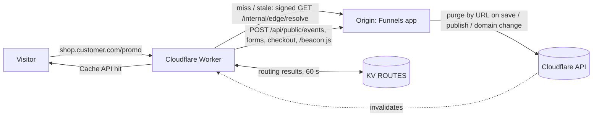

# Serving funnels through Cloudflare

The origin can serve every published page itself (see ARCHITECTURE.md). Putting a Cloudflare Worker in front adds a global cache, stale-while-revalidate, and graceful behaviour when the origin is down. The worker lives in `edge/` (TypeScript, `wrangler.toml`).

## What the worker does

1. `GET/HEAD` pages: look up `https://host/path` (query stripped) in the Cache API. Fresh (< `CACHE_TTL_SECONDS`, default 60): serve. Older but < `STALE_SECONDS` (default 24 h): serve the stale copy and revalidate in the background with `x-edge-checksum`; the origin answers `notModified` or sends the new HTML.
2. Miss: signed call to the origin. Result kinds: `page` (200 or the domain's default 404 page with status 404), `redirect` (301 for case/trailing-slash canonicalisation), `missing`. Redirects and missing results are cached in KV for 60 s so unknown paths do not reach the origin.
3. Cookies are added per response and never cached: `visitor_id` (if absent), `funnel_id`, `step_id`, sanitised and length-capped `utm_*`. The beacon is already part of the rendered HTML.
4. `/api/public/*` and `/beacon.js` are forwarded to the origin with `x-forwarded-host`, `cf-connecting-ip` and the shared header `x-cf-origin-secret`. Any client-supplied copy of those headers is overwritten or dropped.
5. Origin down, erroring, or rejecting the signature: serve the stale copy at any age (`x-edge-cache: stale-if-error`); with nothing cached, a friendly 503 page (`no-store`).
6. `ETag` is the page checksum; `If-None-Match` yields 304 (cookies still set only when absent).

## Trust between worker and origin

* Every origin call carries `x-edge-timestamp`, `x-edge-nonce`, `x-edge-signature = HMAC-SHA256(EDGE_SHARED_SECRET, ts.nonce.METHOD.path+query)`.
* The origin (`server/src/edge/signing.ts`) **fails closed**: with no `EDGE_SHARED_SECRET` the endpoint answers 503 to everyone (the legacy bypassed verification when its secret was unset). The worker also refuses to serve without its secret.
* Timestamp skew window `EDGE_SKEW_SECONDS` (120), nonce replay protection (per origin process; a nonce is consumed only by a correctly signed request), constant-time comparison.
* `CF-Connecting-IP` is believed only when the same request carries `x-cf-origin-secret` equal to `CF_ORIGIN_SECRET`; otherwise the client address is the socket (or `X-Forwarded-For` when `TRUST_PROXY=true`). A test proves a spoofed header cannot dodge per-IP rate limits.
* `/internal/*` is not reachable through customer hostnames. Additionally restrict it at the network edge to Cloudflare IP ranges if you can.

## Cache key design

`https://<host><path>`, query string ignored (UTMs vary per click but never change the HTML). One key per public URL means the origin can purge exactly the URLs it knows with the Cloudflare "purge by URL" API. The stored response carries `x-edge-fetched`, `x-edge-checksum`, `x-edge-status`, `x-edge-funnel`, `x-edge-step` headers and no cookies.

## Purge flow

On page save, funnel update (status/domain/favicon/tracking code), step add/delete/reorder/path change, soft delete and domain loss/deletion the origin queues an `edge.purge` job with the funnel's live URLs (`https://host/path`, plus `/` when the step is the domain home), computed before and after the change. The job worker calls the `CloudflarePurger` (`CloudflareApiPurger` when `CF_API_TOKEN` + `CF_ZONE_ID` are set, a no-op otherwise; tests use a fake), 30 URLs per request, retried with exponential backoff. Without a purge the TTL/revalidation still converges within `CACHE_TTL_SECONDS` plus one revalidation.

Known gap: when a step path is *renamed*, the old URL is not purged (only current paths are known); it expires by revalidation and then 404s.

## Setup

1. Add the zone and point customer hostnames at it. Manual DNS: customers CNAME to `APP_PUBLIC_CNAME_TARGET` (a proxied record in your zone) and add the TXT challenge. Cloudflare for SaaS: set `DOMAIN_PROVIDER=cloudflare`, `CF_API_TOKEN` (permissions: SSL and Certificates edit, Cache Purge) and `CF_ZONE_ID`; `CloudflareDomainProvider` creates/gets/deletes custom hostnames and maps hostname + certificate status to `pending|active|failed` (active only when both are active; a lost status reverts funnels to test exactly as for manual domains). Manual verification stays the default.
2. `cd edge && npm ci`, then `npx wrangler kv namespace create ROUTES` and uncomment the binding in `wrangler.toml`.
3. Secrets: `npx wrangler secret put EDGE_SHARED_SECRET` and `CF_ORIGIN_SECRET`; set the same values on the origin (`EDGE_SHARED_SECRET`, `CF_ORIGIN_SECRET`). Use 32+ random characters.
4. Set `ORIGIN_URL` to the app's public URL and add a worker route (`*/*` on the zone, or per hostname). `npx wrangler deploy`.
5. Origin: `CF_API_TOKEN`, `CF_ZONE_ID` for purges; `TRUST_PROXY=true` behind your load balancer.

Local: `docker compose --profile edge up` runs `wrangler dev` against the compose app. The worker's unit tests (`npm test --prefix edge`) run in plain Node with fake Cache/KV and verify every signed call with the origin's real `verifyEdge`; they do not run inside workerd/miniflare, so Cache API and KV semantics are modelled, not exercised.

## Failure modes

| Failure | Behaviour |
|---|---|
| Origin down / 5xx / timeout | stale copy at any age, else friendly 503 |
| Origin rejects signature (secret drift, clock skew > 120 s) | same as origin down; check worker vs origin secrets and clocks |
| Purge API down | job retries (30 s, 60 s, ... 5 attempts, then dead-lettered); TTL covers the gap |
| KV unavailable | ignored; every miss asks the origin |
| Funnel unpublished | purge + next revalidation returns `missing`; stale-if-error would keep serving only while the origin is *unreachable* |
| Replay of a captured call | rejected by nonce cache and the 120 s window |

## Cost notes

Workers bill per request and CPU time; a cache hit is one request with a few ms of CPU (cookie assembly), and revalidation adds one subrequest per stale hit per colo. KV reads are billed per read (only on cache misses). Cloudflare for SaaS bills per custom hostname beyond the free allotment. Tune `CACHE_TTL_SECONDS` upward (with purge enabled) to cut origin traffic; every purge-by-URL call counts against the purge rate limit, which is why URLs are batched per job.
