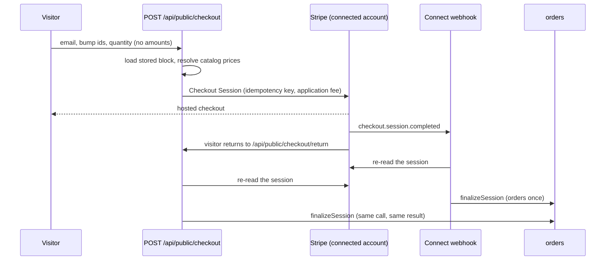
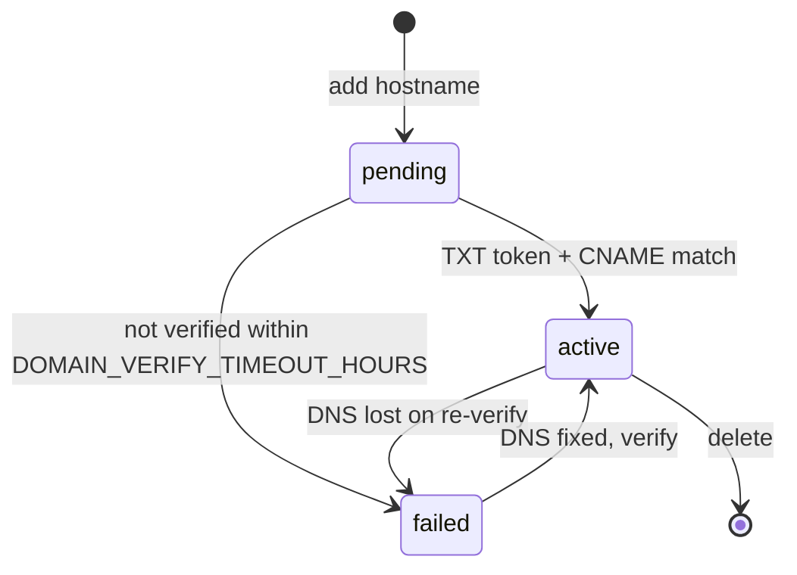
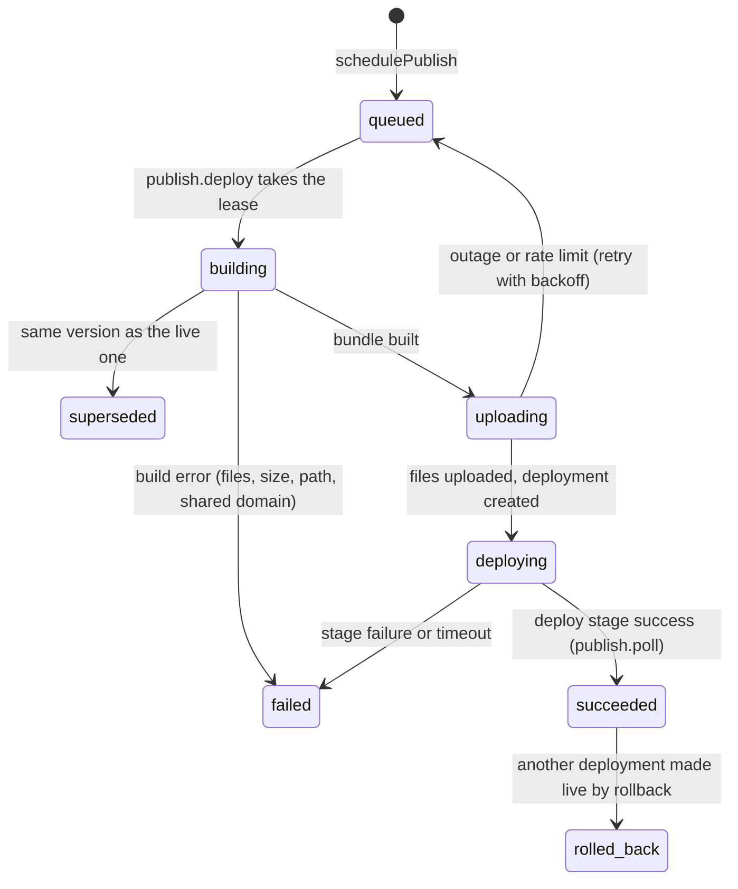
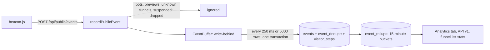

# Features

One entry per feature: what it does, the data flow from click to database to the outside world, its states, its limits, how it fails and, where it matters, how test mode differs from live. Each entry links to the deeper document. For screens see [USER-GUIDE.md](USER-GUIDE.md); for the code see [FUNCTIONS.md](FUNCTIONS.md); for what has and has not been run against real third-party services see [VERIFIED.md](VERIFIED.md).

| | |
|---|---|
| **Accounts and access** | [Accounts and workspaces](#accounts-and-workspaces) · [Roles and permissions](#roles-and-permissions) · [Two-factor authentication](#two-factor-authentication) · [Invitations, password reset and mail](#invitations-password-reset-and-mail) · [Audit log](#audit-log) |
| **Building** | [Funnels and steps](#funnels-and-steps) · [The page builder](#the-page-builder) · [Saving, versions and assets](#saving-versions-and-assets) · [Templates](#templates) · [AI funnel builder](#ai-funnel-builder) · [Builder assistant and AI helpers](#builder-assistant-and-ai-helpers) |
| **Selling** | [Product catalog](#product-catalog) · [Checkout and payments](#checkout-and-payments) · [Refunds and disputes](#refunds-and-disputes) · [Plans and platform billing](#plans-and-platform-billing) |
| **Publishing** | [Test mode and preview](#test-mode-and-preview) · [Built-in address](#built-in-address) · [Custom domains](#custom-domains) · [Cloudflare Pages](#cloudflare-pages-publishing) · [Cloudflare Workers (experimental)](#cloudflare-workers-experimental) · [Serving, caching and the edge worker](#serving-caching-and-the-edge-worker) |
| **Measuring** | [Tracking, events and rollups](#tracking-events-and-rollups) · [Funnel analytics and AI summaries](#funnel-analytics-and-ai-summaries) · [Leads and forms](#leads-and-forms) · [Ad pixels and consent](#ad-pixels-and-consent) · [Server-side conversions](#server-side-conversions) · [Attribution, ad spend and ROAS](#attribution-ad-spend-and-roas) · [Google reviews](#google-reviews) · [Analytics API, API keys and identity pepper](#analytics-api-api-keys-and-identity-pepper) |
| **Integrating** | [Webhooks](#webhooks) · [Notifications](#notifications) |
| **Running it** | [Admin panel](#admin-panel) · [Rate limiting](#rate-limiting) · [Error monitoring](#error-monitoring) · [Databases, Redis and scale options](#databases-redis-and-scale-options) · [Background jobs](#background-jobs) · [Health, metrics and logs](#health-metrics-and-logs) · [Outbound requests](#outbound-requests) |

## Accounts and workspaces

**What.** A person registers once and gets a **workspace** (the tenant) and the Owner role in it. Every business row carries `workspace_id`, repositories and services always filter by it, and a foreign id answers `404` ([ADR 0003](adr/0003-tenancy.md)). A user belongs to one workspace.

**Flow.** `POST /api/auth/register` (name, email, password of at least 8 characters, optional workspace name) creates workspace, user and session in one transaction and returns an access token and a refresh token. The web app keeps both in the browser's local storage, renews the access token (15 minutes by default) with the refresh token and signs out when renewal fails. `POST /api/auth/login` checks the password (scrypt hash) and answers either a session or, when two-factor is on, a challenge token ([below](#two-factor-authentication)). Each refresh rotates the refresh token; presenting a used one again after the grace period revokes the whole session (theft detection); two tabs racing inside `REFRESH_REUSE_GRACE_SECONDS` get a retryable `401 REFRESH_RACE`. Sessions end at `SESSION_MAX_DAYS` (90) whatever the activity.

**Limits and failures.** Failed sign-ins (wrong password, wrong code) are counted per account and per IP and lock them out for a while (`auth.attempts`, `auth.failures.*`; the lockout answers 429 with `Retry-After`). A suspended workspace can sign in but every route except `me`, `logout` and announcements answers `403 WORKSPACE_SUSPENDED`. Tokens live in local storage; the CSP (`script-src 'self'`) is the mitigation, httpOnly cookies are not implemented. **Deeper:** [RBAC.md](RBAC.md), [ADR 0018](adr/0018-rbac-sessions-2fa.md).

## Roles and permissions

**What.** Authorization is permission-based. There are 33 permissions (`funnels:read`, `orders:refund`, `publishing:manage`, ...) and four built-in roles that live in code: **Owner** (all), **Admin** (all except billing, workspace settings, member and role management, permanent deletion and the identity pepper), **Member** (15 permissions: build funnels, products, read leads, orders, analytics and ads, AI, view domains and members) and **Viewer** (8, read only). Owners can make custom roles per workspace.

**Flow.** Every route is one row in `server/src/routes/spec.ts` with the permission it needs; `authenticate()` enforces it before the handler, so a route cannot exist without an authorization decision (a test fails otherwise, and a generated test asks every route as every lower role). The interface hides what a role cannot do. **Rules:** nobody can grant a permission they do not hold; a workspace always keeps one Owner; removing a member or changing a role revokes their sessions at once. **Deeper:** [RBAC.md](RBAC.md) (the permission and route tables there are generated and tested).

## Two-factor authentication

TOTP only (RFC 6238: HMAC-SHA-1, 6 digits, 30 s, one step of drift; tested with the RFC vectors). **Enrol:** Settings > Security > Set up shows a secret and an `otpauth://` link (no QR is drawn), the first valid code turns it on and returns 10 recovery codes once. **Sign in:** `POST /api/auth/login` answers `{twoFactorRequired, challengeToken}` (valid 5 minutes, useless alone) and `POST /api/auth/2fa/verify` takes a code or a recovery code. A code works once (the accepted time step is stored), wrong codes count towards the lockout. **Turn off or regenerate codes:** password and a code. Secrets are encrypted with AES-256-GCM under a key derived from `DATA_ENCRYPTION_KEY` (or `JWT_SECRET` when unset: set the former, because rotating the latter would make seeds unreadable). **Recovery:** a holder of `members:manage` can reset a member's second factor, which ends their sessions. Platform administrators must have it in production (`ADMIN_REQUIRE_2FA` is forced on). A password reset does not bypass it. **Deeper:** [RBAC.md](RBAC.md#two-factor-authentication-totp).

## Invitations, password reset and mail

**Invitations.** Settings > Team > Invite member creates a one-time link (`/accept-invite?token=...`, 7 days) bound to an email and a role; the token is stored hashed. The invitee chooses a name and password and is signed in. Pending invitations count towards the member limit of the plan. **Password reset.** `POST /api/auth/password/forgot` answers the same for known and unknown addresses, has its own per-address budget (3 per hour), and the reset link (60 minutes, single use) ends every session when used. **Mail.** No SMTP library is bundled: `MAIL_TRANSPORT=webhook` posts `{from, to, subject, text}` (optionally HMAC-signed) to an endpoint you run, `console` prints to the log (development), `none` (default) sends nothing: invitations then show the link to the inviter and password resets cannot be delivered. **Failure mode:** with `none`, "forgot password" silently does nothing, by design. **Deeper:** [RBAC.md](RBAC.md#invitations-password-reset-and-mail), [CONFIGURATION.md](CONFIGURATION.md).

## Audit log

Security- and business-relevant actions write an `audit_log` row (workspace, actor, action, target, small JSON detail, IP): sign-ins, sessions, 2FA, invitations, role and member changes, workspace updates, product and price changes, domain and publishing changes, integrations, refunds, API keys and the identity pepper, and admin and support-access actions (recorded in the customer's own log and marked as support access). Passwords, tokens and secrets are never written. The Audit page (`audit:read`) pages newest-first with an action filter; platform administrators have a platform-wide log with prefix filters. IP addresses are stored: trim `audit_log` and `sessions.ip` to your retention policy. **Deeper:** [RBAC.md](RBAC.md#audit-log), [ADMIN.md](ADMIN.md#platform-audit).

## Funnels and steps

**What.** A **funnel** is an ordered list of **steps** (pages), each with a path (`/free-guide`), a stored page and an order; a funnel has a status (`test` or `live`), optional tags, a favicon, optional header and footer tracking code, an address (domain) and, since built-in addresses, a public slug.

**Flow.** `POST /api/funnels` makes a funnel and its first step with a starter page. Structure changes (create, update, delete, reorder, duplicate steps, save a page, attach a domain) all go through one lock order (workspace, domain, funnel, steps by id) so concurrent edits cannot deadlock. **Paths** are validated (letters, digits, `-`, one segment), unique inside the funnel and, when a domain is attached, across every live funnel on that domain; `POST /api/funnels/validate-path` suggests `/path-NNNN` alternatives and attaching a domain with clashes asks for a per-path resolution that must be a subset of the server's own conflict list. **Domain home and 404:** two steps can be marked as the domain's `/` and not-found pages. **Duplicate** copies steps, pages and rewires step references. **Trash:** deleting is soft; the funnel stops being served, its domain is detached and `/trash` lists it; restore brings it back in test mode; purge (Owner) deletes steps, backups, events and orders and queues deletion of a Cloudflare project the app created ([ADR 0004](adr/0004-soft-delete.md)). **Search and filters:** name, status, tag, domain state, sort, paging.

**Limits.** Plan limits on funnels (3, 50, 1000) apply only with `BILLING_ENFORCE_LIMITS`; trashed funnels free a slot and restoring needs one. A funnel cannot go `live` without an address (`DOMAIN_NOT_ADDED`); going to `test` always detaches the domain.

## The page builder

**What.** A [GrapesJS](https://grapesjs.com) editor (loaded as its own lazy chunk) with all of GrapesJS's own panels switched off; the interface around the canvas is React. The canvas is GrapesJS's own iframe, so dragging from Blocks, reordering, nesting, resizing and inline text editing are real interactions. The panels are described in [USER-GUIDE.md](USER-GUIDE.md#the-page-builder).

**Data flow.** The source of truth is a **project JSON** (`editor.getProjectData()`), stored as `step_pages.doc_json = { version: 2, project, forms, products }`. The browser sends only the project. The server cleans every node against allow-lists (tags, attributes, classes, ids, style properties and values, selectors, media text), derives `forms` and `products` from typed component props (`fnForm`, `fnProduct`, `fnVideo`, `fnCountdown`, `fnProgress`, `fnCode`, `fnAction`, `fnReviews`, `fnReviewCta`), renders the HTML itself, runs a final `sanitize-html` pass over the whole body and stores HTML with its CSS. The same pure TypeScript (`server/src/pagemodel/shared`, aliased as `@pagemodel` in the web build) is used by the canvas and the renderer, so the canvas shows what is published. The public form and checkout endpoints read the **derived** lists, so a client can never choose a price or a form definition. **Limits:** 3,000 elements, depth 24, 2 MB, 6,000 style rules, 10,000 characters of text per node. **Scripts:** a *Custom code* block's JavaScript and custom header and footer code are kept only when the workspace allows custom scripts and the saver is the Owner; otherwise new or edited code is reduced to sanitised HTML and CSS and a note says so. **Failure modes:** a document that no longer validates opens as an empty page with a warning and nothing is lost until you save; a save the cleaner refuses answers `422 INVALID_DOCUMENT` with the paths; the canvas never runs custom code, it shows its escaped source. **Deeper:** [ARCHITECTURE.md](ARCHITECTURE.md#page-builder), [FUNCTIONS.md](FUNCTIONS.md#the-page-model-pagemodel), [SECURITY.md](SECURITY.md), [ADR 0022](adr/0022-grapesjs-page-builder.md), [design/DESIGN.md](design/DESIGN.md).

## Saving, versions and assets

**Save.** `PUT /api/funnels/{id}/steps/{sid}/page` with the expected `version`: the server locks funnel then step, compares the version with the committed one and also updates `WHERE version = old` (optimistic concurrency, `409 VERSION_CONFLICT`); inside one transaction it inserts a backup of the previous document when asked (`backup: true`, which Save does and autosave does not), re-renders, updates `step_pages`, bumps `steps.version`, prunes backups to the newest 10 and then invalidates the page cache and queues an edge purge or a Cloudflare redeploy when the funnel is published. **Restore** copies a backup back (`funnels:write`, one more version). Legacy version-1 block documents are converted once at start-up and lazily when read ([MIGRATION-NOTES.md](MIGRATION-NOTES.md)). **Images:** `/api/assets` stores uploads in the database (PNG, JPEG, GIF, WebP decided by magic bytes, SVG refused, 1.5 MB each, 200 per workspace) and `/uploads/{id}/{name}` serves them with `nosniff`, a restrictive CSP and long caching; customer domains reach them through the same passthrough as `/beacon.js`. **Custom blocks:** a selected element can be saved as a reusable block (`blocks:manage`).

## Templates

**What.** 28 funnel templates served from the database (`templates`, `template_steps`, `template_categories`; global, not per workspace) with category, industry, goal, tags, product slots and step kinds. A versioned, idempotent seed runs at boot and never overwrites a template that was edited, imported or published ([TEMPLATES.md](TEMPLATES.md), [ADR 0023](adr/0023-template-library.md)).

**Flow.** `GET /api/templates` filters by category, industry, goal, tag and checkout and searches by text (ETag, facet counts). `GET /api/templates/{id}/html?step=n` renders a step as an inert page for previews (shown in `sandbox=""` frames). `POST /api/templates/{id}/use` copies the template into a **test** funnel in the caller's workspace; for each product slot `bindings` say either `{priceId}` (use a catalog price) or `{create: true}` (create the template's sample product, reusing an equal one). Product references in the copied pages are rewritten to the chosen products. **Platform administrators** can publish a funnel as a template and import and export templates as JSON through the API (no screen); imports are validated like a page save and size limited.

## AI funnel builder

**What.** A multi-stage pipeline that turns a description into a normal test funnel: understanding (brief and assumptions), strategy (funnel type, page sequence, closest templates), products, copy per page, assembly, validation, save ([AI-BUILDER.md](AI-BUILDER.md), [ADR 0040](adr/0040-ai-funnel-builder-pipeline.md)).

**Flow.** `POST /api/ai/builds` stores an `ai_generations` row, enqueues the `ai.build` job and answers `202`; the job checkpoints after every stage (so a restart resumes), publishes `ai.build` events on the workspace stream, and ends with the funnel saved in test status. **The model writes plain text for named fields; code assembles the pages** from the same building blocks the templates use and validates them with a deterministic rubric (structure, wiring, one call to action, contrast, lengths, claims, no external hosts, bound products, fake proof). A failing stage is repaired up to `AI_BUILD_MAX_REPAIRS` times, then replaced by the deterministic built-in writer; the record says `source: model | heuristic | fallback` and `degraded`. **Safety:** the brief is untrusted data (wrapped and defused, injection phrases flagged), claims such as guarantees, rankings, customer counts and invented scarcity are refused, testimonials are always placeholders, an optional switch redacts emails, phone numbers and card numbers before anything is stored or sent. **Products:** `none` (default; offer pages collect enquiries), `create` (draft products, not synced to Stripe, needs `products:write`) or `existing`. **Limits:** one build per workspace at a time (`409 BUILD_IN_PROGRESS`), per-call and per-build token budgets, `ai.minute` and `ai.daily` quotas, records purged after 90 days. **Without `ANTHROPIC_API_KEY`** the built-in writer produces deterministic copy (same description, same funnel). **Not verified against the real model**, see [VERIFIED.md](VERIFIED.md).

## Builder assistant and AI helpers

The builder's AI tab sends an **outline** of the page (ids, types, short texts, no HTML or styles) to `POST /api/ai/edit`, which returns zod-validated **edit operations** (`insert`, `replace`, `delete`, `move`, `setText`, `restyle` over allow-listed components and 20 style properties, at most `AI_EDIT_MAX_OPS`); the browser re-validates each one, previews them as **one undo step** and the author keeps or undoes them. `POST /api/ai/section` writes one section. The element-level helpers (`rewrite`, `headlines`, `alt-text`) and the analytics `insights` and `summary` use the same provider and fallbacks. Any model answer that fails validation, times out or is empty is replaced by the deterministic built-in answer. Quotas: `AI_RATE_LIMIT_PER_MINUTE` (10), `AI_DAILY_CAP` (50 per UTC day, 0 turns AI off), counted even when the model fails; the `ai_assistant` feature flag can switch it off per workspace. **Deeper:** [AI.md](AI.md), [AI-BUILDER.md](AI-BUILDER.md), [ADR 0041](adr/0041-builder-assistant-edit-operations.md).

## Product catalog

**What.** Products and **immutable prices**, money in minor units with the currency's exponent (zero- and three-decimal currencies handled), per workspace. A checkout block names a catalog price; the server prices from the catalog, never from the browser ([PRODUCTS.md](PRODUCTS.md), [ADR 0024](adr/0024-product-catalog.md)).

**Flow.** Creating a product with a price inserts rows and, when Stripe is connected, mirrors them to the connected Stripe account with idempotency keys (best effort: a failure leaves `sync_status = failed` and the product still works in checkouts). Changing a price **replaces** it: new price created, old one archived and pointed at the new one (`replaced_by`), so pages and checkouts follow it while past orders keep theirs. Products are archive-only (archived products are hidden from pickers and checkouts naming them refuse with a friendly message; pages keep rendering). Stripe `product.*` and `price.*` webhook events reconcile the mirror. Saving a page with checkout blocks links them to catalog rows (`linkCatalog`). **Limits:** at least one active price per product; a subscription price cannot be a one-click upsell; one currency per order.

## Checkout and payments

**Test provider (default, `PAYMENTS_PROVIDER=mock`).** The visitor submits the checkout block, the server resolves the block from the stored page (never trusting a client amount), and records orders as if paid; **no card is charged and no money moves**. Orders for main offer and chosen bumps are inserted under a unique `idem_key`; the one-click upsell and downsell records follow from the saved order. Refunds only update the record. This mode is for development and demos.

**Stripe (`PAYMENTS_PROVIDER=stripe`).** Funnels uses **Stripe Connect Standard**: the workspace owner connects their own Stripe account (Settings > Payments), the buyer pays on **Stripe-hosted Checkout** on that connected account (direct charge, `Stripe-Account` header) and Funnels keeps an **application fee** by plan (5 %, 2 %, 0). Card data never reaches Funnels.

Orders are created when payment is confirmed, by whichever arrives first, the signed webhook or the visitor's return; both call the same `finalizeSession`, which re-reads the session from Stripe, checks the paid total against the stored total and inserts orders with a unique key per session and block, so the race produces exactly one set. A one-click upsell charges a PaymentIntent off-session with the card the buyer just used; a decline or a card needing authentication is `402 PAYMENT_FAILED` and the funnel moves on. Subscriptions use `mode=subscription` with trial days; renewals are **not** recorded as orders. **Failure modes:** a total mismatch answers `409` and leaves the webhook unprocessed so Stripe retries; a handler failure records the error and returns non-2xx; Stripe unreachable at checkout is a friendly `502`. **Test vs live:** the mode follows the key (`sk_test_` is test mode, with the test-card table in Settings); the same code runs both. **Status:** exercised against an in-process fake and checked against sandbox response shapes only; never a real charge ([VERIFIED.md](VERIFIED.md)). **Deeper:** [STRIPE.md](STRIPE.md), [ADR 0020](adr/0020-stripe-connect-billing.md).

## Refunds and disputes

`POST /api/orders/{id}/refund` (`orders:refund`, optional `amountCents`): the amount is **reserved inside a transaction before Stripe is called** so concurrent double refunds cannot both pass; the refund is created with an idempotency key; a Stripe failure releases the reservation (`502 REFUND_FAILED`; "already refunded" is `409`). Refunds made in the Stripe dashboard arrive as `charge.refunded` and are allocated the same way. **Disputes:** `charge.dispute.*` events become `disputes` rows linked to orders through the PaymentIntent; order status is derived (`charged_back`, `disputed`, `paid`, `partially_refunded`, `refunded`), a lost dispute deducts at most what is left after refunds and is subtracted from the sales rollups once, out-of-order delivery is tolerated, and each change notifies (bell, `funnel.dispute` webhook, audit). Evidence is submitted in Stripe, not in Funnels. Statuses `won`, `warning_closed` and `prevented` close with nothing deducted. **Deeper:** [STRIPE.md](STRIPE.md).

## Plans and platform billing

Three plans (Free, Pro, Business) with limits on funnels, domains, members, API keys and hosted Pages projects, and an application fee of 5 %, 2 % and 0. Limits are enforced only with `BILLING_ENFORCE_LIMITS=true` (off by default so a self-hosted install is unlimited); going over answers `402 PLAN_LIMIT_REACHED` with `{resource, limit, used, plan}` and nothing is ever deleted on a downgrade. `POST /api/billing/subscribe` starts a Stripe Checkout subscription on the **platform** account (webhook `POST /api/stripe/webhook`, secret `STRIPE_WEBHOOK_SECRET`, plan from `STRIPE_PRICE_PRO` or `STRIPE_PRICE_BUSINESS`); `POST /api/billing/portal` opens the Stripe billing portal. The two webhook endpoints have separate secrets so an event for one cannot be replayed at the other. **Deeper:** [STRIPE.md](STRIPE.md#platform-billing-and-plan-limits).

## Test mode and preview

A funnel starts in **test** mode. In test mode the pages are not served on any address (the built-in address, customer domains and the edge all answer 404 for it) and **nothing is counted**: only the **signed preview** serves it. `POST /api/funnels/{id}/preview-token` mints a signed token (JWT, `JWT_SECRET`) and `/preview/<funnel>/<step path>?token=` renders the saved page through the same code as live pages with its own link builder; the beacon runs in preview mode (no page view, submissions flagged) so previews create no events, leads or orders. Taking a live funnel offline (`status: test`) detaches its domain. **Live** means the address is reachable by anyone and visits, leads and orders are recorded. Everything that is "test vs live" about *payments* is separate and follows the Stripe key ([above](#checkout-and-payments)). **Deeper:** [GO-LIVE.md](GO-LIVE.md).

## Built-in address

**What.** The free way to go live with no domain and no account: `<APP_PUBLIC_URL>/s/<workspace slug>/<funnel slug>/<step path>`. **Flow.** *Go live* (`POST /api/funnels/{id}/go-live {address:{kind:"builtin"}}`) attaches the workspace's built-in system domain (`kind='builtin'`, one per workspace, always active, synthetic `.invalid` hostname) and sets the funnel live. Slugs are made from names the first time they are needed, are unique (`-2`, `-3` on a collision), stay stable when the name changes and are editable (changing one moves the address: the old one 404s, there is no redirect). Links between steps are rewritten from step ids at render time to stay inside the prefix; cookies are scoped to `Path=/s/<workspace>`; built-in pages answer `X-Robots-Tag: noindex, nofollow` unless indexing is switched on; a funnel that is not live, trashed, on another address or mistyped answers the same 404 (no existence leak) and a suspended workspace answers 503. **Pages with owner-authored code** (custom code, tracking snippets) run on the app's origin, so they are served with `Content-Security-Policy: sandbox allow-scripts ...` (opaque origin: their scripts work but cannot read the app's cookies, storage or API session). Use a custom domain for production ad tracking. **Deeper:** [GO-LIVE.md](GO-LIVE.md), [ADR 0045](adr/0045-built-in-address-path-prefix.md).

## Custom domains

**What.** A workspace can add hostnames (`offers.example.com`) and serve live funnels on them.

**Flow.** Adding returns two records: a **CNAME** to `APP_PUBLIC_CNAME_TARGET` and a **TXT** at `_funnels-challenge.<host>` carrying the verification token. **Verify** (and a periodic `domain.verify` job) resolves both with the injected DNS resolver; with `DOMAIN_PROVIDER=cloudflare` Cloudflare for SaaS custom hostnames are managed through the API, with the default `manual` the app only checks DNS. Hostnames of the app itself and `.invalid` system hostnames cannot be registered. A registered hostname never falls through to the app (a pending or failed one answers an "unavailable" page, so the admin UI is never served on a customer's domain). When a domain fails or is deleted, funnels on it go to test and are detached in the same transaction. **TLS** for customer domains is terminated in front of the app (a CDN, a proxy, Caddy on-demand TLS or Cloudflare), not by the app. **Limits:** plan domain limit (1, 10, 100). **Deeper:** [ARCHITECTURE.md](ARCHITECTURE.md#domain-state-machine), [CLOUDFLARE.md](CLOUDFLARE.md).

## Cloudflare Pages publishing

**What.** An alternative to serving from this server: each funnel is built into a **static site** and deployed to its own Cloudflare Pages project with the Direct Upload API, so pages keep loading when this server is down (forms, checkout and tracking still call this app). The funnel then has a free `<project>.pages.dev` address with no domain, or a custom domain attached to the project ([CLOUDFLARE-PAGES.md](CLOUDFLARE-PAGES.md), [CLOUDFLARE-SETUP.md](CLOUDFLARE-SETUP.md), [ADR 0030](adr/0030-publish-targets-cloudflare-pages.md), [ADR 0043](adr/0043-system-domains-free-addresses.md)).

**Flow.** Connect once (Settings > Publishing: account id and a scoped API token; stored encrypted, shown only as its last four characters; or use the installation's own account when `CF_PAGES_*` is configured, subject to the plan's hosted-project limit). *Go live* on the Cloudflare address creates the project and queues the first deployment. Anything that changes what a live funnel serves (page save, step or settings change, status, domain, pixels, suspension) calls `onFunnelChanged`, which queues **one debounced deployment** per funnel (`PAGES_DEBOUNCE_SECONDS`, default 5).

The bundle is deterministic (paths validated after percent-decoding; a CSP per page from SHA-256 hashes of the platform's own inline scripts; `_headers` and `_redirects`; the version id is a hash of files, headers and redirects, so an unchanged funnel is `superseded` and uploads nothing). One lease per funnel gives single flight, last change wins. **Rollback** makes an earlier successful deployment live and **holds** automatic deployments until someone presses Redeploy (otherwise the next autosave would undo it); **Unpublish** pauses (a "not available" page) or deletes the project. States shown to the user: *Test mode*, *Publishing...*, *Live*, *Publishing failed*, *Paused*. **Limits:** Cloudflare allows 100 Pages projects per account (one per funnel here), 20,000 files per site, 25 MiB per file; the app counts the account's projects and refuses cleanly (`PAGES_*` limits are configurable). A Pages project serves one funnel per domain, so deployment is refused while another live funnel shares the domain. **Failure modes:** an outage or rate limit retries with backoff; permission, not-found and limit errors become messages that say what to fix; a failed deployment keeps the previous one online. **Verified:** the Go live path on the free `pages.dev` address was run by the maintainer against a real Cloudflare account (the run found and fixed the project-count bug in commit 1438c8c); rollback, unpublish, Pages custom domains, the smoke script and the platform-account mode have no recorded real run ([VERIFIED.md](VERIFIED.md)).

## Cloudflare Workers (experimental)

A second `PublishTarget` (`cloudflare-workers-assets`, [ADR 0044](adr/0044-publish-target-interface-workers-assets.md)) publishes the same bundle as a Worker with static assets at a `workers.dev` address, behind the same deployment state machine. It needs the *Workers Scripts: Edit* token permission and a workers.dev subdomain, is marked **Experimental** in the interface, and has only been run against the in-memory fake (`scripts/cf-workers-smoke.ts` is how you check it with your own token).

## Serving, caching and the edge worker

**Origin serving.** `hostRouting` middleware maps the `Host` header to a live funnel step before anything else can claim the path (`resolveLive`, coalesced per host and path); `/s/...` serves built-in addresses and `/preview/...` previews. Pages are served from `step_pages.html` with `ETag` = checksum, `Cache-Control: private, max-age=0, must-revalidate` and 304 on `If-None-Match`, behind an in-process LRU page cache that every save clears. Cookies `visitor_id`, `funnel_id`, `step_id` and `utm_*` are set per request. Public pages are rate limited (`public.page`, 6,000 per minute per client by default).

**Edge worker (optional).** `edge/` is a Cloudflare Worker in front of the origin: it caches pages by public URL (default 60 s fresh, 24 h stale-while-revalidate, stale-if-error), revalidates with an **HMAC-signed** call to `/internal/edge/resolve` (without `EDGE_SHARED_SECRET` it refuses to serve: fail closed), forwards `/api/public/*`, `/public/reviews/*` and `/beacon.js` with the real client IP, can answer `POST /api/public/events` with 202 and queue them to Cloudflare Queues (`/internal/edge/events` takes batches of up to 500), rate limits at the edge (Workers Rate Limiting bindings, a Durable Object GCRA), and sets visitor cookies per request (never cached with the HTML). The origin purges the edge cache by URL (`edge.purge` job, `CF_API_TOKEN` and `CF_ZONE_ID`) on every change. **Deeper:** [CLOUDFLARE.md](CLOUDFLARE.md), [ADR 0006](adr/0006-edge.md). The edge worker's unit tests run against fakes; it has not been deployed by this documentation pass ([VERIFIED.md](VERIFIED.md)).

## Tracking, events and rollups

**What.** Every published page carries `/beacon.js` (plain ES5, no dependencies), which sets the visitor id, reports a **page view** with `sendBeacon`, progressively enhances forms, checkouts and upsells (JSON POST, success actions), reports the marketing touch and browser ids for attribution (ids only when consent allows) and announces conversions to the pixel runtime.

**Flow.**

Only `page_view` and `optin` can be reported by a browser; **orders can only be created by the server-side checkout**, so a visitor can never forge revenue. The workspace is always derived from the funnel id. Bots (user-agent heuristic), previews and unknown or trashed funnels are silently ignored. The buffer inserts a batch and folds it into `event_rollups` with one upsert per bucket in the same transaction; "first view" (unique) is decided at flush time from `visitor_steps`, exact across replicas; opt-in idempotency keys live in `event_dedupe` (kept `EVENT_DEDUPE_DAYS`, 30). **Limits and failures:** per-workspace admission (`ingest.workspace`, 429 with `Retry-After`) so one tenant's flood cannot starve others; the buffer applies backpressure at `EVENT_BUFFER_MAX` (the caller waits for the flush; with the ingest queue on, a backlog beyond `INGEST_MAX_LAG` answers 503); a hard kill loses at most the unflushed buffer window (about a quarter of a second); shutdown flushes. On PostgreSQL `events` is partitioned by month and partitions are created ahead by maintenance. **Deeper:** [ARCHITECTURE.md](ARCHITECTURE.md#data-layer), [SCALING.md](SCALING.md), ADRs [0007](adr/0007-event-buffer.md), [0008](adr/0008-rollups.md), [0013](adr/0013-partitioned-events.md), [0014](adr/0014-hll-sketches.md).

## Funnel analytics and AI summaries

The Analytics tab (`GET /api/funnels/{id}/analytics?from&to&tz`) reads the rollups: page views and unique visitors, opt-ins, orders, gross, earnings per view and conversion rates per funnel and per step, plus a daily series folded to the requested time zone. Refunds and **lost disputes** are netted out of sales (booked in the bucket in which they happened; closed periods are not rewritten). Product analytics (`/api/analytics/products`) groups orders by product, currency, role, funnel, step and 15-minute bucket (currencies are never added). The **AI summary** (`POST /api/analytics/summary`) and **insights** (`POST /api/ai/insights`) build an evidence object in SQL, let the provider narrate it and **throw away any text containing a number that is not in the evidence**, falling back to the deterministic narrator; the response always carries the untouched metrics beside the text. With `ANALYTICS_READ_STORE=clickhouse` reads go to a ClickHouse mirror and fall back to the primary on error or staleness (not verified against a real ClickHouse). **Deeper:** [ANALYTICS-API.md](ANALYTICS-API.md), [ADR 0025](adr/0025-grounded-analytics-summary.md), [ADR 0016](adr/0016-clickhouse-secondary-store.md).

## Leads and forms

A form block (name, email, phone, text, long text, dropdown, checkbox fields; consent line; success action) posts to `POST /api/public/forms/{funnelId}/{stepId}/{blockId}`. The server loads the **stored** block, validates against its field definitions (unknown keys dropped, 422 with per-field messages, honeypot `_hp`), and in one transaction upserts the lead by email (unique per workspace; a repeat bumps `submissions`), records an opt-in event and rollup, stamps first and last touch attribution, creates a notification, queues a signed webhook delivery and the server-side conversions. A `submissionId` makes the submit idempotent. In preview nothing is recorded. Leads are listed and exported (CSV, streamed, formula-injection safe) per funnel. **Failure modes:** an unknown block or a stale page is a 404; a suspended workspace answers 503; the form endpoints have their own per-client limits and penalty box (`public.forms`).

## Ad pixels and consent

Pixel and tag settings exist per workspace, funnel and step (a step overrides its funnel, which overrides the workspace, per network; `null` switches a network off) for Meta, Google (GA4 and Ads), TikTok, LinkedIn and Microsoft UET. The server **generates** the loader from strictly validated ids (nothing a user types is run as script), injects it into the page head for the origin and for Pages bundles, and adds the needed hosts to the page's CSP. The cookie **consent banner** is part of the generated runtime: mode opt-in (nothing loads until Accept; recommended for the EU and UK) or opt-out, who is asked (everyone, or a heuristic based on the browser time zone for Europe), position, texts, policy link, and respect for Do Not Track and Global Privacy Control (load nothing and send no server-side conversions for those visitors). Changing settings re-renders the affected pages and refreshes live copies. Browser pixels load the vendors' public script URLs and were written from the vendors' documentation, not checked against the real vendors ([VERIFIED.md](VERIFIED.md)). **Deeper:** [ADS.md](ADS.md), [ADR 0031](adr/0031-ads-conversions-attribution.md).

## Server-side conversions

**Flow.** When the server itself verifies a lead (form) or a purchase (finalized order), it writes one `conversion_deliveries` row per enabled integration **in the same transaction** and enqueues `conversion.deliver`. The job builds the network's payload (Meta Conversions API, GA4 Measurement Protocol, TikTok Events API) with hashed identifiers only (SHA-256 of normalised email and phone, no raw PII), the same event id the browser pixel uses (so the network deduplicates), consent respected, and posts it through the SSRF-guarded client. Retries use exponential backoff and become dead letters; the delivery log keeps status, attempts, HTTP status and the network's answer (never the token or a raw email) for 180 days, and failed ones can be retried from the screen. **Send test event** uses each network's test mechanism (test event code for Meta and TikTok, the validation endpoint for GA4). Credentials are stored encrypted. **Status:** request shapes are covered by golden tests against fakes; the TikTok payload comes from secondary descriptions of the API. None of the three has been sent to the real network ([VERIFIED.md](VERIFIED.md)).

## Attribution, ad spend and ROAS

`POST /api/public/attribution` records each visitor's **first and last marketing touch** (UTM parameters, click ids `gclid`, `fbclid`, `ttclid`, `msclkid`, `li_fat_id`, external referrer host, landing path) and, with consent, browser ids (`_fbp`, `_fbc`, `_ttp`, GA client and session ids) in `visitor_attribution`; leads and orders are stamped with the touches at creation. **Ad spend** has no platform connection: it is typed in or imported from CSV (`date, source, campaign, currency, spend`, optional `account, impressions, clicks`; dry run, per-row error report, idempotent re-import). The **performance report** joins spend to results by campaign (a *campaign map* ties a platform campaign name to the `utm_campaign` its traffic carries) and shows spend, visits, leads, orders, revenue, CPL, CPA, ROAS and profit per campaign, source, funnel or day, in **one currency at a time** (others are listed, never added). Revenue from campaigns without recorded spend is reported separately ("not counted above"). IP addresses and user agents kept for server-side conversions expire after `ATTRIBUTION_RETENTION_DAYS`. **Deeper:** [ADS.md](ADS.md).

## Google reviews

A *Google reviews* block (list, carousel, rating badge) and an *Ask for a Google review* button. **Flow:** the page document only stores the place id and options; when a page is rendered or published the server fetches the place (Places API (New): Place Details and Text Search) with the workspace's **encrypted key** (or the platform key `GOOGLE_PLACES_API_KEY`), caches it in `google_places_cache` for a short time (`GOOGLE_REVIEWS_CACHE_TTL_S`, 3,600 by default, Google's storage terms apply), and bakes a snapshot into the HTML; pages (origin and Pages) refresh the numbers at runtime from `GET /public/reviews/{token}` (CORS for customer domains and Pages hosts). **Failures:** a missing key, no place, an API error, a quota limit (`GOOGLE_REVIEWS_DAILY_FETCHES`, 200 lookups per day per workspace by default) or an open circuit breaker all degrade to the testimonials typed into the block, labelled as customer feedback, never as Google reviews; the endpoint always answers 200. Attribution to Google and links to authors are always shown. **Not exercised against the real Google API** ([VERIFIED.md](VERIFIED.md)). **Deeper:** [REVIEWS.md](REVIEWS.md), [ADR 0042](adr/0042-google-reviews-places-api.md).

## Analytics API, API keys and identity pepper

`/api/v1/analytics/*` lets another system read **funnels, steps, time series, ads, attribution and products** and export **events and leads as NDJSON** (one page per request with `X-Next-Cursor`). Access is by **API key** (`fa_live_` or `fa_test_`, scopes `analytics:read` and `analytics:export`, optional expiry and IP allow-list, revocable; only a hash is stored and the secret is shown once). Exports never contain raw email, phone, name or visitor id: people are identified by `contact_key = HMAC-SHA256(pepper, lower(trim(email)))` and `visitor_key = HMAC-SHA256(pepper, "v:" + visitor_id)`. The **pepper** is a per-workspace secret (encrypted at rest under `DATA_ENCRYPTION_KEY`; production refuses the exports until that key is set) that holders of `analytics_identity:manage` can view, rotate and **import** so two apps of one customer compute the same keys and can join data without sharing personal data; every response carries a **fingerprint** (first 8 hex characters of its SHA-256) to compare. JSON Schemas are generated from the zod definitions into [analytics-api/](analytics-api/) and served at `/api/v1/analytics/schema`. Daily, workspaces subscribed to the `analytics.daily_rollup_ready` webhook are told that yesterday's data is complete. **Deeper:** [ANALYTICS-API.md](ANALYTICS-API.md), [ADR 0019](adr/0019-analytics-api.md).

## Webhooks

**Flow.** Settings of a webhook: URL (public http(s) only; private, loopback and link-local addresses are refused) and events (`funnel.optin`, `funnel.purchase`, `funnel.refund`, `funnel.dispute`, `analytics.daily_rollup_ready`; `funnel.test` for the test button). When a lead, order, refund or dispute is written, the delivery row and a `webhook.deliver` job are inserted **in the same transaction** (so a rollback sends nothing). The job POSTs the JSON body with `X-Funnels-Signature` (HMAC-SHA256 of `timestamp.body` with the webhook's secret, shown once at creation and on rotation), resolving DNS itself, **pinning the vetted IP** and refusing redirects. A non-2xx answer, timeout or DNS failure requeues with exponential backoff (30 s, 1 min, 2 min, ... capped at 1 h) up to `WEBHOOK_MAX_ATTEMPTS` (6) and then marks the delivery `dead`; dead or failed deliveries can be retried from the log. Jobs are claimed fairly per workspace, so one tenant's backlog cannot starve another. **Pause** keeps the configuration without deliveries. **Deeper:** [ARCHITECTURE.md](ARCHITECTURE.md#key-flows), [API.md](API.md).

## Notifications

`notify()` stores an in-app notification (new lead, new sale, refund, dispute, billing) and publishes it on the workspace's in-process bus. The web app opens `GET /api/events/stream` (server-sent events) with a short-lived single-use ticket from `POST /api/events/ticket` (EventSource cannot send headers), shows each event as a toast and refreshes its lists; the bell shows the unread count and a drawer. The bus is per process: with several replicas an event reaches only clients connected to the replica that produced it, and the bell still shows it on the next fetch. The stream also carries `ai.build` progress. Concurrency of streams is limited per user (`api.stream`).

## Admin panel

Platform administrators (the `platform_admins` table, bootstrapped by `PLATFORM_ADMIN_EMAILS`, roles `support` and `superadmin`) get `/admin`: workspace search and detail; **suspension** (sessions revoked, serving, public writes and API keys stopped within 5 seconds on any node, edge cache purged; a payment already in flight is still finalized); **support access** (a time-limited session as the owner, read-only by default, write access only for superadmins with a reason of at least 20 characters, never able to change credentials, billing, members, roles or purge; recorded in the customer's own audit log with a banner for the person acting); **feature flags** (override, percentage rollout, default); the **queue inspector** (jobs by status, outbox, bus lag, dead jobs with retry and discard); **announcements**; the platform **audit** log; **GDPR** lookup and erase by email (deletes leads, anonymises orders and checkout sessions, scrubs notifications and webhook payloads); workspace **export** (NDJSON) and permanent **delete** of a suspended workspace; and the monitoring status. Every platform route is checked in one place (administrator, not impersonating, 2FA in production). **Deeper:** [ADMIN.md](ADMIN.md), [ADR 0021](adr/0021-admin-panel.md).

## Rate limiting

One layered limiter (`server/src/ratelimit/`): per client IP, per route class (`public.events`, `public.forms`, `public.checkout`, `auth.attempts`, ...), per user, per workspace (tiered by plan, with cost units: exports cost 5, AI 10, a page save 2), concurrency limits (exports, streams) and in-handler policies (`ai.minute`, body-keyed `public.events`, `auth.failures.*`). Algorithms: GCRA for short windows, a sliding-window counter for long quotas, a lease-based concurrency limiter and a **penalty box** (five refusals in 10 minutes block a client for 1 minute, then 5, 30 minutes and 24 hours). Storage is **Redis** (one Lua `EVALSHA` per decision, atomic across nodes, time from Redis `TIME`) or an **in-memory** store with the same arithmetic (per process). Every Redis call has a 25 ms budget behind a circuit breaker; each policy declares whether it **fails open or closed** when the store is unreachable (login-protecting policies fail closed). Denials answer `429` with `Retry-After` and standard `RateLimit` headers. The route-to-policy table is generated into [RATE-LIMITING.md](RATE-LIMITING.md#policies) and a test fails for any route without a policy. Admins can block, allow-list and re-tier clients through `/api/admin/rate-limits` (API only). **Deeper:** [RATE-LIMITING.md](RATE-LIMITING.md), [ADR 0010](adr/0010-rate-limiting.md).

## Error monitoring

Optional **Sentry**: with `SENTRY_DSN` unset the server never imports the SDK and the web app (which asks `GET /api/config`) downloads no Sentry code. When set, unhandled errors, 5xx responses and dead jobs are reported with an **allow-list scrubber**: error type, scrubbed message, stack, the route **pattern**, a request id, a hash of the workspace id and the plan; never request bodies, cookies, headers, emails, names, keys or page content. `SENTRY_WEB_DSN` enables the browser SDK; `SENTRY_TRACES_SAMPLE_RATE` defaults to 0.05. Admin > Monitoring shows the status and **Send test error**. **Verified:** the real SDK against a fake transport only, never a real Sentry project ([MONITORING.md](MONITORING.md), [ADR 0046](adr/0046-sentry-error-monitoring.md)).

## Databases, Redis and scale options

| Mode | Selected by | Notes |
|---|---|---|
| **SQLite** (default) | `DATABASE_PATH` (file or `:memory:`), `DATABASE_URL` unset | `node:sqlite`, WAL, one writer with a FIFO lock; run **one replica**. Zero configuration. |
| **PostgreSQL** | `DATABASE_URL=postgres://...` | `pg` pool, migrations under an advisory lock so replicas can boot together, `FOR UPDATE SKIP LOCKED` job claims, monthly `events` partitions, optional read replicas (`DATABASE_REPLICA_URLS`, with lag and read-your-writes handling). Tested on 17 and 18. |
| **In-process PostgreSQL (PGlite)** | tests only | The same suite runs against SQLite, PGlite and real PostgreSQL ([TESTING.md](TESTING.md)). |
| **Redis** | `REDIS_URL` | Shared rate limiter state, request coalescing across processes, the durable event bus (Streams). Holds no durable data; do not back it up. Not needed for one instance. |
| **ClickHouse** | `ANALYTICS_READ_STORE=clickhouse` | Optional secondary analytics store behind an interface. Unverified against a real server. |
| **Event bus and ingest queue** | `EVENT_BUS`, `INGEST_QUEUE` | A durable bus (Redis Streams with partition leases and dead letters, or in-memory) with a transactional outbox; with `INGEST_QUEUE` the request path never touches the database for events. |

Per-process state (in-memory limiter without Redis, page cache invalidation, the notification bus, the event buffer's local view) is why SQLite means one replica. Migrations are forward-only and shared between engines (`migrations/sqlite` and `migrations/pg` have the same names; a test compares the two schemas). **Deeper:** [ARCHITECTURE.md](ARCHITECTURE.md#data-layer), [SCALING.md](SCALING.md), [CONFIGURATION.md](CONFIGURATION.md), [RUNBOOK.md](RUNBOOK.md), ADRs [0002](adr/0002-databases.md), [0015](adr/0015-event-bus-outbox-ingest-queue.md), [0017](adr/0017-fair-queueing.md).

## Background jobs

An in-process `JobWorker` polls the `jobs` table (`JOB_POLL_MS`, 1 s) and claims due jobs **fairly per workspace** (round-robin by group key over the oldest 2,000 due jobs; `FOR UPDATE SKIP LOCKED` on PostgreSQL). A job has a type, a JSON payload, a dedupe key (an expected duplicate is skipped inside the statement), attempts and a status (`queued`, `running`, `done`, `dead`). A failure requeues with exponential backoff (30 s doubling to 1 h) until `max_attempts`, then `dead` (reported to Sentry when enabled; visible and retryable in Admin > Queues); a `PermanentJobError` dead-letters at once; a job left `running` by a crashed worker is requeued after 5 minutes (or killed if a newer job with the same dedupe key waits). `ENABLE_WORKER=false` runs an API-only process. Job types: `webhook.deliver`, `conversion.deliver`, `domain.verify`, `edge.purge`, `publish.deploy`, `publish.poll`, `publish.domain`, `publish.destroy`, `ai.build`, `reviews.refresh`, `maintenance.run`. **Maintenance** (every `MAINTENANCE_INTERVAL_HOURS`, 6; one pending job at a time whichever replica queued it) creates event partitions, prunes `event_dedupe`, announces the daily rollup to subscribed webhooks, expires attribution PII, trims the conversion log to 180 days, purges AI generation records and the Places cache. **Deeper:** [FUNCTIONS.md](FUNCTIONS.md#background-jobs), [ADR 0015](adr/0015-event-bus-outbox-ingest-queue.md).

## Health, metrics and logs

`GET /healthz` (liveness), `GET /readyz` (database reachable, buffer depth, migrations applied), `GET /metrics` (Prometheus; `Authorization: Bearer METRICS_TOKEN` when set): HTTP request counts and durations by route pattern, event buffer depth and drops, jobs by status, limiter decisions and breaker state, plus default Node metrics. Every request gets an `x-request-id` (kept from the caller if sent) that appears in the JSON logs and, with monitoring on, in Sentry. A request that outlives `REQUEST_TIMEOUT_MS` answers 504. Alert suggestions and SLO targets are in [RUNBOOK.md](RUNBOOK.md); the monitoring document is [MONITORING.md](MONITORING.md).

## Outbound requests

Everything the server calls on a user's behalf (webhooks, conversions APIs, Cloudflare, Stripe, Google, mail webhook) goes through guarded HTTP: `deps.outbound` resolves the host, **refuses private, loopback, link-local, carrier-grade NAT, benchmarking and reserved ranges** (IPv4 and IPv6), pins the vetted address for the connection and does not follow redirects. Tests replace it with fakes, which is also how the "real service" gaps in [VERIFIED.md](VERIFIED.md) came about.
