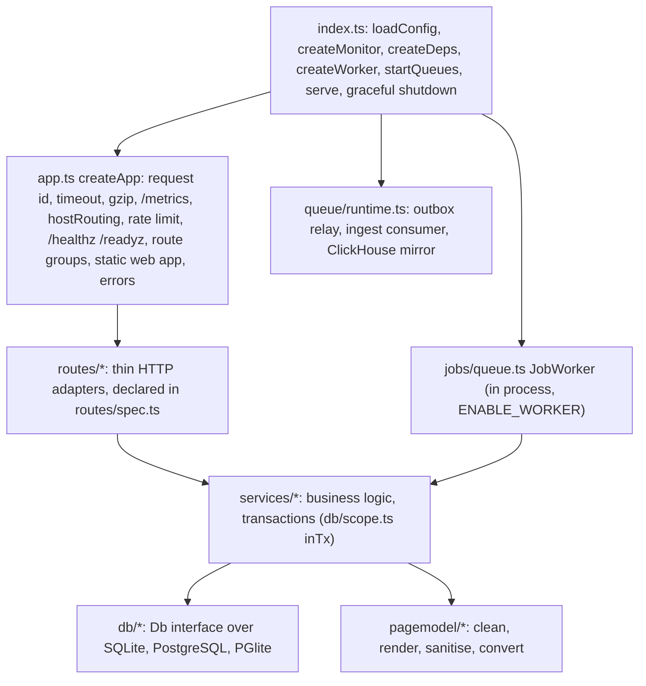
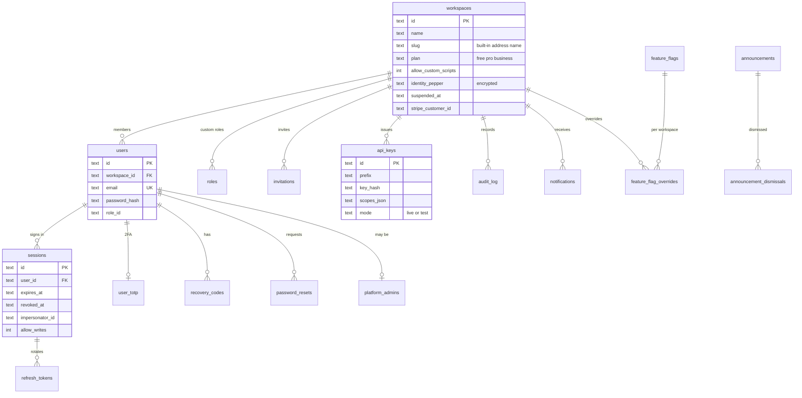
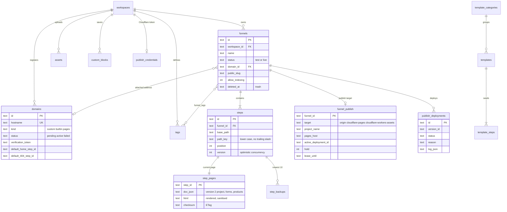
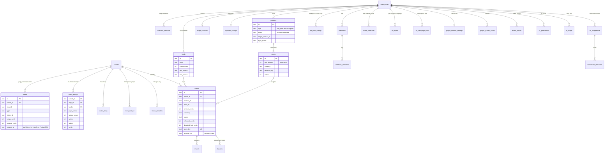

# Functions: server modules, jobs, routes, data model, page model

A map of the code for someone who has to change it: what each server module and service file is for, the background jobs, the HTTP route groups, the tables with their key columns, and the page model with its sanitiser rules. Generated references stay authoritative for detail: [openapi.json](openapi.json) (every route), [RBAC.md](RBAC.md) (permission per route), [RATE-LIMITING.md](RATE-LIMITING.md#policies) (policy per route), [CONFIGURATION.md](CONFIGURATION.md) (every variable). How features behave end to end is in [FEATURES.md](FEATURES.md).

## Process layout

Everything with side effects is injected through `Deps` (`server/src/deps.ts`, wired in `bootstrap.ts`): database, logger, clock, DNS resolver, payment providers (`MockProvider`, optional `StripeClient`), HTTP client and the SSRF-guarded `outbound` fetch, job queue, rate limiter, in-process bus, page cache, request coalescing (`Flights`), event buffer, event bus, mailer, edge purger, domain provider, AI provider, analytics reader, monitor. Tests replace any of them.

## Server modules

| Directory | Files | Responsibility |
|---|---|---|
| `src/` | `index.ts`, `app.ts`, `bootstrap.ts`, `config.ts`, `config.docs.ts`, `deps.ts`, `errors.ts`, `logger.ts`, `metrics.ts`, `beacon.ts`, `seed.ts` | Entry point, app assembly, dependency wiring, validated environment (zod) and its documentation strings, `AppError` and helpers, JSON logger, Prometheus metrics, the tracking beacon source, demo data. |
| `auth/` | `context.ts`, `permissions.ts`, `platform.ts`, `sessions.ts`, `tokens.ts`, `totp.ts`, `password.ts`, `dataCrypto.ts`, `secrets.ts` | `authenticate()` (token, session, suspension, impersonation rules, permission and limiter layers), the permission catalogue and built-in roles, platform-admin checks, sessions and refresh rotation, JWT access/preview/stream tokens, RFC 6238 TOTP, scrypt hashing, AES-256-GCM encryption of stored secrets with key ids. |
| `routes/` | one file per area plus `spec.ts` | HTTP handlers; `spec.ts` is **the** route declaration (method, path, auth, permission, scope, schemas, limiter policies, cost), read by the limiter, the OpenAPI generator and the tests. `serve.ts` serves live pages, built-in addresses, previews and the web app. |
| `services/` | see [below](#services) | Business logic. |
| `repos/` | `funnels.ts`, `sql.ts`, `types.ts` | Row types and shared queries (funnel and step lookups scoped by workspace). |
| `db/` | `index.ts`, `types.ts`, `sqlite.ts`, `pg.ts`, `pghandle.ts`, `pglite.ts`, `replicas.ts`, `dialect.ts`, `migrate.ts`, `scope.ts`, `errors.ts`, `migrations/{sqlite,pg}/NNN_*.sql` | One async `Db` interface over three drivers, dialect helpers (upsert, `ilike`, locks, buckets), read replicas, migrations with an advisory lock, `inTx` (transactions that also hold back cache invalidations and notifications until COMMIT), domain errors for unique and foreign key violations. |
| `pagemodel/` | `doc.ts`, `render.ts`, `convert.ts`, `htmlfilter.ts`, `cssfilter.ts`, `customblocks.ts`, `shared/*` | The page document: cleaning, rendering, sanitising, the legacy converter ([below](#the-page-model-pagemodel)). |
| `blocks/` | `schema.ts`, `defaults.ts`, `safe.ts` | The legacy version-1 block-document schema (still accepted as input and converted) and the form and checkout block types the public endpoints use. |
| `templates/` | `library/*.ts`, `kit.ts`, `seed.ts`, `contrast.ts`, `types.ts` | The 28 built-in templates written in a small page DSL, the versioned seed, a WCAG contrast check used by template and AI validation. |
| `ai/` | `types.ts`, `llm.ts`, `anthropic.ts`, `heuristic.ts`, `service.ts`, `prompts.ts`, `schemas.ts`, `summary.ts`, `buildFunnel.ts`, `builder/*` | `AiProvider` with the Anthropic implementation and the deterministic built-in one; single-call helpers (rewrite, headlines, insights, alt text, legacy funnel generation); the grounded period summary; `builder/` is the multi-stage funnel builder (`brief`, `strategy`, `products`, `copy`, `assemble`, `validate`, `claims`, `redact`, `engine`, `service`) and the assistant's edit operations (`edit`, `ask`), with evals. |
| `ads/` | `pixelConfig.ts`, `snippets.ts`, `runtime.ts`, `touch.ts`, `hash.ts`, `ids.ts`, `providers/{meta,ga4,tiktok}.ts` | Pixel settings schema, generated pixel loaders and the consent runtime, first/last touch logic, hashing of identifiers, the three conversions API payload builders. |
| `analyticsapi/` | `schemas.ts`, `pepperRules.ts` | zod schemas of the v1 API responses (also emitted as JSON Schema) and the identity pepper validation rules. |
| `billing/` | `plans.ts`, `limits.ts` | Plan definitions (limits, application fee) and `assertWithinLimit`. |
| `payments/` | `provider.ts`, `stripe.ts` | The built-in test provider and the Stripe REST client (form encoding, idempotency keys, `Stripe-Account`). |
| `publish/` | `bundle.ts`, `target.ts`, `cfclient.ts`, `cfworkers.ts`, `hash.ts` | Static site bundle for Cloudflare (files, headers, CSP, redirects, version id), the `PublishTarget` interface, Pages Direct Upload and Workers assets clients. |
| `edge/` | `signing.ts`, `purger.ts`, `domainProvider.ts` | HMAC signing of edge calls, Cloudflare cache purge by URL, manual or Cloudflare-for-SaaS custom hostnames. |
| `ratelimit/` | `limiter.ts`, `policies.ts`, `http.ts`, `redis.ts`, `memory.ts`, `scripts.ts`, `math.ts`, `ip.ts`, `subject.ts`, `tiers.ts`, `guarded.ts`, `admin.ts`, `response.ts`, `types.ts` | The layered limiter ([RATE-LIMITING.md](RATE-LIMITING.md)). |
| `queue/` | `eventbus.ts`, `outbox.ts`, `runtime.ts` | Durable event bus (Redis Streams or memory), transactional outbox and its relay, starting the consumers. |
| `store/` | `eventstore.ts`, `clickhouse.ts`, `clickhousereader.ts` | Secondary analytics store interface and the ClickHouse writer and reader. |
| `jobs/` | `queue.ts` | `JobQueue` (enqueue with dedupe and group, fair claim, backoff, dead letters) and `JobWorker`. |
| `monitoring/` | `index.ts`, `scrub.ts` | Optional Sentry: lazy SDK import, allow-list scrubber (also compiled into the web app). |
| `mail/`, `dns/`, `net/` | `mailer.ts`, `resolver.ts`, `ssrf.ts`, `outbound.ts` | Mail transports (none, console, webhook), the DNS resolver, the SSRF guard (blocked ranges, pinned address, no redirects). |
| `util/` | `ids.ts`, `time.ts`, `money.ts`, `csv.ts`, `csvparse.ts`, `hll.ts`, `pagecache.ts`, `refcache.ts`, `flights.ts`, `bus.ts` | Time-sortable ids, date helpers, minor-unit money with currency exponents, CSV writing (formula-injection safe) and parsing, HyperLogLog, the page LRU, request coalescing (in process or through Redis), the in-process notification bus. |
| `scripts/` | `docgen.ts`, `cf-pages-smoke.ts`, `cf-workers-smoke.ts`, `ai-smoke.ts`, `backfill-clickhouse.ts`, `copy-assets.mjs` | Generated docs (`npm run docs:config`, `docs:api`), smoke tests against real services with your own credentials, ClickHouse backfill, build helper. |

## Services

`server/src/services/`, grouped by area. Each exported function takes `deps` first and, for workspace data, the workspace id or the caller's `Auth`.

| Area | File | Function groups |
|---|---|---|
| Accounts | `accounts.ts` | `register`, `login` / `completeLogin` with lockout (`assertNotLockedOut`, `recordFailure`), `me`, `changePassword`, `updateWorkspace`, members (`listMembers`, `changeRole`, `removeMember`). |
| | `twofactor.ts` | `setup`, `enable`, `disable`, `regenerateRecoveryCodes`, `verifyLogin`, `adminReset`. |
| | `invitations.ts`, `recovery.ts`, `roles.ts` | Invitations (create, list, revoke, resend, lookup, accept); password reset (request, reset); custom roles (`permissionCatalogue`, list, `assertCanGrant`, create, update, delete). |
| | `audit.ts`, `suspension.ts`, `flags.ts`, `announcements.ts` | `audit()` and `listAudit`; the cached suspension check; feature flags (`flagEnabled`, `requireFlag`, overrides, rollout); announcements (CRUD, active ones, dismiss). |
| Funnels | `funnels.ts` | `listFunnels` with filters and stats, `listTrash`, `filterCounts`, `getFunnelDetail`, `createFunnel`, `updateFunnel` (status, domain attach with conflict resolution, tags, tracking code, slug, indexing), `duplicateFunnel`, `createFunnelFromSteps` (templates and AI), `softDeleteFunnel`, `restoreFunnel`, `purgeFunnel`, `bulkTag`. |
| | `steps.ts`, `paths.ts`, `pathconflicts.ts`, `tags.ts` | Step create, update, delete, duplicate, reorder, `validatePath`; path rules and suggestions, copy names; cross-funnel path conflicts on a domain; tags. |
| Pages | `pages.ts` | `getPage`, `validateDoc`, `savePage` (optimistic version, backup, render, prune), `listBackups`, `getBackup`, `restoreBackup`, `getPageHtml`, `renderStep` and the `regenerate*` helpers that re-render when addresses, slugs, pixels or the scripts setting change. |
| | `pagemigration.ts`, `assets.ts`, `publicblocks.ts`, `catalogdoc.ts` | One-time conversion of legacy pages at boot; image uploads (`sniffImage`, limits); resolving a stored form or checkout block for the public endpoints; mapping checkout nodes to catalog rows. |
| Templates | `templates.ts`, `templateio.ts`, `catalogbind.ts` | Gallery (`listTemplates`, `listCategories`, `getTemplate`, `templateStepHtml`), `useTemplate`, admin CRUD and categories, custom blocks; JSON import and export with limits; binding template product slots to catalog prices. |
| Domains and addresses | `domains.ts` | `createDomain`, `verifyDomain` and the `verificationJob`, `deleteDomain` and `revertFunnelsOnDomain`, `setDefaultPages`, `domainRoutes`. |
| | `addresses.ts`, `golive.ts` | Slugs (workspace and funnel), the built-in and Pages system domains, `addressOf` and `stepUrls`; `addressOptions` and `goLive`. |
| Publishing | `publishing.ts` | Cloudflare connection (`connect`, `verifyConnection`, `disconnect`), per-funnel settings and `publishState`, `schedulePublish` and `onFunnelChanged`, `buildFunnelBundle`, the jobs `deployJob`, `pollJob`, `domainJob`, `destroyJob`, `redeploy`, `rollback`, `unpublish`, deployment history, `onWorkspaceChanged`. |
| Tracking and analytics | `events.ts`, `eventbuffer.ts`, `rollups.ts` | `recordPublicEvent` (bot and preview filtering, admission), the write-behind `EventBuffer`, `insertEvents` and `adjustRollup`. |
| | `analytics.ts`, `analyticsapi.ts`, `analyticsproducts.ts`, `productanalytics.ts`, `analyticssummary.ts`, `apikeys.ts` | Dashboard analytics; the v1 API (funnels, steps, time series, ads, attribution, exports, funnel structure, pepper get/set/rotate); product analytics and CSV; the grounded summary; API keys (`createKey`, `authenticateKey`, revoke). |
| Leads and orders | `leads.ts`, `orders.ts` | `submitForm` (validate, upsert lead, event, notification, webhook, conversions), lists and CSV streams; `checkout` (test provider or Stripe hosted session), `persistOrders`, lists, CSV, `getOrder`. |
| Payments | `stripepay.ts`, `stripewebhooks.ts`, `disputes.ts`, `billing.ts`, `payments.ts`, `paymentsettings.ts`, `paymentswizard.ts` | Hosted checkout, `finalizeSession`, off-session upsell, `refundOrder`, `syncChargeRefunds`; signature check and dispatch of both Stripe webhooks; dispute state machine and allocation; Connect onboarding, subscriptions and plan overview; payments status with test cards; checkout settings; the Add payments wizard. |
| Catalog | `catalog.ts`, `catalogsync.ts`, `catalogcheckout.ts` | Products and prices (create, update, archive, replace), Stripe mirror and reconciliation, resolving an offer at checkout and the catalog backfill. |
| Ads | `pixels.ts`, `adtags.ts`, `attribution.ts`, `conversions.ts`, `integrations.ts`, `adspend.ts`, `adsreport.ts` | Pixel settings per level and the effective set; tags injected into pages; touches and stamping; enqueue and deliver conversions; integrations with encrypted secrets and test events; spend entry, CSV import and campaign maps; performance and attribution reports and CSV. |
| Reviews | `googlereviews.ts` | Settings with an encrypted key, Places client with cache, quota and circuit breaker, place search, snapshots for rendering, the public endpoint and the `refreshJob`. |
| Webhooks and notifications | `webhooks.ts`, `notifications.ts`, `cors.ts` | Webhook CRUD, `fireWebhookEvent`, `deliverWebhook` (signed, pinned, backoff), retries; `notify` and the feed; the public API CORS allow-list. |
| Platform | `admin.ts`, `gdpr.ts`, `queueadmin.ts`, `maintenance.ts`, `monitoring.ts` | Admin workspace search, suspend, impersonate, delete, admins, platform audit; subject export and erase, workspace export; queue inspector; the maintenance job; monitoring status and test error. |

## Background jobs

Registered in `createWorker` (`server/src/bootstrap.ts`); run by `JobWorker` (`server/src/jobs/queue.ts`). Default `max_attempts` is 5 unless stated.

| Job type | Handler | Queued by | Notes |
|---|---|---|---|
| `webhook.deliver` | `services/webhooks.ts deliverWebhook` | leads, orders, refunds, disputes, test button, daily rollup | `WEBHOOK_MAX_ATTEMPTS` (6), grouped by workspace, delivery row tracks status. |
| `conversion.deliver` | `services/conversions.ts deliverConversion` | form submits and finalized orders | Meta, GA4, TikTok; delivery log. |
| `domain.verify` | `services/domains.ts verificationJob` | domain creation and re-checks | Fails a pending domain after 72 hours. |
| `edge.purge` | `edge/purger.ts purgeJob` | page saves, suspensions | No-op without `CF_API_TOKEN` and `CF_ZONE_ID`. |
| `publish.deploy` | `services/publishing.ts deployJob` | `schedulePublish` (debounced, deduplicated per funnel) | Lease, build, upload, create deployment. |
| `publish.poll` | `pollJob` | `deployJob` | Reschedules itself every `PAGES_POLL_INTERVAL_MS` until success, failure or timeout. |
| `publish.domain` | `domainJob` | custom domain changes on Pages | Polls the project's custom domain status. |
| `publish.destroy` | `destroyJob` | funnel purge, unpublish with delete | Deletes the Cloudflare project. |
| `ai.build` | `ai/builder/service.ts runBuildJob` | `POST /api/ai/builds` | Checkpointed, resumable, cancellable. |
| `reviews.refresh` | `services/googlereviews.ts refreshJob` | rendering pages with review blocks | Refreshes the Places cache and snapshots. |
| `maintenance.run` | `services/maintenance.ts maintenanceJob` | boot and itself | Every `MAINTENANCE_INTERVAL_HOURS`; one pending at a time (dedupe key). |

Besides the job queue, `queue/runtime.ts` starts the **outbox relay** (publishes `outbox_events` to the event bus), the **ingest consumer** (with `INGEST_QUEUE`) and the **ClickHouse mirror** consumer (with a secondary store).

## API route groups

269 operations, all declared in `server/src/routes/spec.ts` (auth level, permission, limiter policies) and generated into [openapi.json](openapi.json). Counts by tag:

| Group (tag) | Auth | Ops | Paths |
|---|---|---|---|
| ops | infra | 3 | `/healthz`, `/readyz`, `/metrics` |
| public | public | 13 | `/api/config`, `/beacon.js`, `/uploads/*`, `/s/*` (built-in addresses), `/preview/*`, `/api/public/events`, `/forms/*`, `/checkout/*`, `/attribution`, `/public/reviews/:token` |
| edge | signed (HMAC) | 2 | `/internal/edge/resolve`, `/internal/edge/events` |
| auth | public 8, user 10 | 18 | `/api/auth/*`: register, login, refresh, 2FA, password, invitations lookup and accept, sessions |
| workspace | user | 16 | `/api/workspace`, `/api/members`, `/api/invitations`, `/api/roles`, `/api/permissions`, `/api/audit` |
| funnels, steps, pages, tags | user | 16, 6, 6, 5 | `/api/funnels/*` (list, filters, trash, CRUD, duplicate, restore, purge, addresses, go-live, preview token, analytics), steps, page document, html, backups, `/api/tags` |
| templates, blocks, assets | user | 5, 3, 3 | `/api/templates/*`, `/api/blocks`, `/api/assets` |
| domains | user | 7 | `/api/domains/*` |
| leads, orders | user | 2, 5 | `/api/leads`, `/api/orders`, refunds, `/api/disputes` |
| products, payments, billing | user (billing also public webhooks) | 12, 3, 9 | `/api/products/*`, `/api/payments/*`, `/api/funnels/:id/payments`, `/api/billing/*`, `/api/stripe/webhook`, `/api/stripe/connect-webhook`, `/api/public/checkout/return` |
| publishing | user | 12 | `/api/publishing/connection`, `/api/funnels/:id/publishing/*` |
| ads, integrations | user | 24, 5 | `/api/pixels`, `/api/funnels/:id/pixels`, `/api/ads/*`, `/api/integrations/*`, `/api/google-reviews/*` |
| analytics | user | 6 | `/api/analytics/products`, `/api/analytics/summary`, funnel and step analytics |
| analytics-api, api-keys | API key 10, user 7 | 17 | `/api/v1/analytics/*`, `/api/v1/api-keys`, identity pepper |
| ai | user | 13 | `/api/ai/*` |
| webhooks, notifications, events, notices | user | 8, 3, 2, 3 | `/api/webhooks/*`, `/api/notifications/*`, `/api/events/ticket` and `/stream`, `/api/announcements`, `/api/workspace/flags` |
| admin | platform | 42 | `/api/admin/*`: workspaces, suspend, impersonate, export, delete, admins, stats, monitoring, queues, flags, announcements, audit, GDPR, templates, rate limits |

Conventions (errors `{error:{code,message,details}}`, pagination, `ETag`, idempotency keys, rate limit headers) are in [API.md](API.md).

## Data model

Every business table has `workspace_id`; ids are app-generated, time-sortable text (`fn_...`, `stp_...`), timestamps ISO-8601 text, booleans 0/1, JSON stored as text, so rows are portable between SQLite and PostgreSQL ([ADR 0011](adr/0011-ids.md)). 28 migrations, same names for both engines (`server/src/db/migrations/{sqlite,pg}`). The diagrams show relationships and the key columns; `*` marks the primary key.

### Workspaces, people and access

### Funnels, pages, domains and publishing

### Analytics, leads, commerce and ads

### Infrastructure tables

`jobs` (type, payload, status, attempts, `run_at`, `dedupe_key`, `group_key` for fair claims), `outbox_events` and `consumed_events` (transactional outbox and consumer idempotency), `stripe_events` (webhook event ids, processed or error), `analytics_daily_ready` (one row per workspace and day announced), `catalog_backfill`, `schema_migrations`. Global, workspace-less tables: `templates`, `template_steps`, `template_categories`, `feature_flags`, `announcements`, `platform_admins`.

## The page model (`@pagemodel`)

`server/src/pagemodel/shared/` is pure TypeScript (imports only `zod`). The server uses it to clean and render, and the web builder imports the same files through the Vite alias `@pagemodel`, so the canvas and the published page come from one implementation.

| File | What it holds |
|---|---|
| `shared/clean.ts` | `cleanProject`: rebuilds every node from allow-lists, `PROJECT_LIMITS` (3,000 nodes, depth 24, 2 MB, 6,000 style rules, 10,000 characters of text, 2,000 per attribute), the component types, derives `forms` and `products`. |
| `shared/props.ts` | zod schemas of the typed component props: `fnAction`, `fnForm`, `fnProduct`, `fnVideo`, `fnCountdown`, `fnProgress`, `fnCode`, `fnReviews`, `fnReviewCta`. |
| `shared/markup.ts` | Markup of dynamic components (form, checkout, video, countdown, progress, reviews, review button) shared by canvas and renderer. |
| `shared/css.ts`, `shared/cssvalues.ts` | Style rules, allowed properties and values, selectors and media text. |
| `shared/build.ts` | A small DSL (`section`, `row`, `col`, `heading`, `button`, `form`, `checkout`, ...) used by templates, the AI builder and the default page. |
| `shared/edit.ts` | The builder assistant's edit-operation schema (shared by server and browser). |
| `doc.ts` | `normalizeDoc` (version 2 or a converted version 1 document, cleaned; code reduced for accounts that may not author scripts), `loadDoc`, `defaultStepDoc`, `remapStepRefs`. |
| `render.ts` | `renderProject`: walks the cleaned project, escapes text and attributes, emits HTML with CSS in a style element, the runtime script, links built from step ids (so the same page renders for a domain, a built-in prefix, a preview or a Pages bundle). |
| `htmlfilter.ts`, `cssfilter.ts` | The sanitisers below. |
| `convert.ts` | Deterministic converter from the legacy block document to a project (same input, same ids, never throws). |
| `customblocks.ts` | Validation of saved custom blocks. |

**Component types.** Structure `fn-section` (widths small 652 px, medium 994 px, wide 1170 px, full; padding; colour theme; alignment), `fn-row` (ratio, gap, vertical alignment, keep on phones), `fn-column` (share of the row), `fn-box`; content `fn-heading`, `fn-text`, `fn-button`, `fn-list`, `fn-divider`, `fn-spacer`, `fn-image` and `image`, `fn-video`; interactive `fn-faq` / `fn-faq-item`, `fn-tabs` / `fn-tab-nav` / `fn-tab-btn` / `fn-tab-panel`, `fn-countdown`, `fn-progress`, `fn-popup` / `fn-popup-dialog`; conversion `fn-form`, `fn-checkout`, `fn-reviews`, `fn-review-cta`; `fn-code` (custom code); and the GrapesJS core types (text, link, table, ...). Which component may go inside which is one table, `web/src/builder/editor/rules.ts` (`canDrop`), used by the canvas, Layers and click-to-insert.

### Sanitiser rules

Layers, in order, for every save: (1) `cleanProject` allow-lists, (2) the renderer escapes text and attribute values, (3) a final `sanitizePageBody` over the whole body, (4) CSS through the postcss filter.

* **`sanitizeUserHtml`** (free-form author markup, e.g. custom code from an account that may not run scripts): common text and layout tags only; no forms, inputs, iframes, scripts, styles, SVG, MathML, objects or embeds (their content is dropped too); global attributes `id`, `class`, `title`, `lang`, `dir`, `role`, `hidden`, `aria-*`, `data-*`, plus `href`/`target`/`rel` on links and `src`/`alt`/`width`/`height`/`loading` on images; schemes `http`, `https`, `mailto`, `tel` (images also `data:` base64 rasters PNG, JPEG, GIF, WebP; SVG data is dropped); no protocol-relative URLs; `target="_blank"` always gets `noopener noreferrer`; 50,000 characters max.
* **`sanitizePageBody`** (last pass over the rendered page): the same plus the markup the renderer itself emits: `form` (action forced to `/api/public/...` of this app, method post), `input` (types text, email, tel, checkbox only), `textarea`, `select`, `option`, `iframe` only from `www.youtube-nocookie.com` and `player.vimeo.com`, `video` only with an `https://...mp4` source; `style` attributes survive only as `width: N%` (the progress bar); no event handlers anywhere.
* **`sanitizeCss`** (page CSS, element CSS, custom code CSS): parsed with postcss and re-serialised from an allow-list of properties and values; selectors limited to a safe character set and 400 characters, no `javascript`, `expression` or `url(` in selectors; `@media` kept with safe media text; `@import` only for Google Fonts; every other at-rule (`@font-face`, `@keyframes`, `@charset`, ...) dropped; `</style` removed; unparsable CSS becomes empty; 20,000 characters max.
* **Scripts.** Custom code JavaScript and tracking code are only published when the workspace allows custom scripts (and code is authored by the Owner); otherwise they are stripped. Pages served from the app's own origin with owner code are sandboxed by CSP ([GO-LIVE.md](GO-LIVE.md#the-built-in-address)).

More: [ARCHITECTURE.md](ARCHITECTURE.md#page-builder), [SECURITY.md](SECURITY.md), [PROVENANCE.md](PROVENANCE.md).

## Web app

`web/src/`: `App.tsx` (routes, lazy chunks), `api/` (fetch client with token refresh, React Query hooks), `auth/` (session context, validation), `pages/` (one file per screen, `settings/` and `growth/` for the Settings sections and Ads), `components/` (Go live, wizards, product editor, template gallery, charts), `builder/` (GrapesJS integration: `editor/` component types, blocks, commands, rules; `panels/` rail and inspector; dialogs; Publish dialog; AI edit application), `ui/` (design system on Radix and Tailwind), `monitoring/` (optional browser Sentry). Screens: [USER-GUIDE.md](USER-GUIDE.md).

## Edge worker

`edge/src/index.ts` (cache, stale-while-revalidate, signed resolve, passthrough of public routes, cookies, queueing of beacons) and `edge/src/ratelimit.ts` (Workers Rate Limiting bindings and a Durable Object GCRA). Configuration in `edge/wrangler.toml`; see [CLOUDFLARE.md](CLOUDFLARE.md).

## Scripts and tooling

| Command | What it does |
|---|---|
| `npm run install:all`, `dev`, `build`, `start`, `test`, `typecheck` (root) | Install every package, run API and Vite, build server and web, start the built server, run server, web and edge tests, typecheck all four packages. |
| `npm run seed` | Demo workspace `demo@example.test` / `demo-password-123` (idempotent; never in production). |
| `npm run docs:config`, `docs:api`, `docs:check` | Regenerate CONFIGURATION.md, the rate-limit and RBAC tables, openapi.json and the analytics JSON Schemas; check every doc rule (links, anchors, index, env vars, generated files, Mermaid, runnable API examples). |
| `npm run check:size` | Web bundle budgets. |
| `npm run e2e`, `e2e:install` | Playwright suite against the built app. |
| `e2e/`: `design:shots`, `design:growth-shots`, `design:shots:ai`, `design:publish-shots`, `design:guide-shots` | Screenshot generators for docs/design. |
| `server/`: `smoke:pages`, `scripts/cf-workers-smoke.ts`, `scripts/ai-smoke.ts` | Checks against real Cloudflare and Anthropic with your own credentials. |
| `bench/`, `loadtest/`, `deploy/k6` | Benchmarks and load tests ([PERFORMANCE.md](PERFORMANCE.md), [SCALING.md](SCALING.md), [CLOUD-LOADTEST.md](CLOUD-LOADTEST.md)). |
