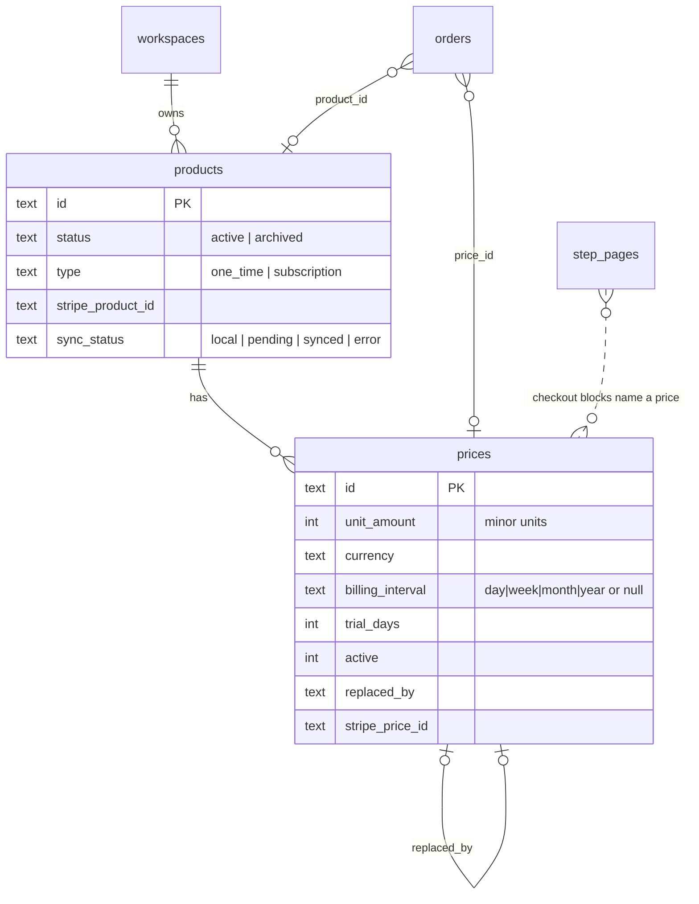

# Product catalog

What a workspace sells, and how checkouts, Stripe, templates and analytics use it. Decision record: [ADR 0024](adr/0024-product-catalog.md). Payments setup (connect, test cards): [STRIPE.md](STRIPE.md). Analytics: [ANALYTICS-API.md](ANALYTICS-API.md#product-analytics).

## Model



Tables `products` and `prices` (migration 021, both dialects), workspace-scoped on every row and query; `orders` gained `product_id`, `price_id`, `quantity`, `discount_cents`, `role` (main, bump, upsell, downsell); `payment_settings` (migration 022); `catalog_backfill` marks workspaces whose pages were scanned once.

## Money

Amounts are integers in minor units with the currency exponent (`server/src/util/money.ts`): 100 per unit for USD, 1 for JPY, 1000 for KWD. API inputs accept `unitAmount` (minor) or `amount` (major, converted with decimal-string arithmetic so 1.005 USD is 1.01, never 1.00). Three-decimal currencies must be multiples of ten (Stripe rounds the last digit); an invalid amount is `400 INVALID_AMOUNT`. Responses carry `unitAmount`, `exponent`, `amount` (major) and `formatted`. Discounts are spread over order lines by largest remainder so the parts add up exactly.

## API

Permissions `products:read` (owner, admin, member, viewer) and `products:write` (owner, admin, member; custom roles can be read-only). Writes are audited (`product.created|updated|archived|restored`, `price.created|replaced|archived`, `catalog.synced`).

| Request | |
|---|---|
| `GET /api/products?status=active|archived|all&search=&page=&limit=` | Products with prices, Stripe sync state, order counts. |
| `POST /api/products` | `{name, description, images[], type, taxCode, metadata, price: {currency, amount, interval, trialDays, nickname}}`. Images are https URLs or `/uploads/...` (existing asset upload). |
| `GET|PATCH /api/products/{id}` | Edit name, description, images, tax code, metadata, default price. |
| `POST /api/products/{id}/archive`, `.../restore` | Soft archive. There is no delete: orders refer to products. |
| `POST /api/products/{id}/prices`, `PATCH .../prices/{pid}` (nickname), `POST .../prices/{pid}/archive` | Add, rename, archive. A product keeps at least one active price. |
| `POST /api/products/{id}/prices/{pid}/replace` | Change an amount: creates the new price, archives the old one (`replaced_by`), moves the default. |
| `POST /api/products/sync`, `POST /api/products/{id}/sync` | Push to Stripe now (`payments.sync` limit). |

```bash
curl -s -X POST $BASE/api/products -H "authorization: Bearer $TOKEN" -H 'content-type: application/json' -d '{"name":"Masterclass","price":{"currency":"USD","amount":97}}'
curl -s -X POST $BASE/api/products/$PRODUCT/prices/$PRICE/replace -H "authorization: Bearer $TOKEN" -H 'content-type: application/json' -d '{"currency":"USD","amount":127}'
```

## Checkout blocks and server authority

A checkout block (`fn-checkout`) names `productId` and `priceId`; its `price`, `currency` and billing text are a display snapshot. The server never reads an amount from the page or the request:

1. **On every page save** (`linkCatalog`, inside the save transaction) a block that names a price of this workspace gets its snapshot refreshed from the catalog (a replaced price is followed to its successor). A block that names nothing, or an id of another workspace, is matched to an equal active product (same name, currency, amount, billing) or gets a new one. A forged id never links another tenant's product.
2. **At checkout** (`resolveOffer`) the amount is resolved from the catalog price again, following `replaced_by`. An archived product, or a price that is gone, answers `409 PRODUCT_UNAVAILABLE` ("This product is no longer available") while the page keeps rendering. Quantity must satisfy the block's `quantity` range (`400 INVALID_QUANTITY`); bumps and upsells are always one. Orders record `product_id`, `price_id`, `quantity`, `role`.
3. **Mixed baskets**: different currencies are refused (`MIXED_CURRENCY`); subscriptions with different intervals (`MIXED_INTERVAL`); a subscription cannot be a one-click upsell (`SUBSCRIPTION_UPSELL_UNSUPPORTED`).
4. **Price changed mid-checkout**: a session already created keeps the amounts stored with it, and the order records the old price; the next visitor pays the new one.

Legacy pages (saved before the catalog) are priced from their block fields until the boot backfill (`backfillCatalog`, once per workspace, marker table) links every checkout block to a catalog product and every order to a product by name.

Offer options per block: `quantity` {enabled, min, max, default}, `allowPromotionCodes` (Stripe shows the code field; the discount is allocated over the lines and recorded as `discount_cents`, `amount_cents` is what was paid), roles (main, bump, upsell, downsell) and `acceptStepId` / `declineStepId` for one-click offers (accept can skip a downsell).

Subscriptions: any recurring price makes the Checkout Session `mode=subscription` (one-time lines ride on the first invoice; the application fee becomes `application_fee_percent`). A free trial records orders of amount 0. Only the first purchase creates an order: renewals are not recorded (known limitation). Refunding an order that started a subscription without a payment answers `409 REFUND_IN_STRIPE`.

## Stripe sync

When a workspace has a connected account and the server has a key, every catalog write pushes the product and its prices to the connected account (`Stripe-Account` header). Without a connection nothing is attempted and the API reports `syncState: "not_connected"`; the catalog and checkouts work regardless.

- Product `POST /v1/products` (idempotency key `prd:<id>:<account>`) or update; prices `POST /v1/prices` (key `prc:<id>:<account>`). Prices are immutable in Stripe as here: a replaced price is archived (`active=false`), never edited. Archive and restore propagate `active`; the default price is set on the product. Metadata carries `funnels_workspace_id`, `funnels_product_id`, `funnels_price_id`.
- Checkout uses the synced Stripe price (`line_items[].price`) when its account is the connected one, otherwise inline `price_data`, so an unsynced product still sells.
- A Stripe failure never fails a catalog change: the product is saved with `syncState: "error"` and the message; `POST .../sync` retries. Connecting a different account resets the stored Stripe ids.
- **Reconcile** from the Connect webhook: `product.updated` (name, description, active), `product.deleted` (archive locally, forget ids), `price.updated|deleted` (archive). Echoes of our own pushes are no-ops. Unknown objects and events of another account change nothing.

UNVERIFIED against the real Stripe API: all of the above runs against an in-process fake modelled on the documentation (`server/test/support/fakestripe.ts`). Run it in test mode before relying on it.

## Templates and the wizard

`POST /api/templates/{id}/use` binds the template's product slots (existing price or created from defaults; equal products are reused). `POST /api/funnels/{id}/payments` ("Add payments to this funnel", also in the builder's top bar and the Steps tab) builds a checkout: product (existing or new), layout one-step or offer plus checkout, order bump, one-click upsell and downsell, thank-you step, wired in order; needs `funnels:write` and `products:write`; refused requests leave the funnel untouched.

## UI

Products page (`/products`): catalog table with search and status filter, create and edit drawer with prices (add, change, archive), image upload, Stripe state and sync, archive; a Performance tab with product analytics. Builder: the Checkout settings choose a product and price (or create one inline), roles, quantity, promotion codes and success steps. Settings, Payments: connection state, mode banner, test cards, checkout settings.

## Edge cases covered by tests (`server/test/products.test.ts`, `payments.test.ts`)

Archived product in a live page; currency mismatch in one order; price changed mid-checkout; subscription and one-time mixes; zero-decimal and three-decimal currencies; deleting is impossible (archive only, orders keep their link); tenant isolation of products, prices, template bindings and forged page links; Stripe down; account switched; webhook reconciliation; backfill idempotency; promotion-code allocation; total mismatch refused.
