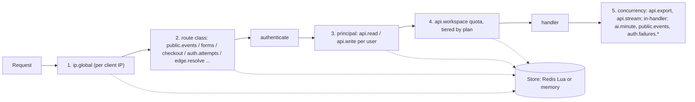

# Rate limiting

One layered limiter, correct across processes and nodes, cheap on the hot path, observable, and safe when its store fails. Code: `server/src/ratelimit/`. Route-to-policy binding: `server/src/routes/spec.ts`. Edge layer: `edge/src/ratelimit.ts`.



Layers run cheapest first and the first refusal short-circuits. Layers 3 and 4 run right after authentication (inside `authenticate()`), because they need the caller; policies that need the request body or a model call (`public.events` keyed by the body's funnel id, `ai.minute`, `auth.failures.*`) run in the handler/service and are listed under `inHandler` in the route declaration.

## The route declaration

`server/src/routes/spec.ts` has one row per HTTP operation: method, path, auth level (`public|user|admin|owner|platform|edge|infra`), request schemas, and the limiter policy ids. The same table generates `docs/openapi.json`. Tests fail when:

* a registered route has no row, or a row has no route;
* a row has no limiter policy (probes `/healthz`, `/readyz`, `/metrics` are exempt with a written reason);
* a row names a policy that does not exist, or a policy is used by no route (two are reserved on purpose: `public.page` is applied in host routing, `webhook.inbound` is reserved for Stripe);
* an authenticated route lacks a per-user and a per-workspace layer;
* a route declared authenticated answers without a token, or a role-gated route answers a lower role.

To add a limit: add the policy to `ratelimit/policies.ts`, name it in the route's row, run `npm run docs:config` (regenerates the table below).

## Algorithms

* **GCRA** (generic cell rate algorithm), the default for per-second/minute limits. One number per key, the theoretical arrival time. A request of cost `c` is allowed when `max(tat, now) + c * T - now <= T * capacity` (`T` = window / limit, capacity = burst). Denied calls change nothing, so hammering does not postpone recovery. `Retry-After` is exactly `new_tat - now - tau`: a client that waits it is admitted (tested to the millisecond). Memory: one key per client, TTL = time to refill + 1 s.
* **Sliding-window counter** for long quotas (hour/day: failed logins). Two adjacent fixed windows, the previous one weighted by its remaining overlap. It never admits more than `limit` in one fixed window and (adversarially, bursts clustered at a window edge) at most `2 x limit` in any sliding window; both are property-tested. `mode: check` asks whether the budget is spent without charging (used before password work).
* **Concurrency limiter**: a sorted set of lease ids with expiry scores; acquire fails at `max`, release removes the id in `finally` (or when a stream ends or is cancelled), and an abandoned lease frees itself after `leaseTtlMs`.
* **Cost-weighted**: every policy call takes a cost (exports 5 against the workspace quota, AI calls 10 units against `ai.minute`, a page save 2, a funnel duplicate 3). A cost above the bucket size is refused forever (waiting never helps), not queued.
* **Penalty box**: on `auth.attempts`, `public.forms`, `public.checkout`, five refusals within 10 minutes block the client for 1 minute, then 5, 30 minutes, and 24 hours (cap). A level is forgotten 24 hours after its block ends. While blocked every policy of that client answers 429 with the remaining block as `Retry-After`. Manual deny/allow lists (with TTL) sit in front: deny wins over allow, allow bypasses every IP-keyed policy of that address.
* **Float tolerance**: epoch milliseconds are doubles with about 0.25 microsecond resolution and GCRA accumulates one rounding per call, so comparisons allow 0.05 ms. Without it the last token of a burst was refused after a few dozen calls (found by a test; it is why `EPS` exists in `ratelimit/math.ts` and the Lua).

## Storage

**Redis** (`REDIS_URL`): each decision is one `EVALSHA` of one Lua script, so check-and-update is atomic for any number of processes. The scripts (`ratelimit/scripts.ts`) check manual lists and the penalty box first, then run the algorithm, then record violations, all in the same call. Details:

* time comes from Redis `TIME` (clock skew between nodes is irrelevant; tested with a process whose clock is an hour off);
* all keys of one decision share a `{subject}` hash tag, so the scripts are Redis Cluster safe; admin keys live under `{admin}`;
* every key has a TTL (tested: nothing is left behind after expiry);
* scripts are preloaded at boot; `NOSCRIPT` (after `SCRIPT FLUSH`, a restart, or a failover to a replica) reloads transparently;
* keys are namespaced `REDIS_KEY_PREFIX:rl:{subject}:...`; IPs are readable (an operator must be able to block one), every other identifier is a 16-hex-digit hash, so no email, user id, API key or visitor id is in Redis, logs or metrics; subjects are length-bounded.

**In-memory** (no `REDIS_URL`): same interface and arithmetic (a test replays random call sequences against both and demands identical answers, including penalty escalation), bounded LRU (100,000 keys) with lazy expiry and a periodic sweep. It is per process: with several replicas and no Redis each enforces its own limit.

**Local lease tier** (`RATELIMIT_LEASE_FRACTION`, default 0.1; 0 disables): for policies marked `lease` (never the penalty/auth ones) a process pre-pays a batch of tokens (10% of the burst) from Redis in one call and spends them locally; concurrent requests for one key share one refill (single flight); a refusal is remembered until its `Retry-After`, so a client that keeps hammering costs one Redis call per `Retry-After`, not one per request. Error bound: tokens are charged to Redis when leased, so the cluster **never admits more than limit + burst**; the price is the other direction: an idle process strands up to `lease` tokens until its lease expires (`batch x emission`, at most 5 s), so with N processes a key can be refused up to `N x lease` tokens early (tested with 3 processes). Manual lists and the penalty box are not consulted inside a lease window (at most 5 s); policies that need them (auth, forms, checkout) never lease.

## Failure policy

Every Redis call has a budget (`REDIS_TIMEOUT_MS`, default 25 ms) and sits behind a circuit breaker (5 consecutive failures open it for 2 s; then one probe). While open, calls fail immediately, so an outage adds no latency.

| policy `onFail` | when the store fails | policies |
|---|---|---|
| `open` | admit, count `outcome="fail_open"`, log | ip.global, public.events, public.page, public.preview, api.*, ai.minute, ai.daily, edge.resolve, webhook.inbound |
| `local` | decide with this process's own in-memory store (same arithmetic, `outcome="fallback"` counted), so a flood is still refused; across N processes the effective limit is N x | ingest.workspace |
| `closed` | answer `503 RATE_LIMITER_UNAVAILABLE` with `Retry-After` | public.forms, public.checkout, auth.*, admin.platform |

Fail-open means a Redis outage removes protection (flood protection falls back to the edge layer and Cloudflare WAF); fail-closed means a Redis outage stops sign-ups, logins and form posts. That trade is deliberate: spam floods and credential stuffing are worse than a short outage of those four endpoints. Change it per policy in `policies.ts`.

## HTTP contract

Every response from a limited route carries, for the tightest layer of the request (lowest remaining / capacity), `RateLimit-Policy: "api.workspace";q=600;w=60`, `RateLimit: "api.workspace";r=187;t=12` (draft-ietf-httpapi-ratelimit-headers) and `X-RateLimit-Limit/Remaining/Reset`. A refusal adds `Retry-After` (integer seconds, the GCRA/window computation rounded up) and the body

```json
{ "error": { "code": "RATE_LIMITED", "message": "Too many requests. Slow down and retry later.", "retry_after_s": 7, "policy": "public.forms" } }
```

Concurrency and overload refusals are `503` with `code: "OVERLOADED"` and `Retry-After`; an unavailable fail-closed limiter is `503 RATE_LIMITER_UNAVAILABLE`. Nothing in a response reveals another tenant's state. A repeated `Idempotency-Key` header on a policy marked `idempotent` (writes, forms, checkout) is counted once for the policy window (minimum 60 s).

## Client address

Used for every IP-keyed policy (`ratelimit/ip.ts`, tested with a spoofing matrix):

1. `CF-Connecting-IP` is believed only if the request carries `x-cf-origin-secret` equal to `CF_ORIGIN_SECRET` (constant-time compare) or the TCP peer is inside Cloudflare's published ranges (`TRUST_CLOUDFLARE_RANGES`, default on; override the list with `CF_IP_RANGES`; the built-in list must be reviewed when Cloudflare changes it).
2. Else, with `TRUST_PROXY=true`, `X-Forwarded-For` counting `TRUSTED_PROXY_HOPS` entries from the right (the left side is client-controlled). **Change from before:** the old code used the leftmost entry, which any client can forge.
3. Else the TCP peer address.

IPv6 clients are keyed by their /64; IPv4-mapped addresses are unwrapped.

## Plans and overrides

`workspaces.plan` (`free|pro|business`, migration 005) multiplies the workspace quota (`api.workspace`, `ai.minute`: x1, x5, x20) and the export concurrency cap (x1, x2, x4 of 2). `workspaces.rate_override` holds a per-workspace multiplier. Plans are read through a 30 s cache, so a change reaches every node within 30 s.

## Operator hooks

`RateLimitAdmin` (`ratelimit/admin.ts`) and `/api/admin/rate-limits*` (platform admins, `PLATFORM_ADMIN_EMAILS`): list recently limited subjects (one record per subject and policy per second, newest 1000), list active block/allow entries, block or allow an `ip`, `workspace` or `user` with a TTL, lift a block (which also clears its penalty level), set a workspace's plan or multiplier. Every change is a row in `audit_log` and a log line. There is no admin UI yet; these are the calls it will make.

## Observability

Prometheus (`/metrics`): `funnels_ratelimit_decisions_total{policy,outcome}` (outcomes: allowed, limited, blocked, denied, bypassed, shed, error, fail_open, replayed, and `fallback`, an extra count next to the allowed/limited one when a `local` policy decided on the process's own store), `funnels_ratelimit_store_seconds{ok}` (Redis call latency), `funnels_ratelimit_lease_total{policy,result}` (hit, refill, direct), `funnels_ratelimit_breaker_state` (0 closed, 1 half-open, 2 open), `funnels_ratelimit_penalty_box` (in-memory store only; with Redis watch `outcome="blocked"`). Labels are policy ids and a fixed outcome set only. One in 20 limited decisions is logged with the policy id, never a key or address.

Alerts worth setting: `rate(funnels_ratelimit_decisions_total{outcome="fail_open"}[5m]) > 0` (Redis trouble, protection off), `funnels_ratelimit_breaker_state > 0`, `outcome="error"` (fail-closed endpoints refusing), and a sudden rise of `limited` for `auth.attempts`.

## Edge layer (Cloudflare)

The Worker refuses floods before they reach the origin (`edge/src/ratelimit.ts`): the Workers Rate Limiting binding (`RL_EVENTS`, `RL_FORMS`) per client IP for `POST /api/public/events` and forms/checkout, and an optional Durable Object GCRA (`RL_DO`) for exact worldwide counts on forms/checkout. Refusals use the same 429 body and `Retry-After`. Both fail open; the origin limiter stays authoritative. WAF rules and a Terraform snippet are in `docs/CLOUDFLARE.md` and `deploy/cloudflare/waf.tf`.

## Policies

<!-- policies:start -->
Defaults, before environment overrides and plan multipliers (this table is generated by `npm run docs:config`).

| Policy | Layer | Key | Algorithm | Limit | On store failure | Tiers | Options | Purpose |
|---|---|---|---|---|---|---|---|---|
| `ip.global` | ip | ip | gcra | 1200 / 1 min, burst 300 | open |  | lease | Per client IP, every request. A coarse guard against floods; generous on purpose because many people share an IP. |
| `public.events` | class | composite(ip+scope) | gcra | 120 / 1 min, burst 120 | open |  | lease | Public beacon events, per IP and funnel. |
| `public.forms` | class | composite(ip+scope) | gcra | 20 / 1 min, burst 20 | closed |  | penalty box, idempotency key | Public form posts, per IP and funnel. Fails closed so a limiter outage cannot become a spam flood. |
| `public.checkout` | class | composite(ip+scope) | gcra | 20 / 1 min, burst 20 | closed |  | penalty box, idempotency key | Public checkout posts, per IP and funnel. Fails closed. |
| `public.page` | class | ip | gcra | 6000 / 1 min, burst 1500 | open |  | lease | Pages served straight from the origin on a customer domain, per IP (the edge cache absorbs real traffic). |
| `public.preview` | class | ip | gcra | 300 / 1 min, burst 100 | open |  | lease | Signed previews, per IP. |
| `auth.attempts` | class | ip | gcra | 10 / 1 min, burst 10 | closed |  | penalty box | Register and login requests, per IP. Fails closed, with a penalty box. |
| `auth.refresh` | class | ip | gcra | 600 / 1 min, burst 60 | open |  | lease | Refresh-token exchanges, per IP. The token itself is the credential (256 bits), so this only bounds load; generous because offices share an address. |
| `auth.reset` | class | ip | gcra | 10 / 1 min, burst 5 | closed |  | penalty box | Password reset requests and redemptions, per IP. Fails closed, with a penalty box. |
| `auth.reset.email` | principal | composite(scope) | window | 3 / 1 h | closed |  |  | Reset mails per address (hashed): 3 per hour, so nobody can mail-bomb an inbox. Over budget the request still answers the same, silently. |
| `auth.failures.account` | principal | composite(scope) | window | 8 / 15 min | closed |  |  | Failed logins per account (hashed email): lockout after 8 failures in 15 minutes. |
| `auth.failures.ip` | principal | ip | window | 30 / 15 min | closed |  |  | Failed logins per IP: lockout after 30 failures in 15 minutes. |
| `api.read` | principal | user | gcra | 600 / 1 min, burst 200 | open |  | lease | Authenticated reads, per user. |
| `api.write` | principal | user | gcra | 300 / 1 min, burst 100 | open |  | idempotency key | Authenticated writes, per user. A repeated Idempotency-Key is not counted twice. |
| `api.workspace` | workspace | workspace | gcra | 600 / 1 min, burst 200 | open | free x1, pro x5, business x20 | lease | Workspace quota across all its users, tiered by plan (free x1, pro x5, business x20, overridable per workspace). |
| `api.export` | concurrency | workspace | concurrency | 2 in flight | open | free x1, pro x2, business x4 |  | Concurrent CSV exports per workspace (in-flight cap, lease with TTL, released in finally). |
| `api.stream` | concurrency | user | concurrency | 5 in flight | open |  |  | Open SSE streams per user. |
| `ingest.workspace` | workspace | workspace | gcra | 600000 / 1 min, burst 10000 | local | free x1, pro x5, business x20 | lease | Public events per workspace (noisy-neighbour guard, checked before an event is queued). GCRA with a one-second burst, scaled by plan tier; a refusal affects only that workspace. |
| `ai.minute` | workspace | workspace | gcra | 100 / 1 min, burst 100, cost 10 | open | free x1, pro x5, business x20 |  | AI calls per workspace per minute; each call costs 10 units. The daily cap is `ai.daily`; ai_usage only meters. |
| `ai.daily` | workspace | workspace | window | 50 / 24 h | open | free x1, pro x5, business x20 |  | AI calls per workspace per day (sliding window over two adjacent UTC days, AI_DAILY_CAP, scaled by plan tier). Refusals answer AI_DAILY_CAP_REACHED. A cap of 0 disables AI. |
| `edge.resolve` | class | ip | gcra | 120000 / 1 min, burst 12000 | open |  | lease | Signed requests from the Cloudflare worker (all traffic arrives from few IPs, so the limit is high). |
| `admin.platform` | principal | user | gcra | 120 / 1 min, burst 30 | closed |  |  | Platform admin routes, per user. |
| `webhook.inbound` | class | ip | gcra | 6000 / 1 min, burst 1000 | open |  | lease | Reserved for inbound provider webhooks (Stripe, later). High limit, fails open so a limiter outage never drops payment events. |
<!-- policies:end -->

## Tuning

* Behind a CDN or load balancer set `TRUST_PROXY=true` and `TRUSTED_PROXY_HOPS` to the number of proxies you own; otherwise every visitor shares the proxy's address and `ip.global` will throttle everyone.
* Raise `PUBLIC_EVENTS_PER_MINUTE` / `PUBLIC_FORMS_PER_MINUTE` for offices and schools behind one IP; they are per IP **and funnel**.
* With several replicas always set `REDIS_URL`; without it each replica enforces its own limits and the effective limit is N times higher.
* Keep `REDIS_TIMEOUT_MS` under your p99 request budget; lower values fail open (or closed) sooner during Redis slowness.
* Load tests from one IP need the limits raised (`loadtest/run.mjs` and `bench/ingest.mjs` set them), otherwise you measure the limiter.

## Not done

Socket.IO limits (the app has no sockets; SSE is capped by `api.stream`), per-API-key limits (the policy model supports `apiKey`; no API keys exist yet), event-loop-lag load shedding, Redis Cluster verification (keys and scripts are written for it; only a single Redis was available here), Redis Sentinel/failover testing.

## Noisy neighbours (per-workspace fairness)

`ingest.workspace` caps one workspace's public events (default 600,000 per minute on the free plan, burst one second, pro x5, business x20, overridable per workspace), checked before an event is queued, so a flooding tenant is answered 429 with `Retry-After` and costs nobody else anything. It is the one policy with `onFail: local`: measured on this repository's stack, a Redis that is slow under load (calls over `REDIS_TIMEOUT_MS`, breaker open) made a fail-open version admit 1,026 requests where 110 were allowed; with `local` the quota still holds per process. The queue, the outbox relay and the job claim are fair per workspace as well, see [SCALING.md](SCALING.md#per-workspace-fairness).
