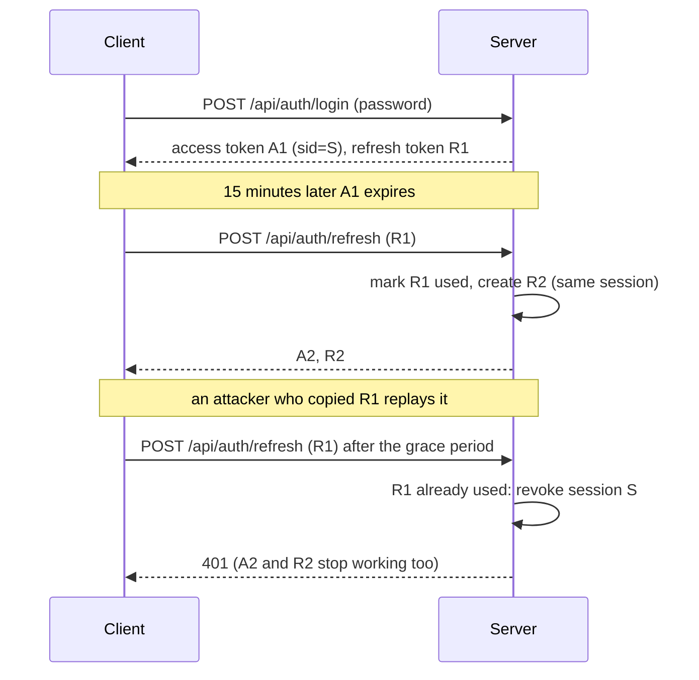

# Access control: roles, permissions, sessions, 2FA

Who may do what in a workspace, how people sign in and stay signed in, and how every security-relevant action is recorded. Code: `server/src/auth/` (permissions, sessions, tokens, TOTP, secrets), `server/src/services/` (`accounts`, `roles`, `invitations`, `recovery`, `twofactor`, `audit`), routes in `server/src/routes/auth.ts` and `team.ts`. Decision record: [ADR 0018](adr/0018-rbac-sessions-2fa.md).

## The model

* **Permission-based.** A permission is a string such as `funnels:write`. A **role** is a named set of permissions; a user has exactly one role in their workspace.
* **Four built-in roles** (owner, admin, member, viewer) live in code, not in the database, so they cannot be edited, drift between deployments, or be deleted. **Custom roles** are per workspace (`roles` table), up to 50.
* **One place decides.** Every authenticated route in `server/src/routes/spec.ts` names the single permission it needs (`any` = every signed-in member). `authenticate()` enforces it before the handler runs, so a route cannot be added without an authorization decision. Tests fail for a route without one, for a permission no route uses, for a new `any` route that is not on the pinned list, and run a generated matrix that proves every route refuses a role holding every permission **except** the one it needs and admits a role holding **only** that one (`test/rbac.policy.test.ts`).
* **Always fresh.** The user, role and session are loaded on every request, so a role edit, a member removal or a revoked session applies on the very next request. Nothing about authorization lives in the token.
* **Tenancy is separate.** Permissions say what you may do; `workspace_id` scoping (404 for other workspaces' ids) is unchanged and still applied in the data layer.

### Built-in roles and permissions

<!-- permissions:start -->
Generated by `npm run docs:config` from `server/src/auth/permissions.ts`.

| Permission | Allows | Owner | Admin | Member | Viewer |
|---|---|---|---|---|---|
| `funnels:read` | View funnels, steps, pages, history, previews and templates | yes | yes | yes | yes |
| `funnels:write` | Create and edit funnels, steps and pages; use templates; duplicate; restore page versions | yes | yes | yes |  |
| `funnels:delete` | Move funnels to the trash and restore them | yes | yes |  |  |
| `funnels:purge` | Permanently delete a trashed funnel | yes |  |  |  |
| `funnels:tracking` | Edit custom header/footer tracking code on funnels and steps | yes | yes |  |  |
| `tags:manage` | Create, rename and delete tags | yes | yes | yes |  |
| `blocks:manage` | Save and delete custom blocks | yes | yes | yes |  |
| `leads:read` | View leads | yes | yes | yes | yes |
| `leads:export` | Export leads as CSV | yes | yes | yes |  |
| `orders:read` | View orders | yes | yes | yes | yes |
| `orders:export` | Export orders as CSV | yes | yes | yes |  |
| `analytics:read` | View funnel and step analytics | yes | yes | yes | yes |
| `ai:use` | Use the AI assistant | yes | yes | yes |  |
| `domains:read` | View domains and DNS instructions | yes | yes | yes | yes |
| `domains:manage` | Add, verify, configure and delete domains | yes | yes |  |  |
| `webhooks:manage` | Manage webhooks and their delivery log | yes | yes |  |  |
| `members:read` | View members, invitations and roles | yes | yes | yes | yes |
| `members:manage` | Invite, remove and change the role of members | yes |  |  |  |
| `roles:manage` | Create, edit and delete custom roles | yes |  |  |  |
| `workspace:manage` | Rename the workspace and change workspace-wide settings | yes |  |  |  |
| `audit:read` | View the audit log | yes | yes |  |  |
| `api_keys:manage` | Create and revoke API keys | yes | yes |  |  |
| `analytics_identity:manage` | View and rotate the workspace identity pepper used by analytics exports | yes |  |  |  |
| `billing:read` | View the plan, usage and invoices | yes | yes |  |  |
| `billing:manage` | Change the plan, payment method and Stripe connection | yes |  |  |  |
<!-- permissions:end -->

`funnels:tracking` is enforced inside the funnel and step services (it depends on which fields a request changes), not on a route. `api_keys:manage`, `analytics_identity:manage`, `billing:read` and `billing:manage` are reserved: their features are not built yet, and the policy test lists them as reserved so the list only ever shrinks.

### Rules that stop privilege escalation

1. **You can only grant what you hold.** Creating or editing a custom role, inviting someone, or changing a member's role requires that you hold every permission of the role involved. A holder of `roles:manage` cannot mint themselves an admin-equivalent role; a holder of `members:manage` cannot promote anyone above themselves.
2. **You cannot act on someone who holds more than you.** Editing or deleting a role, changing or removing a member, and resetting someone's 2FA all require holding everything the target's role holds (so nobody below an owner can demote, remove or reset an owner).
3. **A workspace always has an owner.** The last owner cannot be demoted or removed. A workspace can have several owners.
4. **Built-in roles are immutable**, custom role names are unique (case-insensitive) and cannot reuse a built-in name, and a role that members or pending invitations still use cannot be deleted.
5. **Nothing crosses workspaces:** a role, invitation, session or audit row of another workspace is a 404 (or simply absent from lists).

### Which route needs which permission

<!-- routes:start -->
Generated from `server/src/routes/spec.ts`.

| Permission | Routes |
|---|---|
| any signed-in member | `GET /api/auth/me` `POST /api/auth/logout` `GET /api/auth/sessions` `DELETE /api/auth/sessions/:id` `POST /api/auth/sessions/revoke-others` `POST /api/auth/password` `POST /api/auth/2fa/setup` `POST /api/auth/2fa/enable` `POST /api/auth/2fa/disable` `POST /api/auth/2fa/recovery-codes` `POST /api/events/ticket` `GET /api/events/stream` `GET /api/workspace` `GET /api/permissions` `GET /api/notifications` `POST /api/notifications/read-all` `POST /api/notifications/:id/read` |
| `ai:use` | `GET /api/ai/status` `POST /api/ai/funnel` `POST /api/ai/rewrite` `POST /api/ai/headlines` `POST /api/ai/insights` `POST /api/ai/alt-text` |
| `analytics:read` | `GET /api/funnels/:id/analytics` `GET /api/funnels/:id/steps/:sid/analytics` |
| `audit:read` | `GET /api/audit` |
| `blocks:manage` | `POST /api/blocks` `DELETE /api/blocks/:id` |
| `domains:manage` | `POST /api/domains` `POST /api/domains/:id/verify` `PUT /api/domains/:id/default-pages` `DELETE /api/domains/:id` |
| `domains:read` | `GET /api/domains` `GET /api/domains/:id` `GET /api/domains/:id/routes` |
| `funnels:delete` | `DELETE /api/funnels/:id` `POST /api/funnels/:id/restore` |
| `funnels:purge` | `DELETE /api/funnels/:id/purge` |
| `funnels:read` | `GET /api/funnels` `GET /api/funnels/filters` `GET /api/funnels/trash` `GET /api/funnels/:id` `POST /api/funnels/:id/preview-token` `GET /api/funnels/:id/steps` `GET /api/funnels/:id/steps/:sid/page` `GET /api/funnels/:id/steps/:sid/backups` `GET /api/funnels/:id/steps/:sid/backups/:bid` `GET /api/tags` `GET /api/templates` `GET /api/templates/categories` `GET /api/templates/:id` `GET /api/blocks` |
| `funnels:write` | `POST /api/funnels` `POST /api/funnels/validate-path` `POST /api/funnels/bulk-tag` `PATCH /api/funnels/:id` `PUT /api/funnels/:id` `POST /api/funnels/:id/duplicate` `POST /api/funnels/:id/steps` `PUT /api/funnels/:id/steps/order` `PATCH /api/funnels/:id/steps/:sid` `DELETE /api/funnels/:id/steps/:sid` `POST /api/funnels/:id/steps/:sid/duplicate` `PUT /api/funnels/:id/steps/:sid/page` `POST /api/funnels/:id/steps/:sid/backups/:bid/restore` `POST /api/templates/:id/use` |
| `leads:export` | `GET /api/leads/export` |
| `leads:read` | `GET /api/leads` |
| `members:manage` | `PATCH /api/members/:id` `POST /api/members/:id/reset-2fa` `POST /api/invitations` `POST /api/invitations/:id/resend` `DELETE /api/invitations/:id` `DELETE /api/members/:id` |
| `members:read` | `GET /api/members` `GET /api/invitations` `GET /api/roles` |
| `orders:export` | `GET /api/orders/export` |
| `orders:read` | `GET /api/orders` `GET /api/orders/:id` |
| `roles:manage` | `POST /api/roles` `PATCH /api/roles/:id` `DELETE /api/roles/:id` |
| `tags:manage` | `POST /api/tags` `PUT /api/tags/:id` `DELETE /api/tags/:id` `DELETE /api/tags` |
| `webhooks:manage` | `GET /api/webhooks` `POST /api/webhooks` `PATCH /api/webhooks/:id` `DELETE /api/webhooks/:id` `POST /api/webhooks/:id/rotate-secret` `POST /api/webhooks/:id/test` `GET /api/webhooks/:id/deliveries` `POST /api/webhooks/deliveries/:did/retry` |
| `workspace:manage` | `PATCH /api/workspace` |
<!-- routes:end -->

Platform operator routes (`/api/admin/*`: global templates, rate-limit blocks, plan overrides) are separate: they require the caller's email to be in `PLATFORM_ADMIN_EMAILS`, not a workspace permission.

## Sessions and refresh-token rotation

A login creates a **session** (a row: device, IP, created, last used, expiry) and returns a short **access token** (JWT, `ACCESS_TOKEN_TTL_SECONDS`, default 15 minutes, carrying the session id) and an opaque **refresh token** (`rt_...`, only its SHA-256 is stored). The web app renews the access token with the refresh token before it expires.

* **Rotation and theft detection.** Every refresh marks the presented token used and issues the next. Presenting a used token again means two parties hold it, so the **whole session is revoked** (audit event `session.refresh_reuse_detected`) and the user signs in again.
* **Two tabs are not theft.** A used token presented again within `REFRESH_REUSE_GRACE_SECONDS` (10) is a race: `401 REFRESH_RACE`, session kept; the client retries with the token the other tab stored. The claim is atomic (`UPDATE ... WHERE used_at IS NULL`), so of two simultaneous requests exactly one wins.
* **Lifetimes.** A refresh token is valid `REFRESH_TOKEN_TTL_DAYS` (30) from issue and never beyond the session's absolute `SESSION_MAX_DAYS` (90) expiry, however active the user is.
* **Revocation is immediate.** Logout, "sign out of other sessions", changing the password, resetting the password, turning 2FA off, an admin resetting 2FA and removing a member all revoke sessions; because the access token carries the session id and the session is checked on every request, revoked access tokens stop working at once instead of at expiry. Stream tickets (SSE) are bound to the session too.
* Endpoints: `POST /api/auth/refresh`, `POST /api/auth/logout`, `GET /api/auth/sessions`, `DELETE /api/auth/sessions/{id}`, `POST /api/auth/sessions/revoke-others`.

## Two-factor authentication (TOTP)

RFC 6238 (HMAC-SHA-1, 6 digits, 30 s, one step of drift allowed), the profile every authenticator app uses. Verified against the RFC 6238 and RFC 4226 test vectors (`test/twofactor.test.ts`).

* **Enrol:** `POST /api/auth/2fa/setup` returns a secret and an `otpauth://` URI (the web app shows the secret and URI; it does not render a QR code, no QR library is bundled). `POST /api/auth/2fa/enable` with the first code activates it and returns **10 recovery codes once** (about 79 bits each; stored as hashes; each works once; case and dashes are ignored).
* **Sign in:** with 2FA on, `POST /api/auth/login` returns `{ twoFactorRequired, challengeToken }` (valid 5 minutes, useless on its own) instead of a session; `POST /api/auth/2fa/verify` with the challenge plus a code or a recovery code completes it.
* **A code works once:** the accepted time step is stored and a step at or before it is refused, so a shoulder-surfed code cannot be replayed.
* **Brute force:** wrong codes count against the same lockout budget as wrong passwords (below).
* **Secrets at rest:** the TOTP secret is encrypted with AES-256-GCM, key derived (HKDF-SHA-256) from `DATA_ENCRYPTION_KEY` (or from `JWT_SECRET` if unset; set it separately so rotating `JWT_SECRET` does not lock everyone out).
* **Turning off / new recovery codes:** need the password **and** a code (or a recovery code); turning off ends other sessions.
* **Account recovery:** a holder of `members:manage` who also holds the target's permissions can remove a member's second factor (`POST /api/members/{id}/reset-2fa`); their sessions end and the action is audited.
* A password reset does **not** bypass 2FA.

## Invitations, password reset and mail

* **Invitations** replace temporary passwords: `POST /api/invitations` `{ email, roleId }` mails a one-time link (`/accept-invite?token=...`, 7 days, `INVITATION_TTL_DAYS`); the invitee sets a name and password and is signed in. The token is 256 bits, stored hashed, single use (atomically claimed), and unknown, used, revoked and expired links all answer the same 404. One pending invitation per address (a new one replaces the old); resend issues a fresh link and kills the old one.
* **Password reset:** `POST /api/auth/password/forgot` answers the same for known and unknown addresses; a per-address budget (`auth.reset.email`, 3 per hour on a sliding window, hashed key) and a per-IP limit (`auth.reset`) stop mail bombing. The link works once for `PASSWORD_RESET_TTL_MINUTES` (60), a newer request replaces the older link, and redeeming it ends **all** sessions.
* **Mail** (`MAIL_TRANSPORT`): no SMTP library is bundled. `webhook` posts `{from,to,subject,text}` (optionally HMAC-signed) to an endpoint you run that hands it to any provider; `console` prints messages (development only, they contain the link); `none` (the default) delivers nothing: the invitation link is then returned to the inviter in the API response (and only then), and a password reset cannot be delivered (logged). A mail outage never fails the invitation.

## Lockout

Failed sign-ins (wrong password, wrong second-factor code, wrong current password when changing it or turning 2FA off) are counted per account (hashed email, whether or not it exists) and per IP in sliding windows: 8 failures per 15 minutes for an account, 30 for an IP. Beyond that the answer is `429` with `Retry-After` **before** any password or code is checked, so a lockout also stops scrypt abuse; successful logins are not counted. The moment an account becomes locked is audited (`auth.locked_out`). An operator can lift a lock or block with the rate-limit admin routes ([RATE-LIMITING.md](RATE-LIMITING.md)).

## Audit log

`GET /api/audit` (permission `audit:read`) lists the workspace's rows newest first with `action`, `actor`, `from` and `to` filters and keyset pagination (`nextCursor`). Rows never contain secrets, tokens or passwords. Other workspaces' rows and platform rows never appear.

| Area | Actions |
|---|---|
| Sign-in | `auth.register`, `auth.login`, `auth.locked_out`, `auth.password_changed`, `auth.password_reset_requested`, `auth.password_reset` |
| Sessions | `session.revoked`, `session.revoked_others`, `session.refresh_reuse_detected` |
| 2FA | `2fa.enabled`, `2fa.disabled`, `2fa.recovery_codes_regenerated`, `2fa.recovery_code_used`, `2fa.reset_by_admin` |
| People | `invitation.created`, `invitation.resent`, `invitation.revoked`, `invitation.accepted`, `member.role_changed`, `member.removed` |
| Roles | `role.created`, `role.updated` (with permissions added and removed), `role.deleted` |
| Workspace | `workspace.updated` |
| Operators | `block`, `unblock`, `allow`, `unallow`, `set_tier` (rate-limit administration, recorded under the affected workspace when there is one) |

IP addresses are stored (they are personal data in many jurisdictions): trim `audit_log` and `sessions.ip` to your retention policy.

## What this does not do

* No SSO (SAML/OIDC), SCIM, per-resource permissions (a role applies to the whole workspace) or approval workflows.
* Tokens live in the browser's `localStorage` (as before): an XSS flaw would expose them. The CSP (`script-src 'self'`) is the mitigation; httpOnly cookies would need CSRF protection and are not implemented.
* WebAuthn / passkeys are not implemented; TOTP is the only second factor.
* Changing `DATA_ENCRYPTION_KEY` makes stored TOTP secrets unreadable (users re-enrol); there is no automated re-encryption.
* The built-in role definitions are code: adding a permission to the member role changes every workspace on the next deploy.
* Access tokens issued before the upgrade to this model carry no session id and are rejected: everyone signs in once after the deploy.

## How to add a permission or a route

1. A new capability: add the permission to `PERMISSIONS` in `server/src/auth/permissions.ts` and to the built-in roles that should have it.
2. A new route: add its row to `OPERATIONS` in `server/src/routes/spec.ts` with that permission (or `any`, and add it to the pinned list in `test/rbac.policy.test.ts`).
3. `npm run docs:config && npm run docs:api` regenerates the tables above and the OpenAPI file; `npm test` proves the route refuses everyone without the permission.
