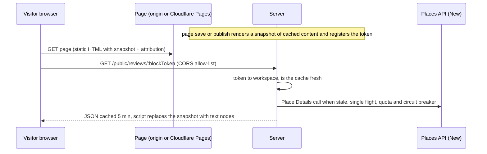

# Google reviews

Status: **not exercised against the real Google API.** The client follows the current documentation and is tested against a fake (`server/test/googlereviews.test.ts`). Check it with your own key before relying on it.

Documentation used (checked 2026-10): Place Details (New) <https://developers.google.com/maps/documentation/places/web-service/place-details>, Text Search (New) <https://developers.google.com/maps/documentation/places/web-service/text-search>, Review object <https://developers.google.com/maps/documentation/places/web-service/reference/rest/v1/places#Review>, policies <https://developers.google.com/maps/documentation/places/web-service/policies>.

## What the author gets

* **Google reviews** block (Blocks > Conversion): list (grid or one per row), carousel, or compact rating badge. Settings: place (search by name, or the workspace default), number of reviews (1 to 5, Google returns at most five), minimum rating, show or hide the text, layout, and the author's own testimonials as a fallback.
* **Ask for a Google review** block: a button to `https://search.google.com/local/writereview?placeid=<id>` (opens in a new tab), an optional message and an optional delay (5 to 120 seconds, a CSS animation, so it works without scripts). Meant for thank-you pages.
* **Settings > Google reviews** (permission `integrations:manage`): the Places API key (stored encrypted, shown only as `…abcd`), the default place, a live test.

Without a key, without a place, over quota, during an outage or with no result, the block shows the testimonials typed into it, headed "Customer feedback" (never presented as Google's). Real quotes only; the editor's sample cards are never saved.

## How it works

* **Fetch**: `GET https://places.googleapis.com/v1/places/{placeId}` with headers `X-Goog-Api-Key` and `X-Goog-FieldMask: id,displayName,rating,userRatingCount,googleMapsUri,reviews`. Search: `POST /v1/places:searchText` with `{textQuery, pageSize: 5}` and mask `places.id,places.displayName,places.formattedAddress,places.rating,places.userRatingCount`. The key travels in a header, never in a URL or log. Calls use `deps.outbound` (public addresses only, no redirects, 8 second timeout); `GOOGLE_PLACES_API_BASE` exists for tests.
* **Normalising**: ratings clamped to 0 to 5, review ratings rounded to whole stars (1 to 5), at most five reviews, review text from `originalText` when present (not translated by us), control and bidi-override characters removed, author and map links accepted only as https on `google.com` or `goo.gl` hosts, avatars only from `googleusercontent.com`. Language codes must look like language tags or are dropped; text is escaped and carries `dir="auto"` so right-to-left reviews display correctly.
* **Rounding**: the number shows one decimal (4.66 becomes 4.7); stars fill to the nearest whole star, half rounding up (4.5 shows five).
* **Attribution** (policy): each review shows the author's avatar and name linked to their profile; the block ends with "Reviews from Google Maps" linked to `googleMapsUri`. Review text is never altered, shortened, summarised or translated. **No structured data** (no JSON-LD, no microdata) is emitted for these reviews.
* **Cache and retention**: place ids are stored while a block uses them. Review content is stored in `google_places_cache` for `GOOGLE_REVIEWS_CACHE_TTL_S` seconds (default 3,600; **0 = never stored**, every refresh is a live call) and is never served after it expires. Expired rows are deleted by the maintenance job. A job `reviews.refresh` refetches content in the last fifth of its life. Saving the key or the default place clears the workspace's cache. Google's terms restrict caching Places content beyond place ids; **the hour default is a documented trade-off, not legal advice**: set it to 0 if your agreement does not allow storing reviews.
* **Quotas and breaker**: `reviews.fetch` (per workspace per day, `GOOGLE_REVIEWS_DAILY_FETCHES`, plan tiers; place searches count too), `reviews.search` (20 per minute), `public.reviews` (per IP and block). After 3 failures a place pauses for 5, 10, 20 ... up to 60 minutes; a rejected key pauses the workspace for 15 minutes and shows on the settings screen.
* **Tokens**: a block's public token is `rv` plus an HMAC of funnel, step and block ids (`JWT_SECRET`), registered in `review_blocks` whenever a page is saved. It identifies a block, not a user, and the endpoint returns only public place data.
* **Two serving paths**: origin pages store the snapshot in `step_pages.html` and fetch from the same origin (`/public/reviews/` is passed through on customer domains and by the edge Worker). Cloudflare Pages bundles take a snapshot at publish time (refreshed live if the cache is empty or expired) and fetch from the app's absolute origin; the bundle's Content-Security-Policy already allows that origin and `https:` images. The endpoint answers CORS only for registered domains, `*.pages.dev` hosts of published funnels and the app itself ([CLOUDFLARE-PAGES.md](CLOUDFLARE-PAGES.md)). The snapshot is real markup in the page (the sanitiser removes `<noscript>`), so it shows without scripts; the script replaces it using `textContent` only.

## Tests (fake Places API)

Settings (encrypted key, masked, audit without the key, permissions), test fetch (headers, mask, URL without the key, rejected key), search (mask, body, normalisation, daily budget), page without a key (fallback, no Google attribution, no structured data), cache TTL and expiry, TTL 0, rendering with attribution, author links, rounding, RTL text unchanged, minimum rating and count, XSS in author names, text, language codes, links and photos, variants, circuit breaker and recovery, malformed answers, tenant isolation, SSRF guard, static bundle snapshot and CORS allow-list, the review button, and the browser runtime in jsdom (text nodes only, link validation, failure keeps the snapshot).
