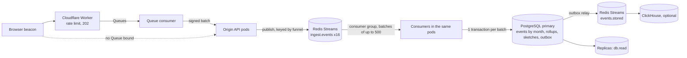

# Scaling Funnels

Targets, the architecture that is meant to meet them, a capacity model with the constants that were measured here, sizing tables, bottlenecks, tuning, limits, and an explicit list of what was measured and what is extrapolated. **One laptop cannot prove 20,000 events/s or 50,000 page req/s; what it can prove is correctness under failure, the absence of super-linear costs, and per-unit costs.** The full-scale figures are validated by the procedure in [CLOUD-LOADTEST.md](CLOUD-LOADTEST.md), which has not been run.

## Targets (assumptions; change only with a reason)

| Area | Target |
|---|---|
| Public pages | 50,000 req/s at the edge with >= 99% cache hit; origin >= 2,000 req/s on misses with single-flight; a viral funnel must not take the origin down |
| Event ingestion | 20,000 events/s sustained, 100,000/s peak absorbed by queues; exactly-once effect via idempotency keys |
| Retention and reads | 1B+ events retained with rollups; analytics over any date range < 300 ms p95 from rollups/sketches |
| Fairness | Heavy tenants do not starve others: per-workspace limits, fair partitions, shedding order defined below |

## Architecture in one picture

* Request path: validate, check the (funnel, step) positive cache, `XADD`. No database read or write (ADR 0015). Without `INGEST_QUEUE` the in-process write-behind buffer is used (ADR 0007).
* Write path: a consumer group splits 16 partition streams (ordering key = funnel id); each batch is one transaction doing dedupe claims, first-view decisions, event inserts, rollup upserts, HyperLogLog sketch updates and (with the mirror on) outbox rows (ADR 0013, 0014, 0016).
* Read path: rollups and sketches, bounded by time so partitions prune; replicas through `db.read()` with a lag guard and read-your-writes.
* Pages: edge cache, `stale-while-revalidate`, single-flight at the origin (in process and through a short Redis lock), purge on publish ([CLOUDFLARE.md](CLOUDFLARE.md)).

## Measured here (and what it does and does not show)

Environment: Apple M1, 8 cores, 8 GB, macOS, Node 24, PostgreSQL 18.4 (native arm64 binary from the `embedded-postgres` package, `shared_buffers` 1 GB, local disk), Redis 8.4.0, 2026-10-20. **The machine was heavily loaded by unrelated processes during every run: load average 20 to 43 on 8 cores.** Absolute throughput numbers are therefore low and noisy and are reported as such; correctness results do not depend on speed. The load generator, the app, Redis and PostgreSQL shared the same 8 cores in every run.

### Correctness under failure (the strong result)

`loadtest/scale.mjs`: N built server processes + a private Redis + real PostgreSQL, one unique visitor per request, 64 connections for 20 s, then every acknowledged event is checked against the database. SIGKILL of node 2 at 8 s where marked. Raw results: `loadtest/results/*.json`.

| Run | Accepted (HTTP 202) | Rows in `events` | Lost (accepted, not in DB) | Duplicates | Rollup minus rows |
|---|---|---|---|---|---|
| 1 node, ingest queue | 15,083 | 15,147 | 0 | 0 | 0 |
| 2 nodes, ingest queue | 30,208 | 30,272 | 0 | 0 | 0 |
| 4 nodes, ingest queue | 12,485 | 12,549 | 0 | 0 | 0 |
| 2 nodes, ingest queue, **SIGKILL one node mid-load** | 14,415 | 14,447 | **0** | 0 | 0 |
| 1 node, in-process buffer (no queue) | 41,629 | 41,693 | 0 | 0 | 0 |
| 2 nodes, in-process buffer, **SIGKILL one node mid-load** | 26,236 | 25,864 | **372** | 0 | 0 |

"Rows beyond accepted" (32 to 64 per run) are requests in flight when the generator stopped: written, response not counted. The last two rows are the point: with the in-process buffer a hard kill loses the events it had acknowledged but not yet flushed (372 of 26,236 here, the documented 250 ms window); with the queue the same kill loses none, because acknowledged events are already in Redis and the surviving node's consumer takes over the dead node's partitions.

Bus-level proofs (`server/test/eventbus.test.ts`, real `redis-server`, 21 tests): per-key order with interleaved keys and a slow handler; competing consumers split work with no duplicates; late subscribers get the backlog; retry with attempt counts; poison events dead-lettered alone out of a batch; consumer takeover after `close()`; a consumer process killed with SIGKILL mid-event has its unacknowledged entries redelivered in the original order. The takeover test found and fixed an ordering bug (a new owner started reading new entries while still draining the old owner's pending ones). `server/test/queue.test.ts` covers the ingest queue (redelivery counted once, database outage mid-stream loses nothing, backpressure 503, poison row), the outbox (rollback publishes nothing, bus outage loses nothing, crash after publish republishes and `once()` applies once, pruning keeps unpublished rows), the mirror, and the signed edge batch endpoint including dedupe of a redelivered batch.

### Per-unit costs (noisy, see environment)

| Quantity | Value | Notes |
|---|---|---|
| Server CPU per 1,000 accepted events, in-process buffer | 369 ms | 1 node, load average 21. One core is about 2,700 events/s at this cost |
| Server CPU per 1,000 accepted events, ingest queue | 762 to 832 ms (1 and 2 nodes) | The consumer's write work runs in the same processes, plus the Redis publish, read and ack; about 1,200 events/s per core. 4 nodes: 1,700 to 1,900 ms under load average 42 (contention, not a property of the code) |
| Accepted events/s observed | 746 (1 node, queue), 1,495 (2 nodes, queue), 609 (4 nodes, queue, load 42), 2,073 (1 node, buffer) | **Not a capacity measurement**: CPU-starved machine, single-thread load generator. Do not read the 4-node figure as negative scaling; there were not more cores to give |
| Drain after load stops | 0.1 to 0.3 s | The consumers kept up with this load throughout (queue lag at the end 41 to 68 events) |
| Process RSS under load | 77 to 258 MB | Includes the consumer and the page cache |
| Bytes per event, table plus its indexes (10M events) | 274 B | Rollup table: 172,801 rows, 26 MB; sketches: 450 funnel-days, 1.9 MB |
| Raw insert into the partitioned table (server-side `generate_series`, 4 partitions, indexes on) | 10M rows in 715 s = 14,000 rows/s | Loaded machine, one connection, no application logic: a floor, not the app write path |
| HyperLogLog | 5.4M adds/s; merging 288 daily sketches 2.1 ms; 1M distinct estimated as 971,688 (-2.8%, inside the 2-sigma 3.2%) | `node` microbenchmark, same machine |
| App write path into PostgreSQL | 31 ms per 1,000 rows (32,000 rows/s) | From PERFORMANCE.md (2026-10-19, earlier PostgreSQL binary, batches of 500); not re-measured after the sketch update was added |
| Rate limiter, per request | 2 Redis round trips, 0.17 ms p50 added | PERFORMANCE.md |

### Data volume: 10 million events on real PostgreSQL

`node bench/volume.mjs 10000000`: 90 days, 5 funnels x 4 steps, monthly partitions, rollups and per-day sketches built, then `EXPLAIN (ANALYZE, BUFFERS)` (median of 5). **This is 10M events, not the 100M the target asks for: the machine has 32 GB of free disk and the 10M load already took 12 minutes under load.** Anything beyond is extrapolated below.

| Query (funnel f1, 2M events in the funnel) | Median | Relations touched |
|---|---|---|
| per-step totals from rollups, 7 / 30 / 90 days | 1.0 / 3.3 / 10.0 ms | `event_rollups` primary key only |
| exact `COUNT(DISTINCT visitor_id)`, 7 days | 52.8 ms | `events_2026_10` only (**partition pruning**: one partition of four) |
| exact `COUNT(DISTINCT visitor_id)`, 30 days | 302.8 ms | `events_2026_09`, `events_2026_10` |
| exact `COUNT(DISTINCT visitor_id)`, 90 days | 4,703.7 ms | four partitions: **over the 300 ms target, which is why sketches exist** |
| fetch sketches for 7 / 30 / 90 days, then merge in the app | under 0.2 ms + about 1 to 2 ms merge | one funnel-day row each, `visitor_sketches` primary key |
| keyset history page (50 rows) | 0.09 ms | index scan per partition |

So with the default `ANALYTICS_EXACT_DISTINCT_MAX` (200,000 page views) this funnel's 30-day query (about 600,000 page views) already uses sketches and answers in milliseconds, at 1.6% standard error. The exact scan grows linearly with the page views in the range (about 50 ms per 160,000 page views here).

A recovery drill: the first load put September in `events_default` because only July and August partitions had been created by my script. The procedure in RUNBOOK.md (detach default, create the month, move the rows, re-attach) moved 3.3M rows in 44 s and queries then pruned correctly.

### Not measured (no number exists)

30+ minute soak (see below if the run finished), reconnect behaviour of the beacon under load, GC pause distribution, cloud-scale anything, ClickHouse (no server was available and downloading one was not authorised), the HTTP suite behind PgBouncer, Postgres failover, Redis failover, a noisy-neighbour run (the limiter keys per IP and funnel and the design is described, but no 100x test was run), more than 4 server processes, more than 10M events.

## Capacity model

Let *E* be sustained events/s, *creq* the server CPU per accepted event, *w* the database cost per event, *s* bytes per event.

* App cores for ingestion: `E x c_req / core_utilisation`. Measured here, with the queue on: `c_req` = 0.8 to 1.0 ms (loaded machine; treat as an upper bound, a quiet machine will be lower). At 60% target utilisation: `E x 0.0009 / 0.6` cores, 30 cores for 20,000 events/s, 150 cores for 100,000/s if they had to be processed at that rate, which they do not (the queue absorbs the peak and drains at the sustained rate).
* Database: rows/s per primary. Measured floor 14,000 rows/s for plain inserts on a loaded laptop with one connection; the application path (dedupe, first-view claims, rollups, sketches) measured 32,000 rows/s earlier on a quieter run. A 16 vCPU primary with NVMe is expected to exceed 20,000 rows/s: **extrapolated, not measured**. Past roughly 50,000 rows/s shard by `workspace_id` (not built; the partitioning and keys allow it).
* Storage: `E x 86,400 x s` per day. With `s` = 274 B measured: 20,000/s is 1.73B events/day and about 474 GB/day of table and indexes; 30 days is about 14 TB. Retention is partition detach (and archive), not delete. Rollups are about 0.26 B/event of raw (26 MB per 10M).
* Redis (ingest queue): about 500 bytes per queued event (extrapolated from the entry layout, not measured), so a 2,000,000-event `INGEST_MAX_LAG` needs about 1 GB headroom; Redis ops are 1 `XADD` per event (auto-pipelined) plus per-batch read and ack, plus 2 limiter calls per request.
* Pool sizing: PostgreSQL server connections = `min(replicas x DATABASE_POOL_MAX, pgbouncer_pods x default_pool_size)` and must stay below `max_connections` minus reserve (about 20). One consumer batch holds one connection for the duration of its transaction, so `DATABASE_POOL_MAX` of 10 per pod is enough for the request path (which needs none for events) plus admin traffic and two or three concurrent batches. In PgBouncer transaction mode set `DATABASE_PREPARED_STATEMENTS=false`; the advisory locks used are transaction-scoped.

### Sizing tables (extrapolated from the constants above; validate with CLOUD-LOADTEST.md)

Funnels has no long-lived connections, so the analogue of "100k / 1M connections" is the sustained event rate.

| Sustained events/s | Per day | App cores at 60% (c_req 0.9 ms) | Primary | Redis | Storage / 30 days |
|---|---|---|---|---|---|
| 2,000 | 173M | 3 | 4 vCPU, 16 GiB | 2 GiB | 1.4 TB |
| 20,000 | 1.7B | 30 (about 15 pods of 2 vCPU) | 16 vCPU, 64 GiB, NVMe | 8 GiB | 14 TB |
| 100,000 (peak only, absorbed) | 8.6B if sustained | queue absorbs; drain at 20,000/s | same primary | queue depth x 500 B: 2 minutes of peak is 6 GB | as sustained |

Page serving at 50,000 req/s is an edge number: with a 99% hit ratio the origin sees 500 req/s of misses (single-flight reduces repeated misses of one key to one). The measured origin page throughput is about 9,500 req/s on one SQLite node (PERFORMANCE.md, loaded), so the 2,000 req/s origin target has headroom; the edge cache hit ratio was not measured (no Cloudflare access).

## Bottleneck ranking (what limits first, what to do)

1. **PostgreSQL write throughput and WAL** on the primary (rows/s per primary). Batch size is the lever (500 per transaction here); more consumers help until the primary saturates; then shard by workspace.
2. **A hot funnel-day**: one funnel's rollup rows and sketch row are updated by every batch of that funnel, so batches for one funnel serialise on those rows (keys locked in sorted order, no deadlocks, tested with 10 concurrent writers). Throughput for one funnel is bounded by one transaction at a time; other funnels are unaffected. Mitigation if it is ever the limit: raise batch size for that funnel, or split sketches by hour.
3. **Redis memory** while the database is behind (about 500 B per queued event) and Redis durability (AOF `everysec` loses up to a second on a crash).
4. **App CPU** (JSON, HTTP stack, `XADD`): linear in nodes, cheap to add.
5. **Replica lag** for analytics reads: falls back to the primary automatically, costs primary CPU.

## Overload behaviour (shedding order)

Defined and implemented: per-IP and per-funnel limits at the edge and origin (429) first; then `INGEST_MAX_LAG` (503 with the beacon retrying); analytics sampling is not implemented. Orders, leads and form submissions are never queued behind events or dropped: they are synchronous transactions with their own limits.

## Tuning guide

| Knob | Default | When to change |
|---|---|---|
| `EVENT_BUS_PARTITIONS` | 16 | Max parallel consumers per group; raise (after draining) beyond 16 pods |
| `INGEST_MAX_LAG` | 2,000,000 | Redis memory headroom / how long a spike may queue |
| `EVENT_BUFFER_MS`, `EVENT_BUFFER_MAX` | 250, 5,000 | Only for the non-queue mode |
| consumer `batchSize` | 500 | Larger batches amortise commits but hold row locks longer (code constant in `queue/runtime.ts`) |
| `DATABASE_POOL_MAX` | 10 | See pool sizing |
| `EVENT_REF_CACHE_SECONDS` | 5 | 0 if you need an instant reaction to a trashed funnel on every replica |
| `ANALYTICS_EXACT_DISTINCT_MAX` | 200,000 | Lower for faster analytics, higher for more exactness |
| Node | one process per core (`UV_THREADPOOL_SIZE` default), `--max-old-space-size` about 75% of the pod limit | Pods of 2 vCPU / 1 GiB limit were assumed |
| Redis | AOF `everysec`, `maxmemory-policy noeviction`, `maxmemory` above `INGEST_MAX_LAG x 500 B` plus limiter keys | Never use an eviction policy with streams |
| PostgreSQL | `max_wal_size` 4 to 16 GiB, `checkpoint_timeout` 15 min, `synchronous_commit` on, autovacuum per partition | The laptop runs used 4 GiB / 15 min |

## Known limits

* Ordering key is the funnel id: one funnel is one partition and one consumer at a time.
* The ingest queue makes events visible after consumer lag; analytics endpoints do not wait for the queue (the in-process buffer's `flush()` guarantee does not exist in queue mode).
* `unique` opt-in dedupe through `externalId` is decided at write time in queue mode: the response says `recorded: true` optimistically; a duplicate is dropped later.
* Redis failover with asynchronous replication can lose up to about a second of acknowledged events (not measured).
* The ClickHouse path is implemented to the HTTP and SQL level described in ADR 0016 but was never run against a ClickHouse server; the analytics API does not read from it.
* Kafka and NATS adapters are stubs that fail loudly.
* Single region. Multi-region design hooks are in the Conversations app (home region routing); for Funnels the edge is global and the origin is one region.
* No noisy-neighbour measurement; no 100M-event measurement; no soak figure unless stated below.

## Measured vs extrapolated

| Figure | Status | Source |
|---|---|---|
| Zero loss / zero duplicates with a node SIGKILL under the ingest queue (up to 4 nodes, 20 s runs) | **Measured** | `loadtest/results/scale-*.json` |
| 372 of 26,236 acknowledged events lost on SIGKILL with the in-process buffer | **Measured** | `scale-n2-qoff-kill.json` |
| Bus semantics (order, takeover, retry, DLQ, SIGKILL redelivery) | **Measured** (tests) | `eventbus.test.ts` |
| CPU per 1,000 events: 369 ms (buffer), 762 to 832 ms (queue) | **Measured, noisy** (load average 20 to 43) | `scale-*.json` |
| Linear throughput scale-out 1 to 2 to 4 nodes | **Not demonstrated**: 746 to 1,495 to 609 events/s tracks machine load, not node count | `scale-*.json` |
| 274 B per event with indexes; partition pruning; analytics query latencies at 10M events | **Measured** | `volume-10m.json` |
| 100M events, 1B events, analytics at that size | **Extrapolated** (linear in rows for exact scans; rollup and sketch cost is independent of event count) | |
| 20,000 events/s sustained, 100,000/s peak | **Extrapolated** | |
| 50,000 page req/s at the edge, 99% hit ratio | **Not measured** (needs Cloudflare); origin page throughput measured earlier on one SQLite node only | PERFORMANCE.md |
| ClickHouse insert rate, dedupe under replay, rollup views | **Not measured**, never run | ADR 0016 |
| Redis memory per queued event (500 B) | **Extrapolated** | |
| Cost estimate | **Rough, from remembered list prices** | CLOUD-LOADTEST.md |
