# User guide

One section per page or screen of the web app, in the order of the sidebar: what each control does, its default, and the permission it needs. It describes the app as built; where something is not verified against a real service, the section says so and [VERIFIED.md](VERIFIED.md) has the full list. For how each feature works end to end see [FEATURES.md](FEATURES.md); for the code behind it see [FUNCTIONS.md](FUNCTIONS.md).

Screenshots are 1440 px wide, light theme, from the seeded demo workspace (`npm run seed`, then `npm run design:guide-shots` in `e2e/`). More sizes and the dark theme: [design/DESIGN.md](design/DESIGN.md).

## Contents

* [How the app is laid out](#how-the-app-is-laid-out)
* [Signed out: sign in, register, password reset, invitations](#signed-out-sign-in-register-password-reset-invitations)
* [My Funnels](#my-funnels) and [New funnel](#new-funnel)
* [A funnel: Steps, Analytics, Products, Ads, Leads, Orders, Settings](#a-funnel)
* [The page builder](#the-page-builder)
* [Templates](#templates)
* [Products](#products)
* [Ads](#ads)
* [Domains](#domains)
* [Webhooks](#webhooks)
* [Trash](#trash)
* [Settings](#settings)
* [Audit log](#audit-log)
* [Admin](#admin)
* [Things that have no screen](#things-that-have-no-screen)

## How the app is laid out

After sign-in every page shares one shell.

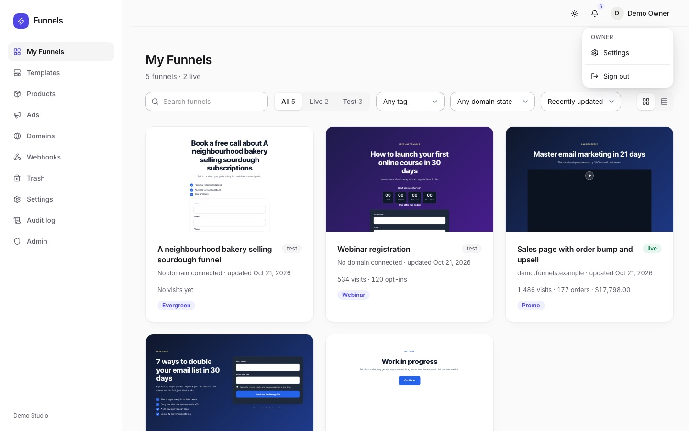

| Part | What it does |
|---|---|
| **Sidebar** (a drawer behind the menu button below 1024 px) | My Funnels, Templates, Products, Ads, Domains, Webhooks, Trash, Settings, Audit log, Admin. Entries you may not use are hidden: Products needs `products:read`, Ads `ads:read`, Webhooks `webhooks:manage`, Audit log `audit:read`; Admin appears only for platform administrators. The workspace name is shown at the bottom. |
| **Theme** (sun/moon button) | Appearance: System (default), Light, Dark. Stored in this browser only. |
| **Notifications** (bell, with an unread count) | A drawer listing new leads, sales, disputes and similar events of the workspace, newest first; **Mark all read**. New events also arrive live as a toast (server-sent events with a one-time ticket; the browser reconnects by itself). |
| **Account menu** (your name) | Shows your role; **Settings**; **Sign out**. |
| **Banners** above the page | Platform announcements (info, warning, critical; non-critical ones can be dismissed), the support-access notice while an administrator acts as you ([ADMIN.md](ADMIN.md)), and, when the workspace is suspended, a red notice with the reason (the pages are hidden meanwhile). |

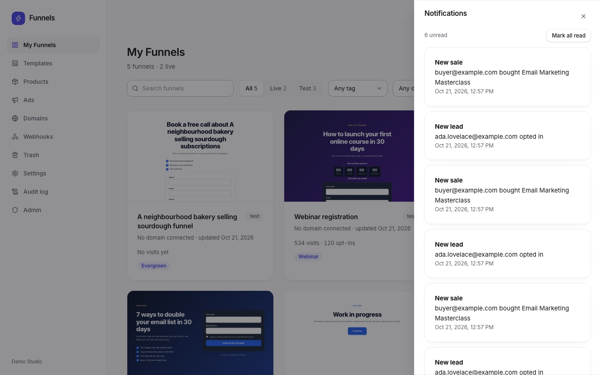

Everything is checked twice: the interface hides what you cannot use, and the server refuses it anyway (a missing permission answers `403`). The permissions behind each role are listed in [RBAC.md](RBAC.md); the built-in roles are Owner, Admin, Member and Viewer, and custom roles can be made in Settings.

## Signed out: sign in, register, password reset, invitations

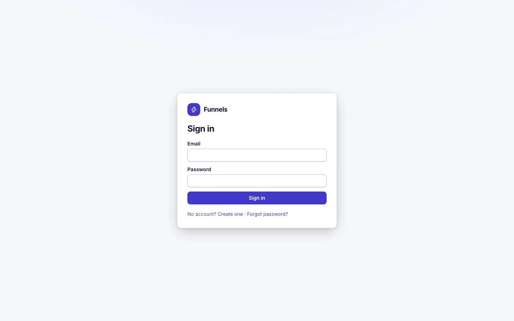

| Page | Address | What it does |
|---|---|---|
| **Sign in** | `/login` | Email and password. After too many failures the account (and the IP) is locked for a while ([RBAC.md](RBAC.md#lockout)). If the account has two-factor authentication on, a second step asks for the 6-digit code from the authenticator app **or one recovery code**; **Start over** returns to the first step. Signing in lands on the page you were trying to open, else My Funnels. |
| **Create your workspace** | `/register` | Name, email, password (at least 8 characters), optional workspace name. Creates the account, a new workspace and makes you its **Owner**, signs you in. An email that is already registered shows the error on the email field. |
| **Reset your password** | `/forgot-password`, then `/reset-password?token=...` | Enter your email: the answer is always "if an account exists, a message is on its way" (it does not reveal which addresses exist). The link works once and expires after `PASSWORD_RESET_TTL_MINUTES` (60). The new password needs 8 characters, and resetting signs you out everywhere. Mail is only delivered when `MAIL_TRANSPORT` is configured; with the default `none` nothing is sent ([CONFIGURATION.md](CONFIGURATION.md)). A password reset does not bypass two-factor authentication. |
| **Join a workspace** | `/accept-invite?token=...` | The page an invited person opens: it names the workspace, the role and the email, asks for a name and a password, creates the account and signs it in. An invalid, used or expired link says so. Links last `INVITATION_TTL_DAYS` (7). |

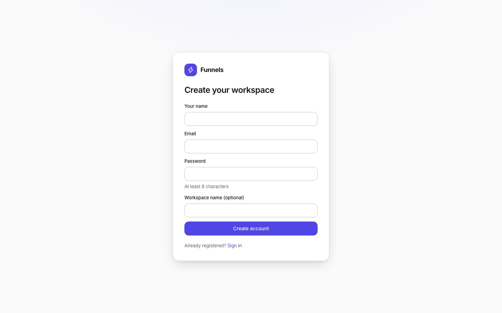
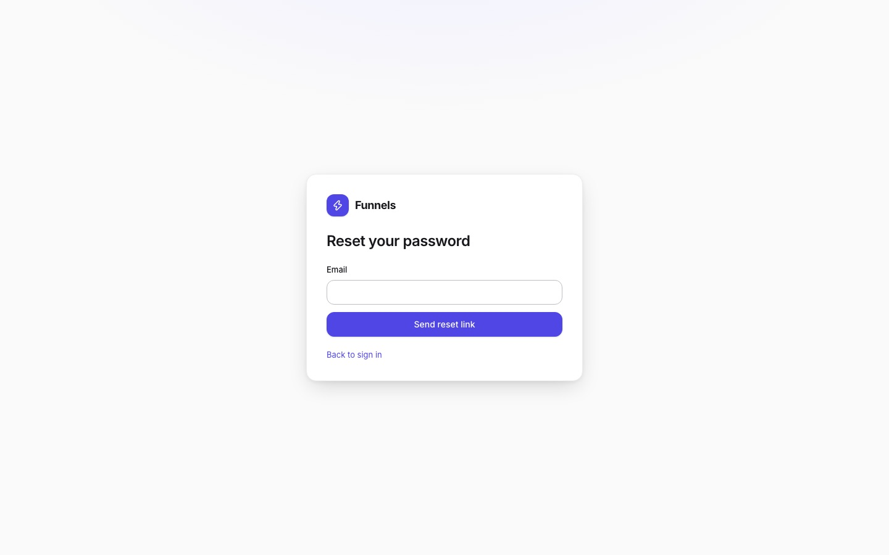

## My Funnels

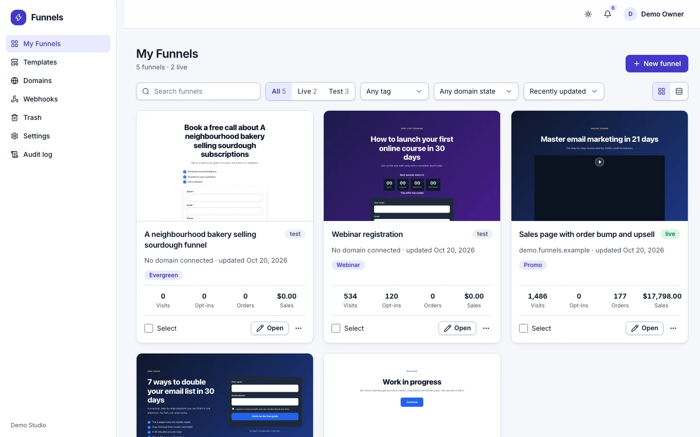

The list of the workspace's funnels (not in the trash). Needs `funnels:read`.

| Control | What it does | Default |
|---|---|---|
| **New funnel** | Goes to [New funnel](#new-funnel). Needs `funnels:write`. | |
| **Search** | Matches the funnel name, debounced; kept in the address (`?search=`). | empty |
| **All / Live / Test** (with counts) | Filter by status. | All |
| **Any tag** | Filter by one tag (with the number of funnels using it). | any |
| **Any domain state** | Domain connected / No domain. | any |
| **Sort** | Recently updated, Recently created, Name. | Recently updated |
| **Cards / Table** | Two views of the same list. The table adds Steps, Visits, Opt-ins, Orders and Sales columns and per-row Duplicate and Delete buttons. | Cards |
| **Selection checkboxes** | Pick funnels (card corner, or the table's header checkbox for the page). A bar appears: **Tag selected** opens a dialog to add and remove tags on all of them at once (`funnels:write`; tags are created in a funnel's Settings), **Clear** drops the selection. | none |
| **Card or row menu** (...) | **Open**, **Duplicate** (creates "copy of ..." in test mode; `funnels:write`), **Move to trash** (`funnels:delete`; asks first). | |
| **Pager** | Pages of the result. | |

Each card shows the page thumbnail (the real first page, or a generated picture while it loads), the funnel name, a **Live** or **Test** badge, the address (domain or "No domain connected"), the last-updated day, one quiet line of numbers (visits, opt-ins, orders and sales; "No visits yet" when all are zero) and its tags. The header line counts all funnels and how many are live.

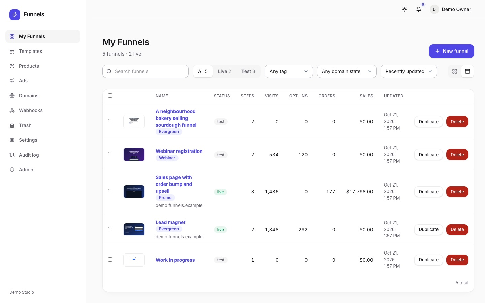

An empty list offers **Create funnel**; an empty result of a filter offers **Clear filters**.

## New funnel

Three ways to start, chosen at the top (default: Blank). Needs `funnels:write`.

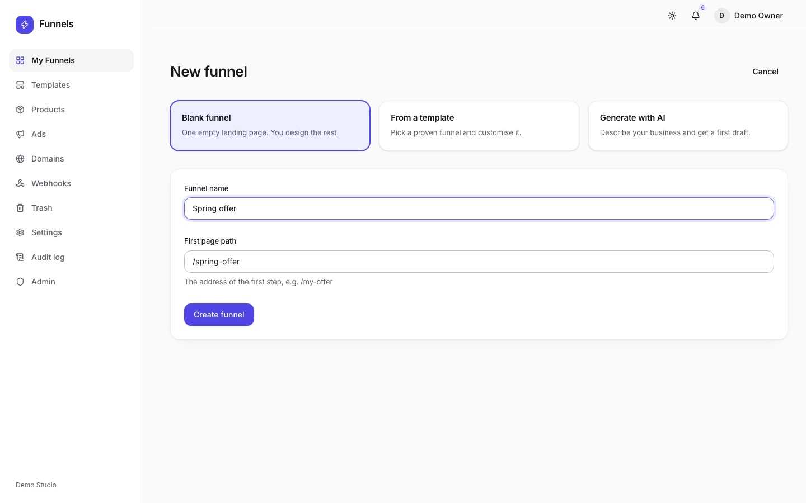

**Blank funnel.** *Funnel name* (required, up to 120 characters) and *First page path* (default: made from the name, such as `/spring-offer`; letters, digits and `-` only, no nested segments; edit it to override). **Create funnel** makes one landing step with a starter page in test mode and opens the funnel. Over a plan limit the server answers `402 PLAN_LIMIT_REACHED` (only when `BILLING_ENFORCE_LIMITS` is on).

**From a template.** The same gallery as [Templates](#templates): Preview, then **Use template** opens the wizard and the funnel is created.

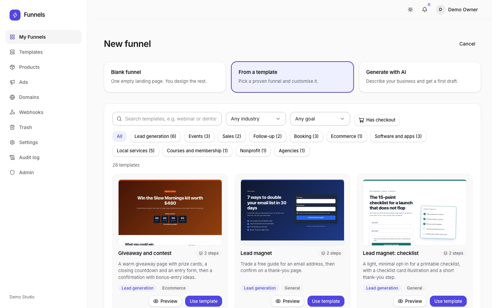

**Generate with AI.** Describe the business in plain words and press **Build my funnel**. Optional: Goal (collect leads, webinar registration, sell a product, book calls, sell event tickets, take donations; default: the AI decides), Voice, number of Pages (1 to 6; default: recommended), what to do with the product catalog (*Do not touch my catalog* is the default and makes offer pages collect enquiries; *Create draft products and wire the checkout* needs `products:write`; *Sell products I already have*), and under *More details* the offer, audience, lowest and highest price, currency and words to avoid, plus a switch to remove emails, phone numbers and card numbers from your text before it is sent or stored. Needs `ai:use` and `funnels:write`.

The wizard then shows live progress for each stage (understanding, strategy, products, copy per page, assembly, validation, saving), can be cancelled, and survives a page refresh (the build id is kept in the browser). The result page shows the plan, the **assumptions** the AI made, the draft products it created (not synced to Stripe), the validation checks, and every page with a **Rewrite** button; **Open the funnel** or **Start another**. The funnel is always created in test mode. Without an `ANTHROPIC_API_KEY` the built-in offline writer produces the copy. How it works and what is guaranteed: [AI-BUILDER.md](AI-BUILDER.md).

## A funnel

Opening a funnel shows its name, status badge, address, **Open builder** (first step), and **Go live** while it is in test mode (leads to the Go live card in Settings). Tabs: **Steps**, **Analytics**, **Leads**, **Orders**, **Settings**, and under **More**: **Products** and **Ads** (the tab you are on stays visible). An unknown or deleted funnel shows "not found" with a way back.

### Steps

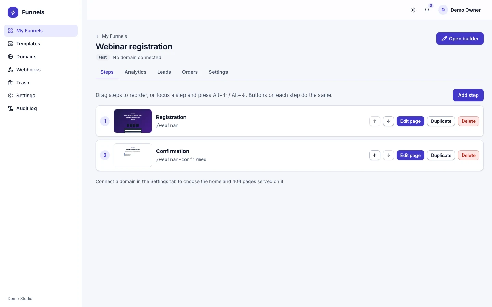

The ordered pages of the funnel (needs `funnels:read`; changes `funnels:write`).

| Control | What it does |
|---|---|
| **Drag a step**, or focus it and press **Alt+Up / Alt+Down** | Reorders the steps (saved at once; an error undoes the move). **Next step** buttons follow this order. |
| **Edit page** | Opens the [builder](#the-page-builder) on that step. |
| **Add step** | Dialog: *Step name* and *Path* (default from the name). The path is checked live for format, for collisions inside this funnel and, when a domain is attached, across every funnel on it; clashes offer `/path-NNNN` suggestions. |
| **Add payments** | The five-page wizard that builds a checkout ([below](#add-payments-wizard)). Needs `funnels:write` and `products:write`. |
| Step menu (...) | Move up / Move down, **Duplicate** (copies the page and its versions), **Set as home** and **Set as 404** (only when the funnel has a domain: the page served at the domain's `/` and for unknown paths; the badges *Domain home* and *Domain 404* mark them), **Delete step** (not the last one; its page and backups go with it). |

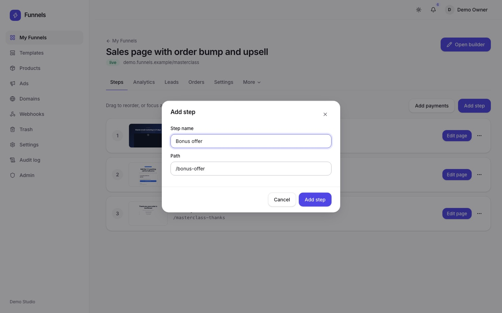

#### Add payments wizard

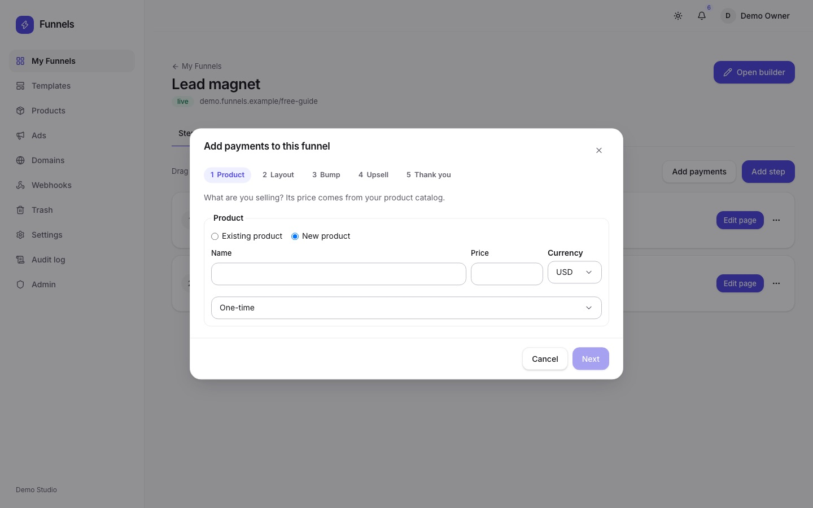

Five steps: **Product** (pick an existing price or create a new product: name, price, currency, one-time or subscription with a billing interval), **Layout** (*One step*: product and payment on one page; *Two steps*: an offer page, then a checkout page; and where it goes: new pages at the end, or appended to an existing page without changing what is written there), **Bump** (optional order bump), **Upsell** (optional one-click upsell, and, once an upsell is chosen, a downsell for buyers who decline; one-click offers must be one-time products because they charge the card just used), **Thank you** (adds a thank-you page; shows a summary). One request builds and wires everything, and every page stays editable. Details: [PRODUCTS.md](PRODUCTS.md).

### Analytics

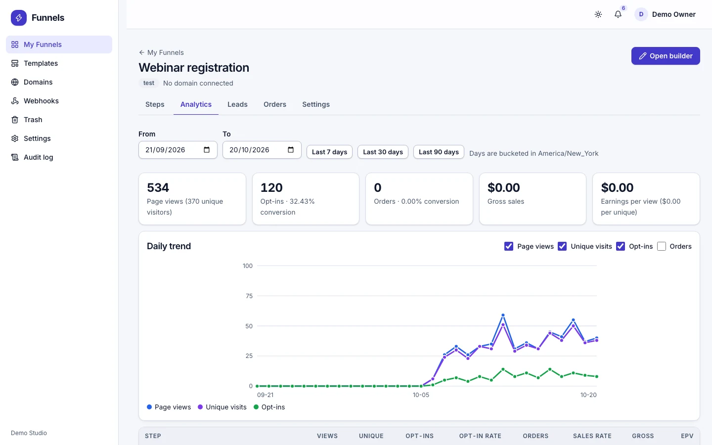

Needs `analytics:read`. A date range (presets such as the last 7, 30 or 90 days, or a custom range; default: the last 30 days, in your browser's time zone) drives everything on the tab. If the start is after the end a warning replaces the numbers.

* **Totals:** page views (and unique visitors), opt-ins with conversion rate, orders with conversion rate, gross sales, and earnings per view (per unique visitor too). Definitions are in [ANALYTICS-API.md](ANALYTICS-API.md#definitions-where-the-contract-leaves-room-this-is-what-the-numbers-mean).
* **Daily trend:** a line chart with a toggle per series (page views, unique visits and opt-ins on by default; orders off).
* **Step breakdown:** per step, views, unique, opt-ins, opt-in rate, orders, sales rate, gross and earnings per view.
* **AI insights** (`ai:use`): **Explain performance** returns a short summary, the weakest step and prioritised actions. Every number comes from your data; the writer only explains it, and any number it invents is thrown away. The footer says whether the AI model or the built-in analyst wrote it.

### Products (funnel tab)

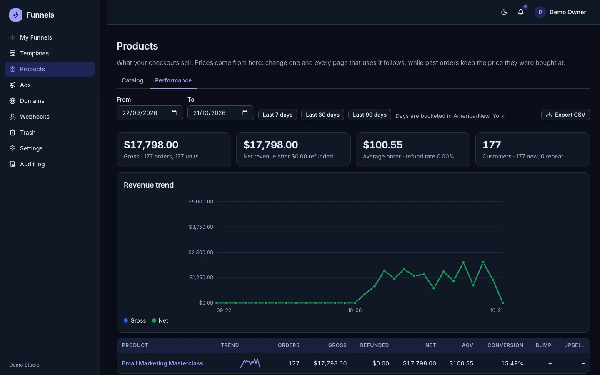

The [Products > Performance](#performance) report limited to this funnel. Needs `analytics:read`.

### Ads (funnel tab)

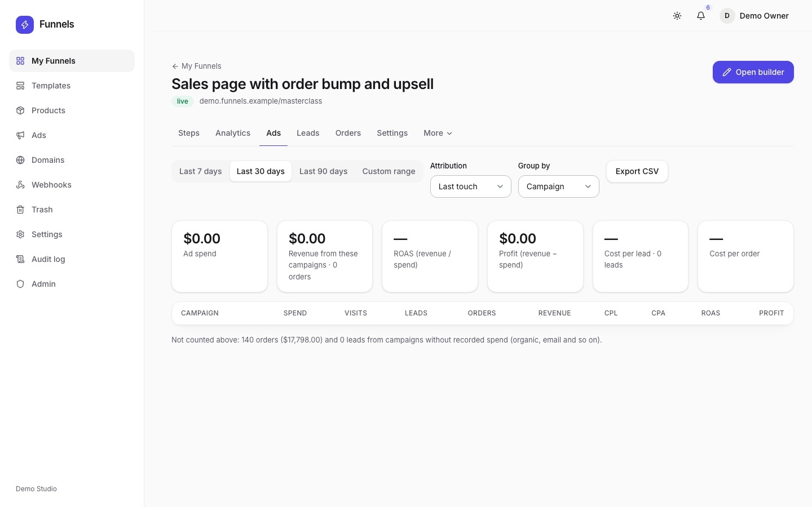

The [Ads > Performance](#performance-and-attribution) report limited to this funnel: spend, visits, leads, orders, revenue, cost per lead, cost per order, ROAS and profit by campaign, source or day. Needs `ads:read`.

### Leads

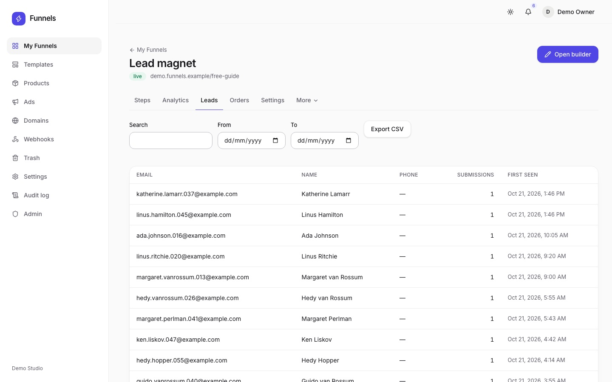

People who opted in through a form of this funnel (needs `leads:read`). *Search* (email or name), *From* and *To* dates, and **Export CSV** (needs `leads:export`; formula-injection safe; streamed). Columns: email, name, phone, number of submissions, first seen. A lead is unique per email inside the workspace. Notifications and webhooks announce each new lead.

### Orders

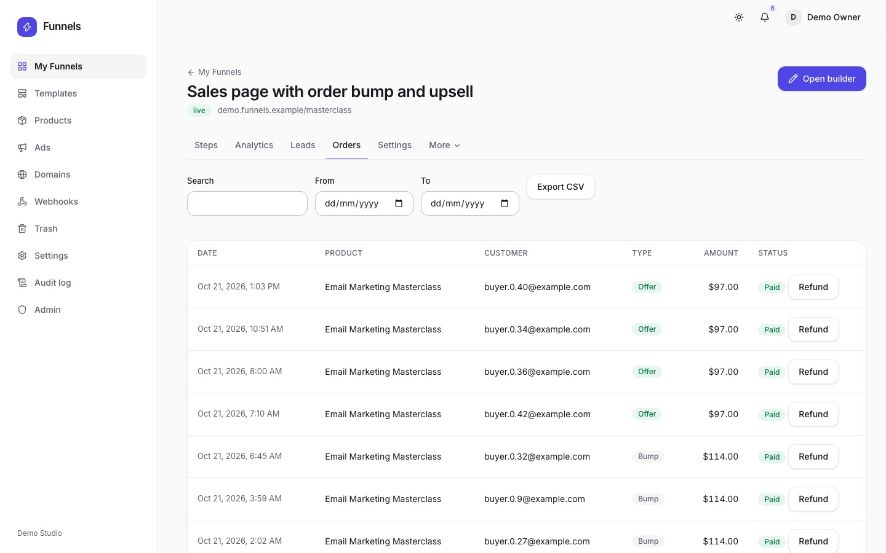

Purchases made through this funnel's checkout blocks (needs `orders:read`). Same search, date filters and **Export CSV** (`orders:export`). Columns: date, product, customer, type (*Offer*, *Bump*, *Upsell*), amount and status. Status badges: *Paid*, *Partially refunded*, *Refunded*, *Disputed* (a Stripe dispute is open; with the evidence due date) and *Charged back* (a dispute was lost; with the amount deducted), and a **View in Stripe** link for disputes. **Refund** (needs `orders:refund`) opens a dialog: leave the amount empty to refund everything that is left, or enter an amount; with Stripe the money goes back through Stripe. Without a Stripe connection (built-in test provider) orders are recorded as if paid and refunds only update the record.

### Settings (funnel tab)

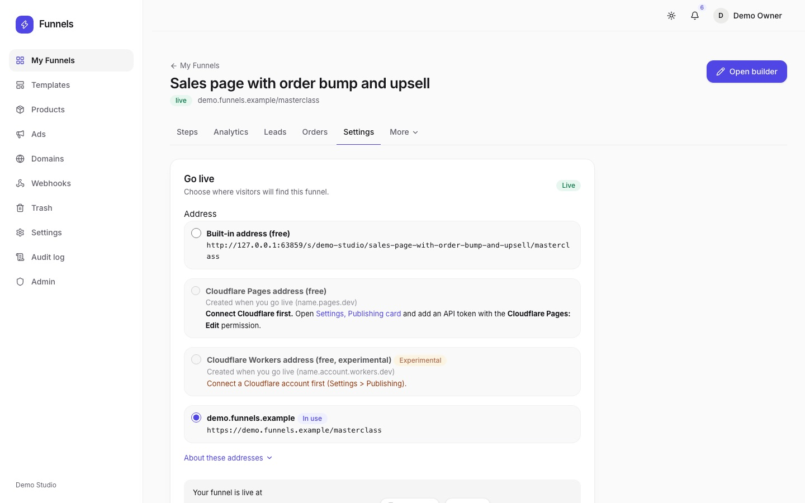

Needs `funnels:read` to see, `funnels:write` to change. The page has these cards:

**Go live** (see [GO-LIVE.md](GO-LIVE.md)). The badge is the publish state: *Test mode*, *Publishing...*, *Live*, *Publishing failed* or *Paused*. In test mode only people with your signed preview link can open the funnel and nothing is counted; live means anyone with the address can open it and visits, leads and orders are recorded. Pick an **Address**: *Built-in address (free)* (this app, no account, no DNS; the default choice), *Cloudflare Pages address (free)* (needs a connected Cloudflare account, otherwise it says "Connect Cloudflare first" with a link), *Cloudflare Workers address (free, experimental)*, or one of your verified domains. Each option shows its real final URL. **Go live** attaches the address and sets the funnel live in one step (for Cloudflare it also creates the project and starts the first deployment); once live it shows the final URL with **Copy link** and **Open**, and **Take offline** returns to test mode. When the built-in address is chosen, *Address name* edits the last part of the URL (changing it moves the address; the old one stops working) and a switch lets search engines index it (off by default: built-in addresses answer `noindex`). **Try again** appears after a failed or paused Cloudflare deployment. Going live needs `funnels:write`, and a Cloudflare address also `publishing:manage`.

**General.** *Funnel name*; *Status* (Test or Live; switching to Test detaches the domain; Live needs an address); *Domain* (None, the built-in address, or a verified domain; saving an attachment that would make two live funnels serve the same path asks you to resolve each conflict first); *Tags* (tick to add, or type a name and **Add tag**, which needs `tags:manage`); under *Favicon and tracking code*: *Favicon URL* (http(s) or a path), and, for people with `funnels:tracking`, *Header tracking code* and *Footer tracking code* (injected into every page; published only when the workspace allows custom scripts, see [Settings](#workspace)). **Save changes** sends only what changed. **Open signed preview** opens the funnel's saved pages in a new tab through a signed link; it counts no visits and works while the funnel is in test mode.

**Ad pixels and consent.** Per funnel (or per step: *Applies to*) Meta Pixel ID, Google Analytics 4 measurement ID, TikTok pixel code, Microsoft Advertising UET tag ID, Google Ads and LinkedIn ids, a switch to send a Lead event on opt-in (off by default), and the cookie consent settings: ask visitors before loading pixels (mode opt-in or opt-out, who is asked, banner position and texts, privacy policy link) and respect Do Not Track and Global Privacy Control. A step overrides the funnel, which overrides the workspace defaults ([Settings > Tracking](#tracking)). Changing them needs `integrations:manage`, re-renders the affected pages and refreshes live copies. Pixels are generated by the server from the ids; nothing typed here runs as script. See [ADS.md](ADS.md).

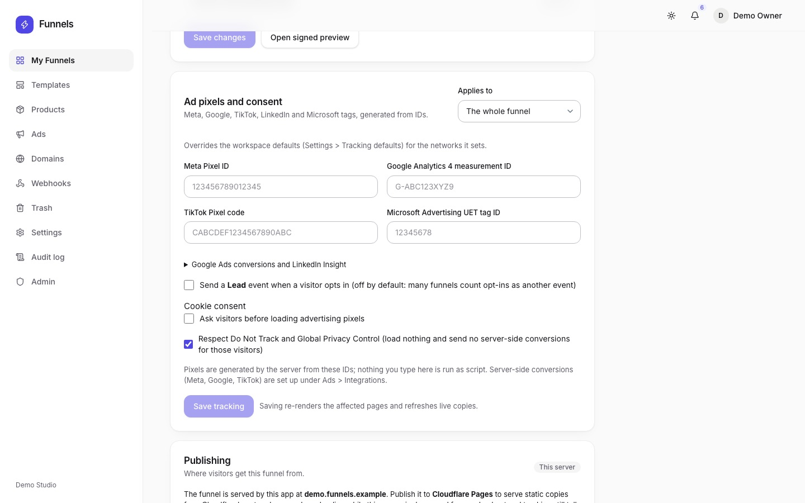

**Publishing.** Where visitors get this funnel from: *This server* (default) or Cloudflare Pages. Choose Pages to publish static copies that keep loading while this server is down (forms, checkout and tracking still talk to this app); the card creates the project (optional *Pages project name*, default `fn-xxxxxxxx`), shows the deployment status, a **Deployment history** (status, version, what, when, size; **Log** per deployment; **Roll back** to an earlier successful one), **Redeploy**, **Check domain** (custom domain DNS record to add), **Unpublish...** (pause with a "not available" page, or delete the project) and **Serve from this server instead**. Rolling back or unpublishing holds automatic deployments until you press Redeploy. Needs `publishing:manage`. Details and limits: [CLOUDFLARE-PAGES.md](CLOUDFLARE-PAGES.md).

**Actions.** **Duplicate funnel**; **Move to trash** (needs `funnels:delete`; the funnel stops being served and its domain is detached; restore it from [Trash](#trash)).

## The page builder

Open it from a step's **Edit page** or a funnel's **Open builder**; the address is `/funnels/<id>/builder/<step id>` and it has its own full-screen layout. It is a [GrapesJS](https://grapesjs.com) canvas (the real page in an iframe: drag, drop, resize and inline text editing are real interactions) with React panels around it. Needs `funnels:read` to open and `funnels:write` to save. Below 1280 px the Inspector becomes a drawer, below 768 px both side panels are drawers and a notice says the builder works best on a larger screen.

### Top bar

| Control | What it does |
|---|---|
| Back arrow | Returns to the funnel's Steps tab. Leaving with unsaved changes asks for confirmation (the browser also warns on reload). |
| **Step** dropdown | Switches to another step of the funnel ("1. Landing", ...). |
| **Undo / Redo** (Cmd or Ctrl+Z, Shift+Cmd+Z) | History of this session. AI changes count as one step. |
| **Desktop / Tablet / Mobile** | Canvas width (full, 768 px, 390 px). Styles set while a smaller device is chosen apply only at that size and below. |
| **Preview** (Shift+Cmd+P) | Hides the editing tools and panels so you see the page as visitors do; press again to return. |
| Save status | "All changes saved", "Unsaved changes", "Saving...", "Autosaved 10:42" or the error. Dirty means the undo history moved since the last save; selecting and scrolling never count. |
| **Save** (Cmd or Ctrl+S) | Saves the page and keeps the version it replaces as a backup. **Autosave** runs 20 seconds after the last change (without a backup). Errors keep your work: *version conflict* means the page changed in another tab or by a teammate (reload), and a list of "Fix before saving" problems appears when the page breaks a limit. |
| **Publish** | Opens the [Publish dialog](#publish-dialog). |
| **More** (...) | *View saved page* (signed preview in a new tab), *Version history*, *Page settings*, *Add payments* (needs `products:write`), *Keyboard shortcuts* (`?`). |

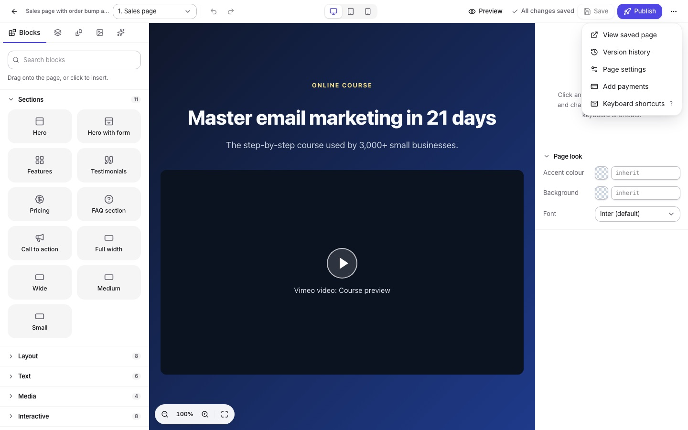

### Left rail: Blocks, Layers, Pages, Images, AI

**Blocks.** A searchable, categorised list. Drag a block onto the page (a live placeholder shows where it will land), or click it, or focus it and press Enter, to insert it; content dropped on the page is wrapped in the section, row and column it needs, in one undo step. Categories: **Sections** (Hero, Hero with form, Features, Testimonials, Pricing, FAQ section, Call to action, and blank Full width, Wide, Medium and Small sections), **Layout** (1 to 5 columns and 1:2, 2:1, 1:2:1 ratios), **Text** (Heading, Sub-heading, Paragraph, Bullet list, Numbered list, Link), **Media** (Image, Video from YouTube, Vimeo or an MP4 address, Divider, Spacer), **Interactive** (Button, Outline button, FAQ accordion, Tabs, Evergreen countdown, Countdown to a date, Progress bar, Popup), **Conversion** (Opt-in form, Contact form, Checkout, Order bump, One-click upsell, Google reviews, Google reviews carousel, Google rating badge, Ask for a Google review), **Cards** (Testimonial, Pricing card, Feature card), **Navigation** (Navbar, Footer) and **Advanced** (Custom code: HTML, CSS and JavaScript; shown only to the workspace owner when custom scripts are allowed). **My blocks** lists blocks you saved: **Save selection as block** (needs `blocks:manage`) stores the selected element for reuse; the trash button on a saved block deletes it. Every component is described in [FUNCTIONS.md](FUNCTIONS.md#the-page-model-pagemodel).

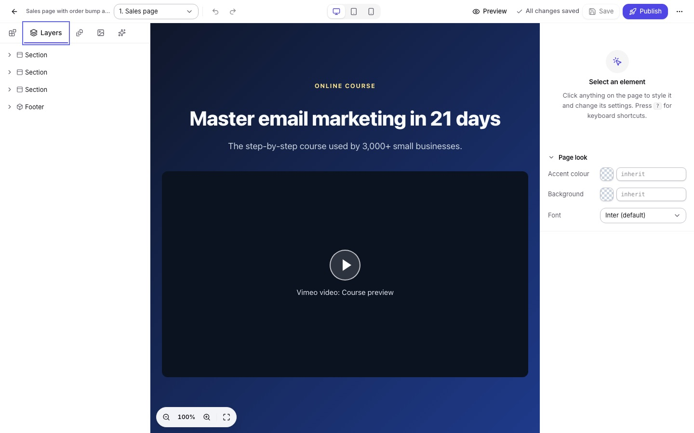

**Layers.** The page as a tree: click to select, drag to reorder or nest, the eye hides an element in the editor only, the lock stops it being selected or moved, double-click renames a layer, Alt+Up / Alt+Down moves a layer from the keyboard. Drop rules are the same as on the canvas.

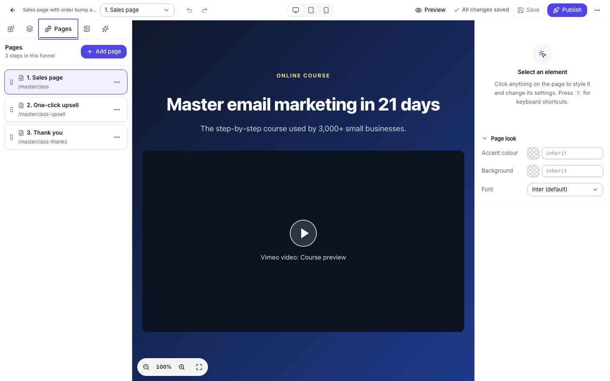

**Pages.** The funnel's steps: click one to open it, drag to reorder, **Add page**, and per page Duplicate and Delete. Path and settings of a page are in *Page settings*.

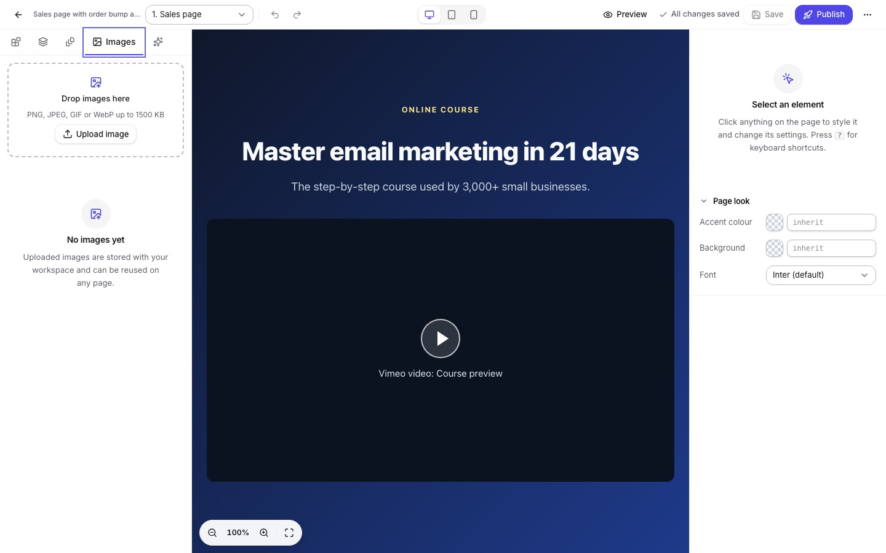

**Images.** Upload (drop or **Upload image**; PNG, JPEG, GIF or WebP, 1.5 MB each, 200 per workspace; SVG is refused) and reuse images stored with the workspace; click one to apply it to the selected image, trash to delete.

**AI** (needs `ai:use` and `funnels:write`). **Edit with AI**: describe a change ("Make the hero shorter", "Add an FAQ about shipping", "Change the tone to playful", "Add a testimonial section", "Translate to Spanish"); with an element selected the change applies to it, otherwise to the whole page. **Suggest changes** lists the proposed operations (with before and after text); **Preview on the page** applies them as one undo step, then **Keep changes** or **Undo changes**. **Write a section** adds one new section from a short description, after the selected block or at the end. Without a model the built-in assistant handles a few edits (shorten, tone, FAQ, testimonial placeholders, centre, enlarge) and says what it cannot do. See [AI-BUILDER.md](AI-BUILDER.md).

### Canvas

Click an element to select it; a floating toolbar offers move (drag handle), select parent, duplicate, rewrite with AI (text, headings and buttons) and delete. Double-click text to edit it inline with a formatting bar (bold, italic, underline, links). Images and columns have resize handles (a column's width is its share of the row). Right-click opens a menu: Select parent, Duplicate, Copy, Paste, Move up, Move down, Move out of parent, **Hide on phones**, **Save as block...**, Delete. The zoom bar at the bottom left zooms 50 to 150 % or fits the page to the width. An empty page shows "Start building".

### Inspector: Style, Settings, Advanced

The panel on the right shows the selected element; with nothing selected, **Page look** (accent colour, background, font).

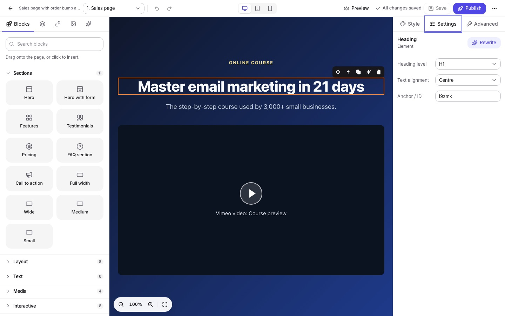

* **Style.** Choose *This element* or a *Class* to style, the device (follows the top bar) and the state (Normal, Hover, Active, Focus). Sections: Layout (display, flex and grid options, gap), Size, Spacing (margin and padding), Typography, Background, Border, Effects and Position. Values are checked against an allow-list by the server.
* **Settings.** The properties of the component type, such as: Section (content width small to full, padding, colour theme, alignment), Row (column ratio, gap, vertical alignment, keep columns side by side on phones), Heading (level, alignment), Button (*When clicked*: does nothing, next step, a step, a web address, open a popup, scroll to an element; style, size, full width, pill), List, Spacer, Image (picture, alt text with **Suggest alt text**, title), Video (address and title), Countdown (evergreen minutes or fixed date, label, text when expired), Progress bar, **Form** (name, fields of type name, email, phone, text, long text, dropdown or checkbox, required, placeholder, consent line, submit label, and *After success*: next step, message or address), **Checkout** (the catalog product and price, button text, order bump or one-click upsell role, quantity, promotion codes, where to go after accepting or declining; prices are read from the catalog on the server, never from the browser), **Google reviews** (place, style, count, minimum rating, layout, your own fallback testimonials) and **Ask for a Google review** (place, label, prompt, delay). Text components have a **Rewrite** button.
* **Advanced.** Visibility by device (everywhere, phones only, hidden), identity (ID or anchor, extra classes), extra attributes (event handlers, styles and URLs are removed by the server) and free CSS declarations for the element.

### Dialogs

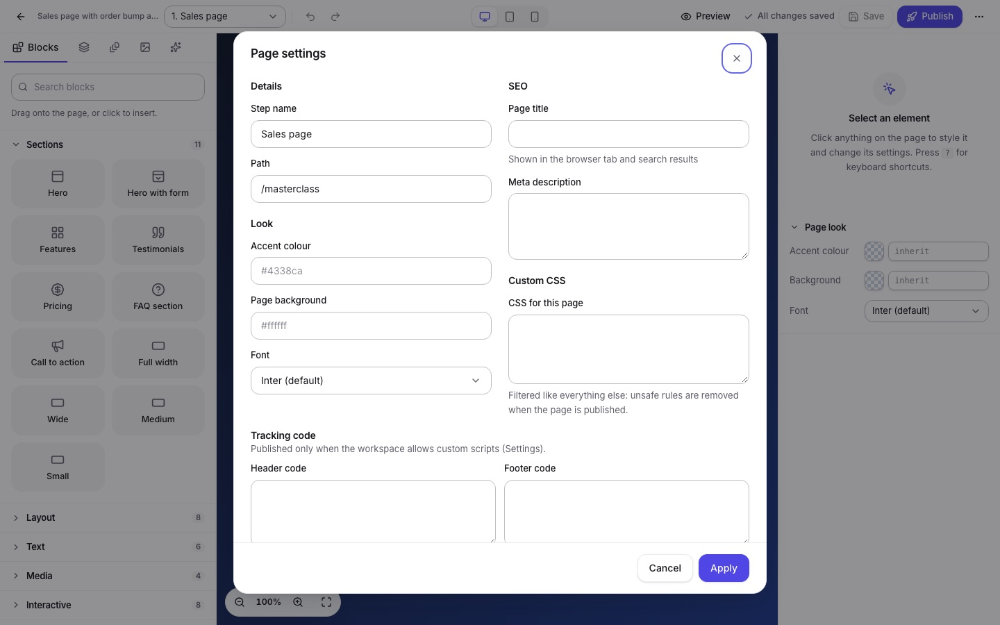

**Page settings.** Step name and path (checked live as in Add step), accent colour, page background, font, page title and meta description, custom CSS (filtered), and, for people with `funnels:tracking`, header and footer code (published only when the workspace allows custom scripts).

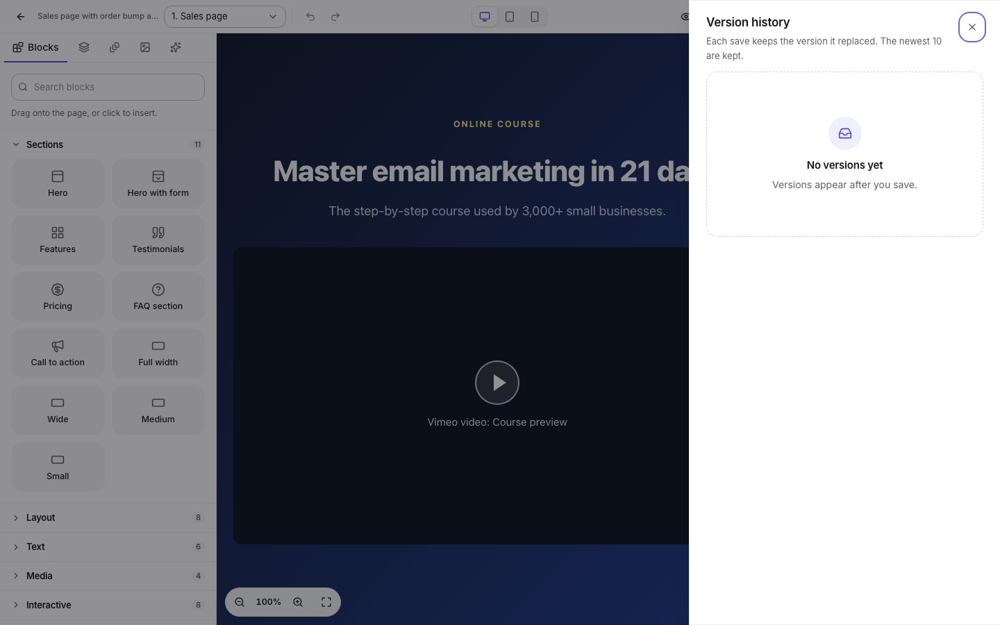

**Version history.** The newest 10 versions saved with **Save** (each save keeps the version it replaced). Preview one on a phone-sized frame and **Restore** it (needs `funnels:write`).

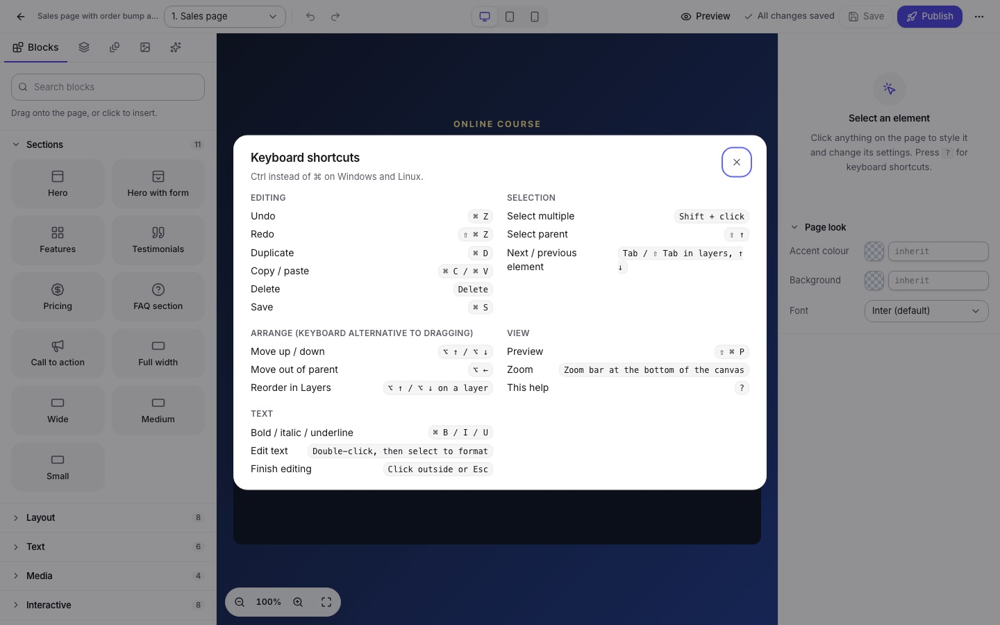

**Keyboard shortcuts** (`?`): undo, redo, duplicate, copy and paste, delete, save, select multiple (Shift+click), select parent (Shift+Up), move (Alt+arrows), preview, bold, italic, underline.

**Choose an image** (from an Image's settings): pick an upload, upload a new one or paste an address. **Rewrite with AI**: tone (persuasive, concise, friendly, formal), shows suggestions that are applied only when you click **Apply**; headings also get headline ideas. **Link** (from the text toolbar): address and whether it opens in a new tab.

### Publish dialog

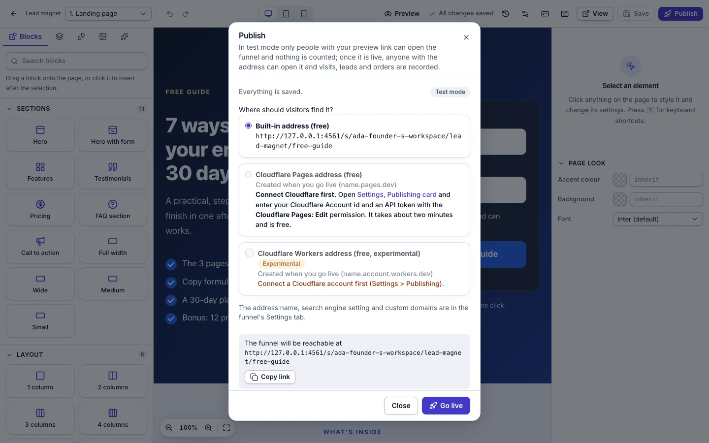

**Publish** saves unsaved changes first (and says so if that fails), then shows the same address choices as the funnel's Go live card, with **Go live**. Once live it is titled *Publish changes* and offers **Update live page** (saves, and on a Cloudflare address queues a redeploy) and **Take offline**; **Open preview** is always there. See [GO-LIVE.md](GO-LIVE.md).

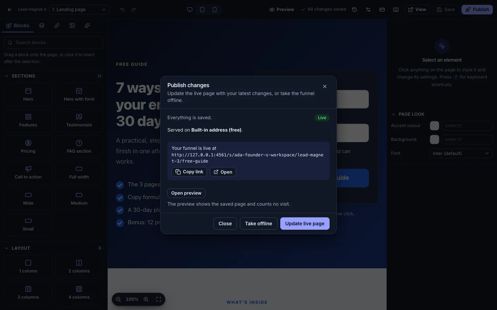

## Templates

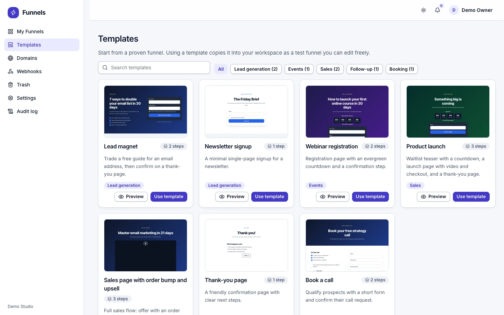

Needs `funnels:read` (using a template needs `funnels:write`). 28 templates in 11 categories (Lead generation, Events, Sales, Follow-up, Booking, Ecommerce, Software and apps, Local services, Courses and membership, Nonprofit, Agencies). Controls: **search**, **industry**, **goal**, **Has checkout**, category buttons, **Clear filters**, a pager (12 per page). Each card shows a real thumbnail of its first page, step count, category, industry and a Checkout badge.

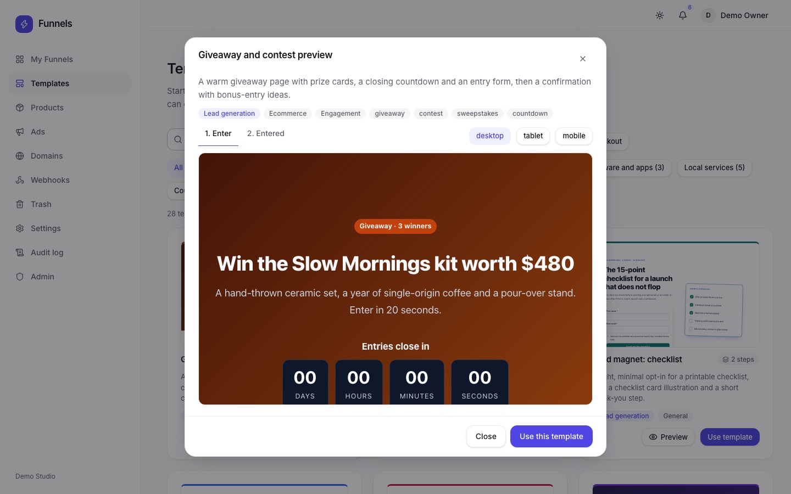

**Preview** opens every step of the template in a sandboxed frame at desktop, tablet or mobile size, shows the description, tags and which products it sells. **Use template** asks for a funnel name; for templates with checkout steps it also asks, per product slot (main offer, order bump, one-click upsell, downsell), whether to **create the template's sample product** (the default, reusing an equal one that already exists) or use a price from your catalog (one-click offers cannot use subscriptions). Nothing is created until **Create funnel**; the result is a test funnel. Templates are copied: later changes to a template never touch your funnel.

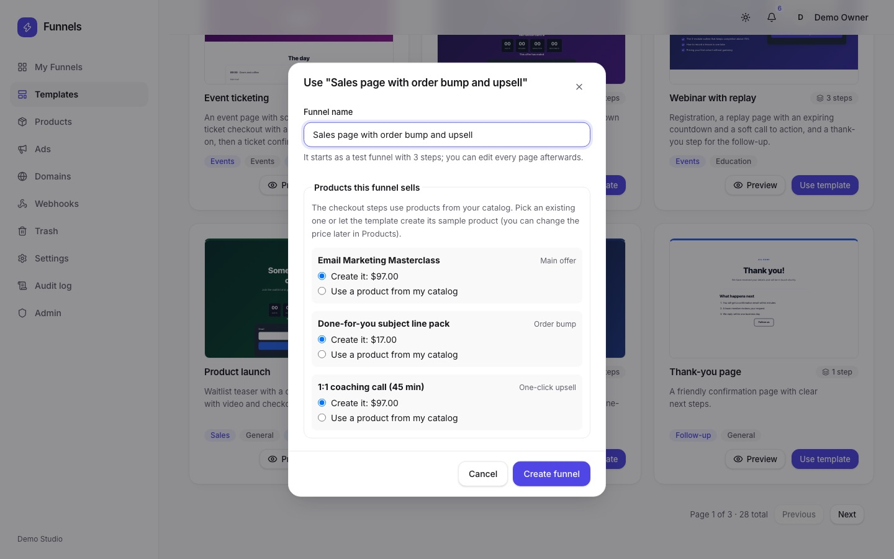

## Products

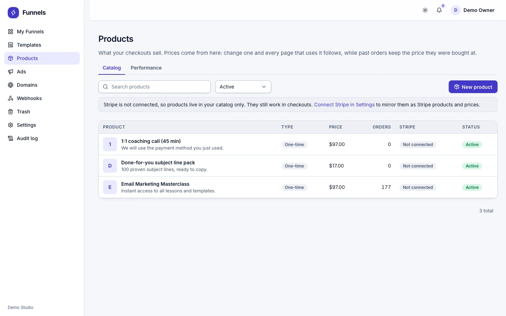

The catalog of what checkouts sell. Needs `products:read`; changing needs `products:write`. Prices come from here: change one and every page that uses it follows, while past orders keep the price they were bought at. Two tabs: **Catalog** and, with `analytics:read`, **Performance**.

**Catalog.** *Search*, *Status* (Active, Archived, All), **Sync with Stripe** (only when Stripe is connected), **New product**. The table shows product, type (One-time or Subscription), the default price (and how many others), orders, Stripe sync state and status. Without a Stripe connection a notice explains that products live in the catalog only and still work in checkouts. Clicking a product opens its panel.

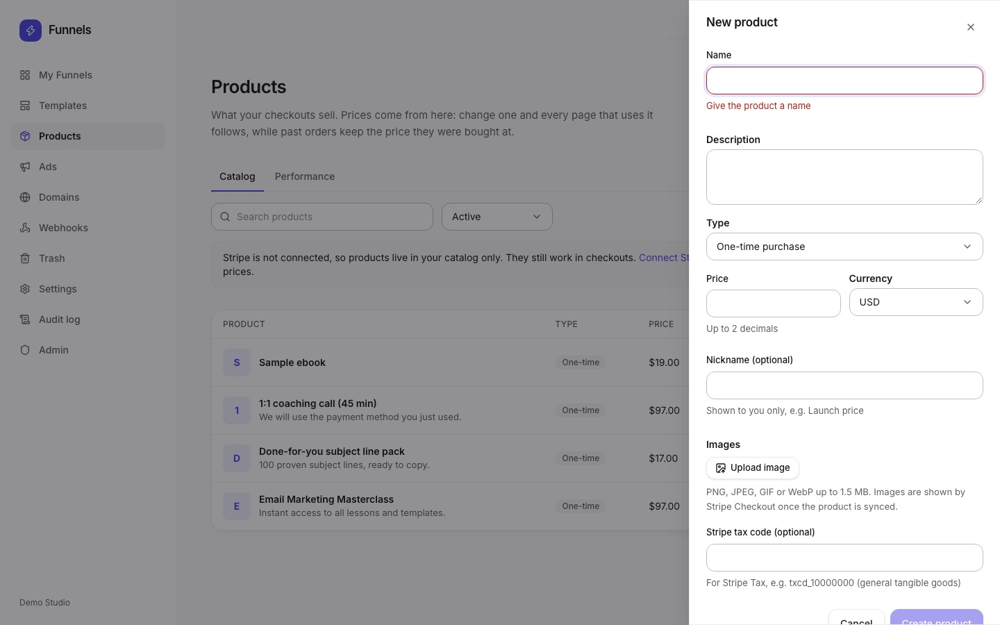

* **New product:** name (required), description, type (cannot change later), first price (amount in major units with the currency's decimals, currency from 19 choices, billing interval and free-trial days for subscriptions, nickname), images (up to 8, 1.5 MB each) and a Stripe tax code. Needs `products:write`.
* **An existing product:** edit name, description, images and tax code; **Prices** lists each price with *Default* and *Archived/Replaced* badges. Prices are immutable: **Change price** creates a new price, archives the old one and points pages and checkouts at the new one; **Add price**; **Archive** a price (a product keeps at least one active price). **Archive product** hides it from pickers and makes checkouts that name it refuse with a friendly message (pages keep rendering, orders keep their data); **Restore** brings it back.
* **Stripe section:** the sync state (*Not connected*, *Synced*, *Not synced*, *Sync failed*), **Sync now**, and the Stripe product id.

### Performance

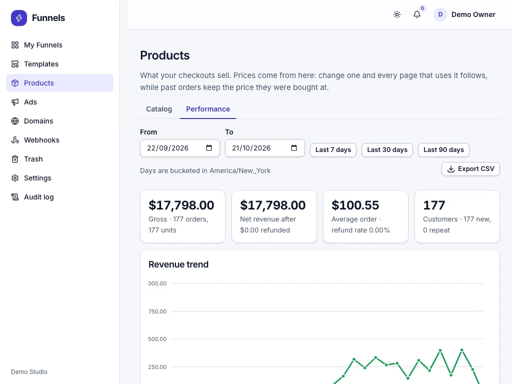

*Needs `analytics:read`.* Date range, **Export CSV**, KPIs (gross, net after refunds, average order, customers new and repeat), a revenue trend, and a table per product and currency (orders, gross, refunded, net, AOV, conversion, bump and upsell take rates, sparkline); a row opens a detail drawer. **Summarise this period** (`ai:use`) writes a short narrative and three prioritised actions from an evidence object the server computes; any number the writer adds is discarded. Currencies are never added together.

## Ads

Needs `ads:read` (the sidebar entry is hidden without it). Four tabs. The app does **not** create or read campaigns in ad platforms; spend is entered by hand or imported from CSV ([ADS.md](ADS.md)).

### Performance and attribution

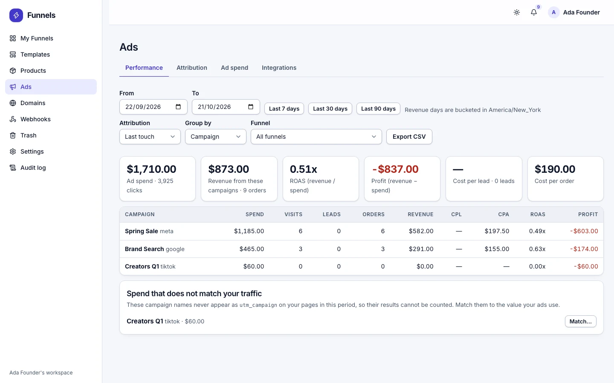

**Performance.** Range presets (7, 30, 90 days, custom), *Attribution* (Last touch default, First touch), *Group by* (Campaign default, Source, Funnel, Day), *Funnel* filter, **Export CSV**. KPIs: spend, revenue from these campaigns and order count, ROAS, profit, cost per lead and cost per order, then a table by the chosen grouping (spend, visits, leads, orders, revenue, CPL, CPA, ROAS, profit). One currency is shown at a time and the others are listed, never added. Below it, **Spend that does not match your traffic** lists campaign names with spend but no matching `utm_campaign` and offers **Match...** (needs `ads:write`) to map a spend campaign to the UTM value your ads carry; revenue from campaigns with no recorded spend is reported separately ("not counted above").

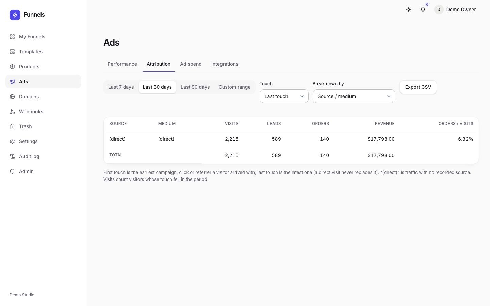

**Attribution.** Visits, leads, orders and revenue by *Source / medium* (default), source, medium, campaign, ad (`utm_content`) or source / medium / campaign, for the first or last touch, with **Export CSV**. First touch is the earliest campaign, click or referrer a visitor arrived with; last touch is the latest one (a direct visit never replaces it).

### Ad spend

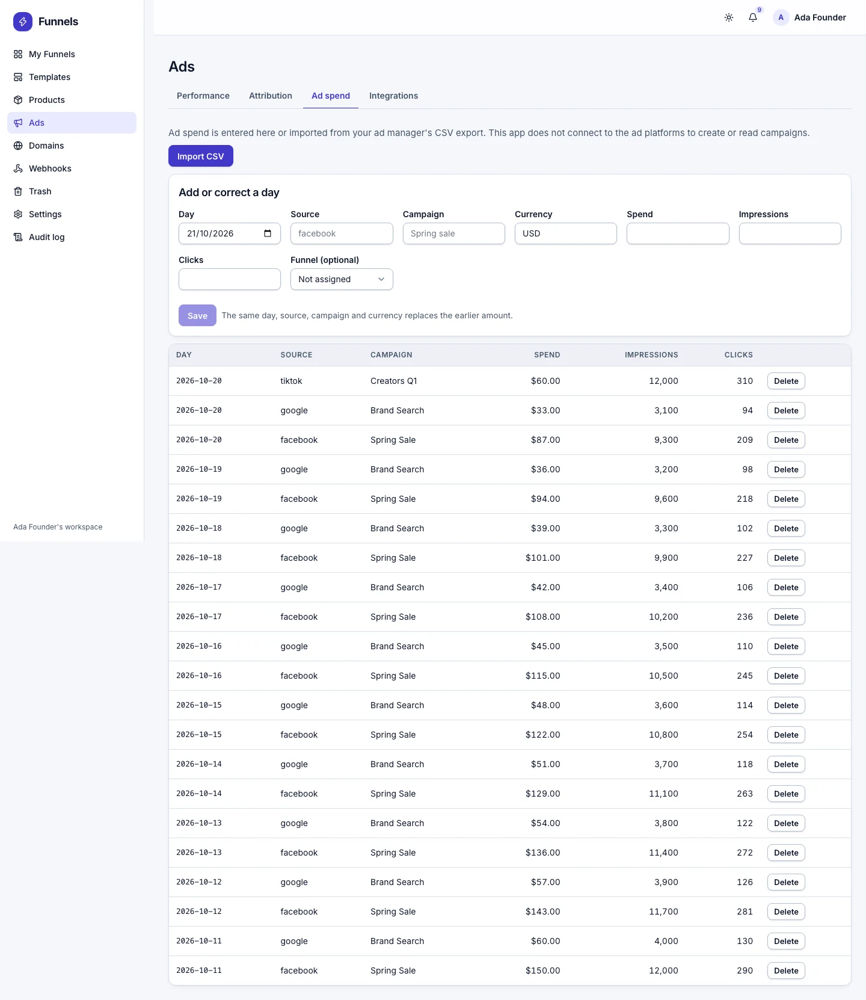

**Add or correct a day:** day, source, campaign, currency, spend, optional impressions and clicks, optional funnel; the same day, source, campaign and currency replaces the earlier amount. **Import CSV:** columns `date, source, campaign, currency, spend` (optional `account, impressions, clicks`); **Check file** validates every row and lists problems without saving, then import (idempotent re-imports). The list has a **Delete** per row. Needs `ads:write` to change; with only `ads:read` you can look.

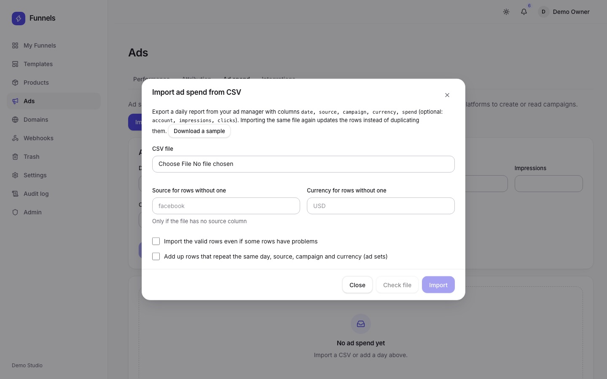

### Integrations

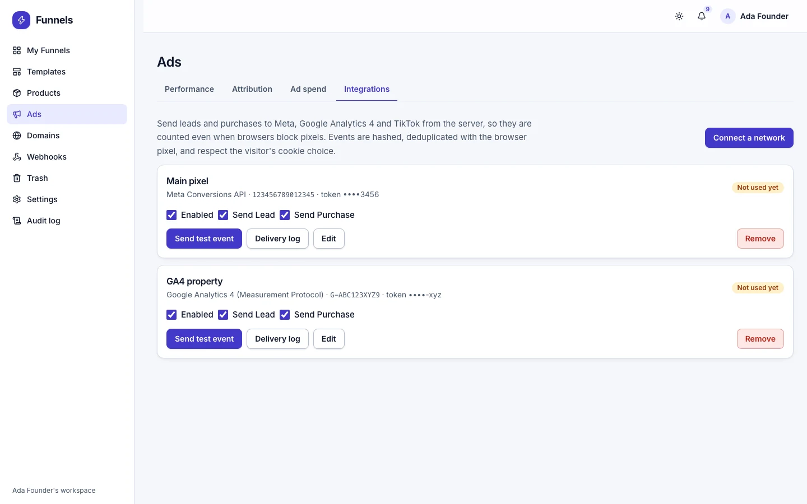

Needs `integrations:manage` to change. **Connect a network** (Meta, Google Analytics 4, TikTok): name, pixel or measurement id, the access token or API secret (stored encrypted, shown afterwards only as its last characters), and a test event code. Each connection shows its status (*Working*, *Last delivery failed*, *Off*), **Send test event** (the network's own answer is shown), **Delivery log** (status, event, tries, detail, **Retry** for failed ones; never the token or a raw email), **Edit** and **Remove**. Conversions are sent from the server for verified leads and purchases, hashed and deduplicated with the browser pixel, and respect the visitor's consent. **Not verified against the real networks**: use *Send test event* with each network's own test tool before trusting a number ([VERIFIED.md](VERIFIED.md)).

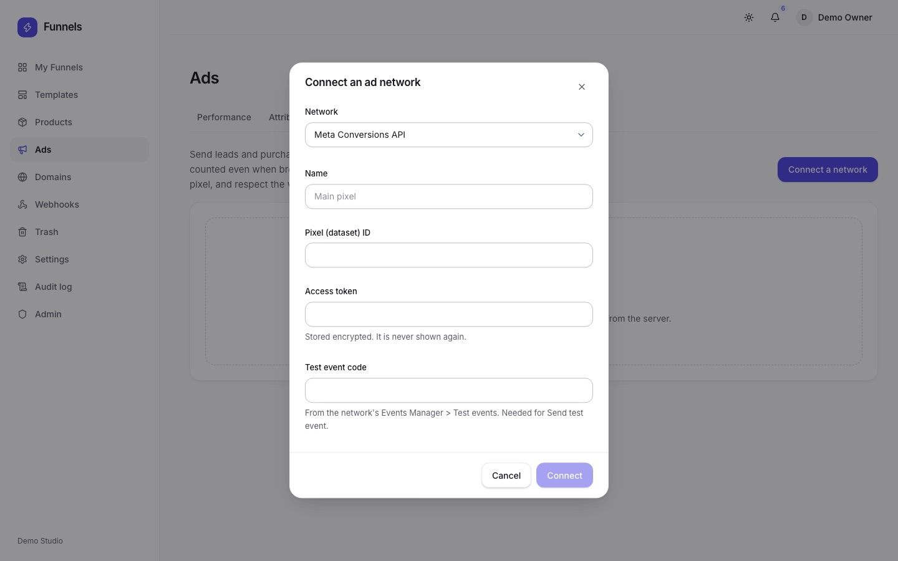

## Domains

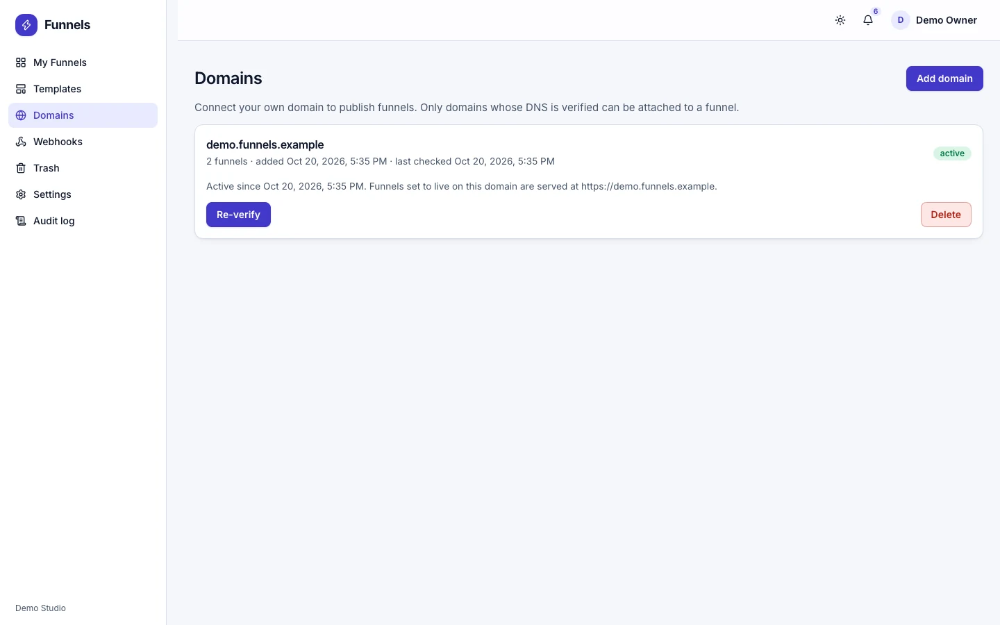

A domain of your own is optional: funnels can go live on the free built-in address or a Cloudflare Pages address. Everyone with `domains:read` sees the list; adding, verifying and deleting needs `domains:manage`.

* **Add domain:** a hostname such as `offers.example.com` (no `http://`, path or port). A card appears with the status (*pending*, *active*, *failed*) and the two DNS records to create at your DNS provider, each with Copy buttons: a **CNAME** pointing to the app's target (`APP_PUBLIC_CNAME_TARGET`) and a **TXT** ownership record.
* **Verify:** runs the DNS check now and shows what was found for each record. DNS can take minutes; pending domains are also re-checked automatically and fail after 72 hours; an active domain whose DNS disappears turns *failed* and the funnels on it go back to test mode.
* **Delete:** funnels using the domain go back to test mode and stop being served.

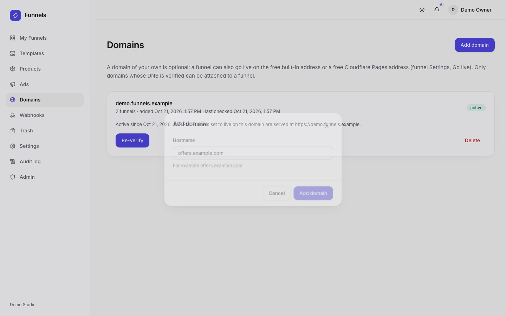

Only a verified (*active*) domain can be chosen in Go live. TLS for customer domains is terminated in front of the app (a CDN, a proxy or Cloudflare), see [DEPLOY.md](DEPLOY.md) and [CLOUDFLARE.md](CLOUDFLARE.md).

## Webhooks

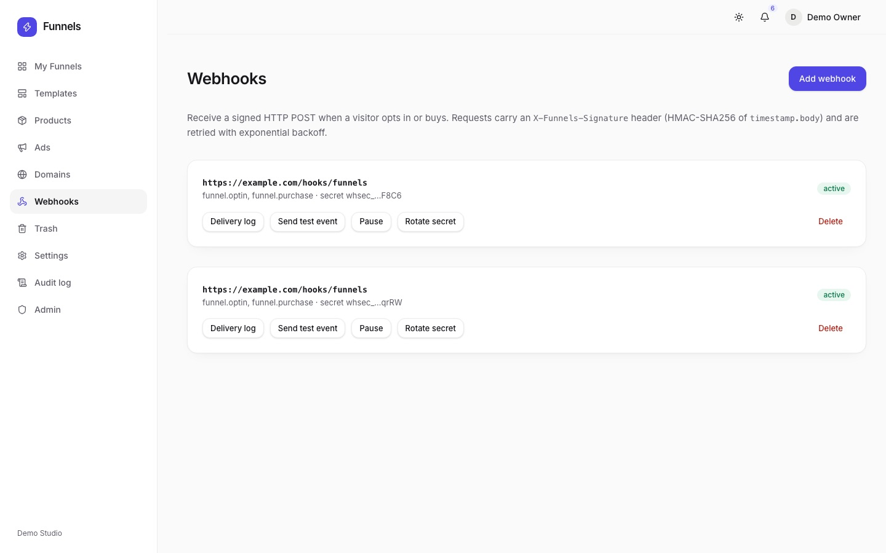

Needs `webhooks:manage` (the page says so otherwise). A webhook receives a signed HTTP POST when something happens. **Add webhook:** endpoint URL (must be a public http(s) address; private and local addresses are blocked) and events (default: new opt-in and new purchase; also order refunded and dispute opened or changed). The signing secret (`whsec_...`) is shown **once**: copy it. Each webhook lists its URL, events and the secret's last characters, with **Delivery log** (each event, status, attempts, HTTP status, error; **Retry** for failed or dead ones), **Send test event**, **Pause / Resume**, **Rotate secret** and **Delete**. Requests carry `X-Funnels-Signature` (HMAC-SHA256 of `timestamp.body`) and are retried with exponential backoff (30 s, 1 min, 2 min, ... up to an hour) and dead-lettered after the maximum attempts. Subscribing to `analytics.daily_rollup_ready` (API only) announces that yesterday's data is ready for the analytics API. Details: [FEATURES.md](FEATURES.md#webhooks).

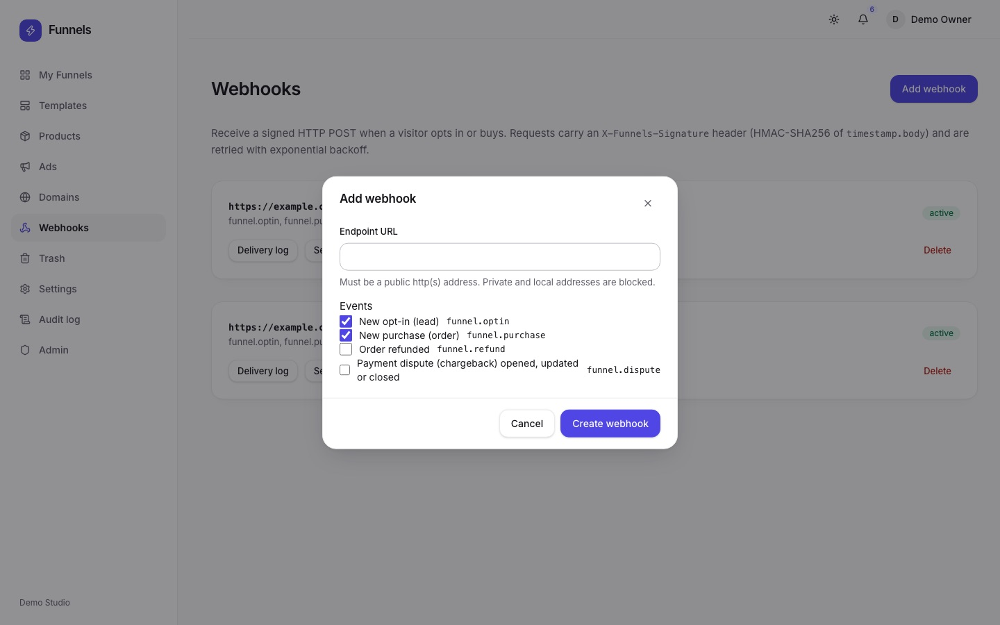

## Trash

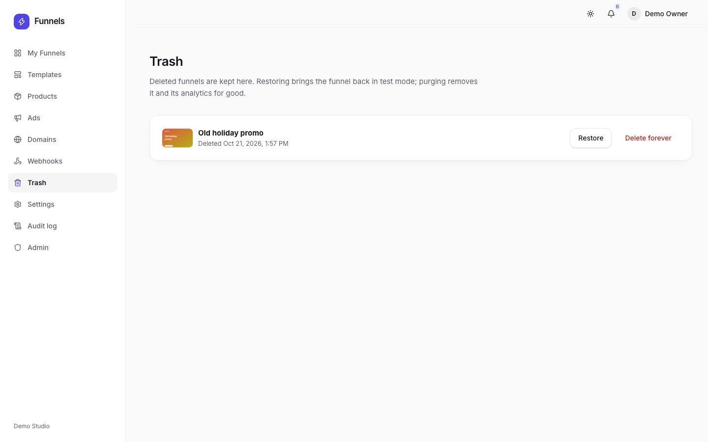

Deleted funnels are kept here (needs `funnels:read`). **Restore** (needs `funnels:delete`) brings the funnel back **in test mode** with no domain attached; **Delete forever** (needs `funnels:purge`, Owner by default) removes the funnel, its steps, backups, opt-in events and orders for good, and the Cloudflare Pages project the app created for it.

## Settings

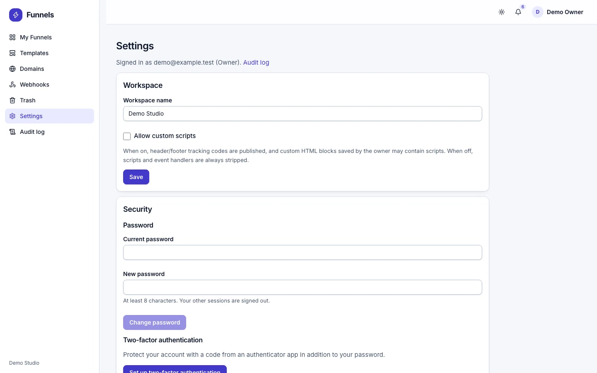

One page; the left index jumps to a section, and sections you may not use are hidden. The header shows who you are and your role.

### Workspace

*Workspace name* and **Allow custom scripts** (off by default). When on, funnels' header and footer tracking codes are published and custom HTML blocks saved by the Owner may contain scripts; when off, scripts and event handlers are always stripped. Changing it needs `workspace:manage` (Owner); other roles see the values read-only. Saving re-renders the workspace's pages.

### Security

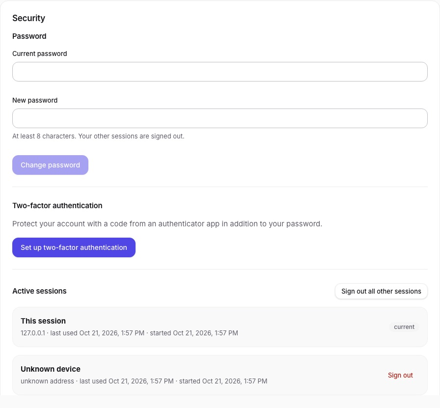

**Password:** current and new password (8 characters at least); changing it signs your other sessions out. **Two-factor authentication:** **Set up** shows a secret and an `otpauth://` link for your authenticator app (no QR code is drawn), then asks for the first 6-digit code and shows **recovery codes once**; afterwards you can regenerate the codes or turn it off (both need your password and a code). **Active sessions:** this session and others with device, address and last use; **Sign out** one or **Sign out all other sessions**. Details: [RBAC.md](RBAC.md#two-factor-authentication-totp).

### Team and roles

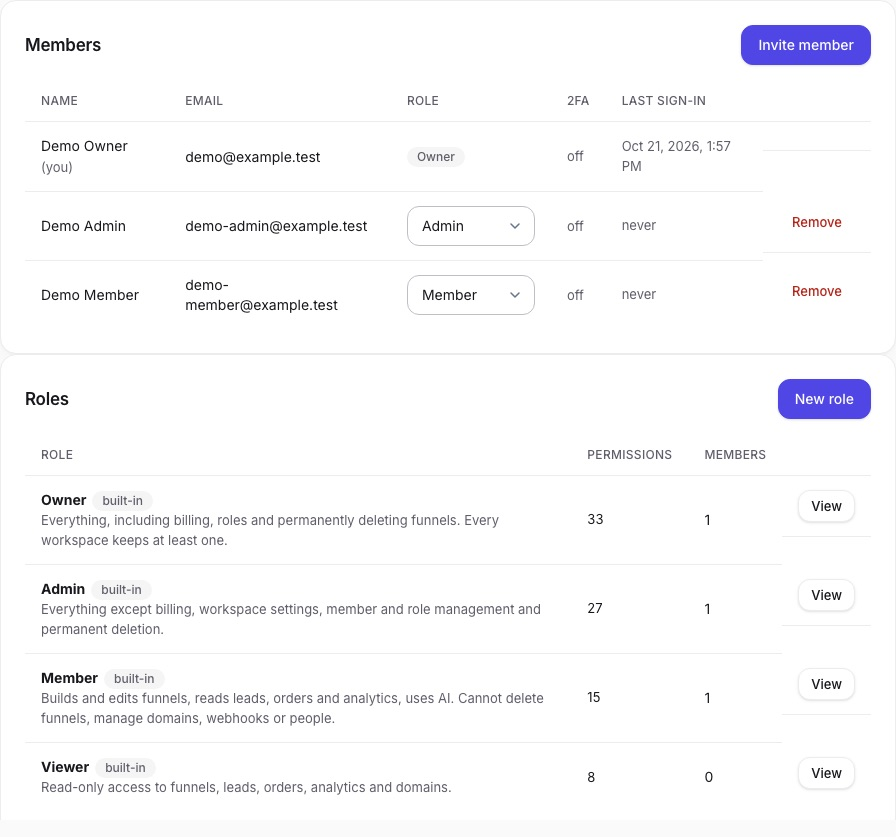

Needs `members:read`; changing needs `members:manage` and `roles:manage`. **Invite member:** email and role (Owner, Admin, Member, Viewer or a custom role); the one-time link is mailed, or shown to you when no mail transport delivers it. Pending invitations can be resent or revoked. The members table shows name, email, role (a dropdown to change it; you can only grant permissions you hold and a workspace always keeps one Owner), whether 2FA is on, and last sign-in, with **Remove** and a **Reset 2FA** button (shown when the member has two-factor on) that removes their second factor and ends their sessions. **Roles:** the four built-in roles (with permission counts and member counts; **View** shows the list) and **New role**: name, description and tick the permissions (you can only grant what you hold).

### Plan

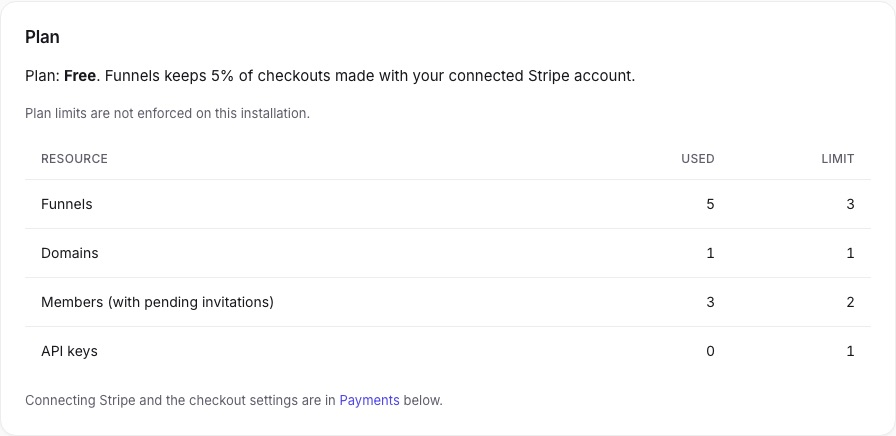

Needs `billing:read`. Shows the plan (Free, Pro, Business), the application fee Funnels keeps from checkouts made through your connected Stripe account (5 %, 2 %, 0 %), usage against limits (funnels, domains, members including pending invitations, API keys) and, only when `BILLING_ENFORCE_LIMITS` is on, whether limits are enforced ("Plan limits are not enforced on this installation" otherwise). **Upgrade to ...** starts a Stripe Checkout session for the platform subscription and **Manage subscription** opens the Stripe billing portal (both need `billing:manage` and a platform Stripe configuration).

### Payments

Needs `products:read` to see, `billing:manage` to change. Shows the mode (*Not available* when the server has no Stripe key, so checkouts run in the built-in test mode where orders are recorded and no card is charged; *Test* for a `sk_test_` key; *Live*), the connection state (not connected, onboarding incomplete with what Stripe still needs, restricted, connected), whether charges and payouts are enabled, the country, currency and active payment methods of the connected account, **Connect Stripe** / **Continue onboarding** / **Open Stripe settings** and **Disconnect**. **Checkout settings:** statement descriptor suffix (22 characters at most on statements), email a receipt for each payment, and calculate tax with Stripe Tax (only when Stripe Tax is set up on the connected account). Test mode also lists the Stripe test cards with a Copy button. **Verified only against sandbox response shapes, never with a real charge** ([VERIFIED.md](VERIFIED.md)).

### Publishing

Needs `publishing:manage`. Connect your own Cloudflare account to publish funnels to Cloudflare Pages: enter the **Account id** and an **API token** with *Cloudflare Pages: Edit* and *Account Settings: Read* (and *Workers Scripts: Edit* for the experimental Workers option). The app checks them with a read-only call, stores the token encrypted and afterwards shows only its last four characters. **Verify** re-checks the token, **Disconnect** deletes the stored token and switches the funnels published through it back to being served by this server; the sites stay online on Cloudflare until you delete them there. Step-by-step: [CLOUDFLARE-SETUP.md](CLOUDFLARE-SETUP.md). If the installation has a platform Cloudflare account configured (`CF_PAGES_ACCOUNT_ID` and `CF_PAGES_API_TOKEN`) the card says it can also host a project for you.

### Tracking

Workspace-wide defaults for ad pixels and the cookie consent banner; every funnel and step can override them ([funnel Settings](#settings-funnel-tab)). Changing needs `integrations:manage`; saving re-renders the affected pages and refreshes live copies.

### Google reviews

Needs `integrations:manage`. The **Places API key** (Places API (New) enabled in Google Cloud) is stored encrypted and never shown again; **Save key**, the **Default place** used by blocks that name no place, and **Test fetch** (one live call; 200 lookups per day are allowed). Without a key the Google reviews block shows the testimonials typed into it, labelled as customer feedback. **Not exercised against the real Google API** ([REVIEWS.md](REVIEWS.md), [VERIFIED.md](VERIFIED.md)).

### API access

Everyone sees the card; **New API key** needs `api_keys:manage`. A key (`fa_live_...` or `fa_test_...`) lets another system read analytics from `/api/v1/analytics` (docs in [ANALYTICS-API.md](ANALYTICS-API.md)): name, mode (live or test funnels), scopes (analytics read, analytics export), optional expiry date and allowed IP addresses or CIDR ranges. The key is shown **once**; **Revoke** stops it at once. **Identity pepper** (needs `analytics_identity:manage`): the secret that turns emails into the `contact_key` and `visitor_key` of the exports, shown as a fingerprint (first 8 hex characters of its SHA-256 and a version), with **Show the pepper**, **Rotate** (all exported keys change), and **Import a pepper** (type it twice) so two apps of one customer compute the same keys and can join data without sharing personal data.

### AI assistant

Needs `ai:use`. Shows whether the provider is the Anthropic model (when `ANTHROPIC_API_KEY` is set) or the built-in offline writer, and a bar of how many of the daily requests were used today (`AI_DAILY_CAP`, default 50, counted per UTC day; 0 turns AI off).

## Audit log

Needs `audit:read` (also linked from Settings). Who did what, newest first, 50 rows per load: when, action (for example `auth.login`, `product.created`, `role.updated`), actor, target, details and IP. *Filter by action* matches the action name. Support-access rows are marked with a badge. Passwords, tokens and secrets are never recorded ([RBAC.md](RBAC.md#audit-log)).

## Admin

Only for platform administrators (see [ADMIN.md](ADMIN.md)): people listed in `PLATFORM_ADMIN_EMAILS`, or added here. Two-factor authentication is mandatory in production. The sidebar's Admin entry opens eight tabs. Administrators are either *support* (look at everything, act read-only as an owner) or *superadmin* (can also open write-enabled support sessions and grant superadmin).

* **Workspaces.** Counts at the top (workspaces, suspended, users, live funnels, paid plans, dead jobs), *Search* (name, id or member email), *Status* filter and the table (owner, plan, members, funnels, status). A workspace opens a panel: plan and usage against limits, members, recent activity, and the actions **Suspend** (with a reason; signs members out, stops serving and public writes, purges the edge cache), **Unsuspend**, **Act as owner** (a time-limited support session, read-only unless a superadmin ticks *Allow changes* and gives at least 20 characters of reason; the workspace's own audit log records it), **Export data** (the whole workspace as NDJSON) and, when suspended, **Delete permanently** (type the workspace name).

* **Queues.** The job queue by type and status with the age of the oldest job, the outbox backlog, event buffer depth, the event bus kind, and **Dead jobs** with their last error, **Retry** and **Discard** per job.

* **Monitoring.** Whether Sentry error monitoring is on (it is off unless `SENTRY_DSN` is set), the environment, release, sample rate and ingest host (never the DSN), and **Send test error** to verify the setup ([MONITORING.md](MONITORING.md)). Screenshots: [off](design/admin-monitoring-off-1440-light.webp), [on](design/admin-monitoring-on-1440-dark.webp).
* **Feature flags.** The two built-in flags (`ai_assistant`, `analytics_api`, both on) and any you create: default on or off, rollout percent, number of overrides, per-workspace **Force on / Force off / Remove override**, and **Create flag** (lowercase letters, digits, dot, dash, underscore).

* **Announcements.** Publish a banner for every signed-in user: title, message and level (Info, Warning, Critical which cannot be dismissed).

* **Audit.** The platform-wide audit log, filtered by action (exact, or a prefix ending in `*` such as `admin.*`) and workspace id.

* **Personal data.** Enter an email address: **Look up** lists everything held about it across workspaces (leads, orders, checkout sessions); **Erase** deletes leads and anonymises orders (amounts stay for the books). Data held by Stripe or by customers' own systems is not touched.

* **Administrators.** The list with source (`PLATFORM_ADMIN_EMAILS` or added here), role and 2FA state; **Add** an existing user by email with a role; remove an administrator (not one from the environment list, not yourself).

## Things that have no screen

These exist as API routes only; the full list is [openapi.json](openapi.json) and [API.md](API.md).

| What | Where |
|---|---|
| Publish a funnel as a global template, import and export templates as JSON, edit or delete templates and categories | `/api/admin/templates...` (platform administrators; [TEMPLATES.md](TEMPLATES.md)) |
| Block, allow-list or re-tier a client, workspace or user at the rate limiter, and see recently limited subjects | `/api/admin/rate-limits...` ([RATE-LIMITING.md](RATE-LIMITING.md)) |
| Analytics API v1: funnels, steps, time series, ads, attribution, products, NDJSON exports of events and leads | `/api/v1/analytics/...` with an API key ([ANALYTICS-API.md](ANALYTICS-API.md)) |
| Rename the workspace's address name (slug of built-in addresses) | `PATCH /api/workspace {"slug": ...}` |
| Webhook event `analytics.daily_rollup_ready` | subscribe with `POST /api/webhooks` |
| Signed public pages: `/preview/<funnel>/...`, `/s/<workspace>/<funnel>/...`, `/uploads/...`, `/beacon.js`, `/public/reviews/<token>`, `/api/public/*`, `/healthz`, `/readyz`, `/metrics` | served by the app, see [FUNCTIONS.md](FUNCTIONS.md#api-route-groups) |
