# Design

How the web app and the page builder look and behave, and why. Screenshots in this folder are produced by `npm run design:shots` (see the end) from the seeded demo workspace, in light and dark, at 1440x900, 1024x768 and 390x844.

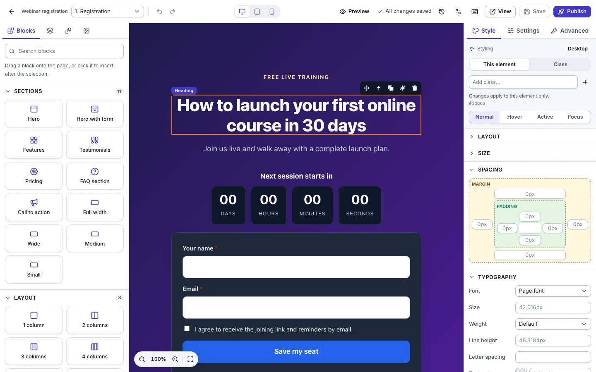

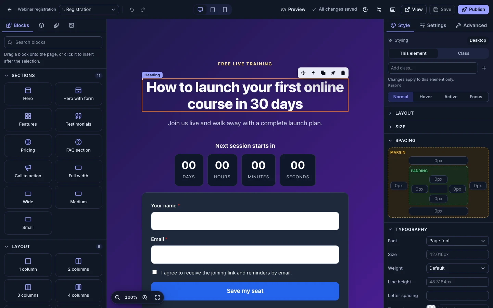

## Principles

* **The page is the product.** In the builder the interface stays quiet and neutral (white or near-black panels, one indigo accent) so that the customer's page is the most colourful thing on screen. In lists, funnel cards and the templates gallery show the real page, not an icon.
* **One set of tokens.** Colours, radii, shadows and type come from CSS variables in `web/src/styles.css`, mapped into Tailwind v4 with `@theme inline`. Components never use a literal colour.
* **Light, dark and system.** `prefers-color-scheme` decides unless the person picked a theme in the header menu (`data-theme` on `<html>`, remembered in `localStorage`). The builder canvas is the exception on purpose: it always shows the page as published, with the page's own colours.
* **Keyboard first, pointer friendly.** Everything the mouse does has a keyboard route (drag a block = click or Enter on the tile; drag in Layers = Alt+Arrow), focus is always visible, dialogs trap and restore focus.
* **Honest states.** Skeletons while loading, an empty state that says what to do, errors with the server's message and code, toasts for what just happened, and "Unsaved changes" / "All changes saved" in the builder's top bar.

## Tokens

Defined in `:root` (light) and under `prefers-color-scheme: dark` / `:root[data-theme='dark']`. `web/src/ui/tokens.test.ts` parses the file and fails the build if any pair below drops under WCAG AA (4.5:1 for text).

| Token | Light | Dark | Use |
|---|---|---|---|
| `bg` | `#f6f7fb` | `#0a0e19` | page background |
| `surface` | `#ffffff` | `#111726` | cards, panels, dialogs |
| `surface-2`, `surface-3` | `#eef0f6`, `#e4e8f1` | `#19203a`, `#232c4a` | hover, table heads, segmented controls |
| `text` | `#0f172a` | `#e8ecf6` | body text |
| `muted` | `#475569` | `#a6b1c8` | secondary text |
| `border`, `border-strong` | `#d9deea`, `#b6bed0` | `#262f4a`, `#3a4668` | separators, control borders |
| `primary` / `primary-hover` / `primary-contrast` / `primary-soft` | `#4338ca` / `#3730a3` / `#ffffff` / `#e9ebff` | `#98a0ff` / `#b3b9ff` / `#0a0e19` / `#1f2556` | the one accent |
| `ring` | `#6366f1` | `#98a0ff` | focus outline |
| `danger`, `ok`, `warn`, `info` (+ `-soft`) | `#b42318`, `#067647`, `#93370d`, `#175cd3` | `#ff9189`, `#55d98d`, `#fbbf24`, `#7cb0ff` | status colours and their soft backgrounds |

Measured contrast (light / dark): text on surface 17.9 / 15.1, muted on surface 7.6 / 8.3, primary-contrast on primary 7.9 / 8.1, primary on surface 7.9 / 7.5, danger on danger-soft 5.6 / 7.1, ok on ok-soft 4.9 / 8.0, warn on warn-soft 6.6 / 8.4, info on info-soft 4.9 / 6.5.

* **Type**: Inter variable (self-hosted through `@fontsource-variable/inter`, Latin subset fetched on demand), 15 px body, `font-semibold tracking-tight` headings, system monospace for code and paths.
* **Radius**: 6, 8, 12, 16 px (`sm`, `md`, `lg`, `xl`); controls use 8, cards 12.
* **Elevation**: `shadow-sm` for controls, `shadow-card` for cards, `shadow-pop` for menus, dialogs and the builder's floating bars.
* **Motion**: 150 to 200 ms fades and slides on dialogs, drawers, toasts and tooltips; skeleton shimmer. `prefers-reduced-motion: reduce` turns all of it into instant changes.

## Components

`web/src/ui/` holds the components, each a thin wrapper over a Radix primitive (or plain HTML) with class-variance-authority variants and `tailwind-merge`:

| Component | Notes |
|---|---|
| `Button` | variants `default`, `primary`, `danger`, `ghost`, `soft`, `link`; sizes `xs`, `sm`, `md`, `lg`, `icon`, `icon-sm`; links use `buttonVariants()` so they look the same |
| `Input`, `Textarea`, `Label`, `FormField` | `FormField` wires label, hint and error to the control (`aria-describedby`, `aria-invalid`) |
| `Select` | Radix select with the app's look; keyboard and type-ahead |
| `Tabs` | Radix tabs: funnel detail, inspector, left rail |
| `Dialog` | Radix dialog, sizes `sm` to `xl`; the `side` variant is the drawer (history, notifications, mobile navigation) |
| `Popover`, `Tooltip`, `DropdownMenu` | Radix; tooltips show the keyboard shortcut |
| `Toast` | Radix toast, one provider; the polite live region announces it |
| `Badge`, `Card`, `Table`, `Skeleton`, `EmptyState`, `Switch`, `Slider`, `ColorPicker` | `ColorPicker` is a swatch, a hex or CSS text field and a popover with presets and the native picker (empty means inherit) |

Older screens still use a compatibility layer (`btn`, `card`, `table`, `badge`, `field`, `input` classes defined with `@apply` in `styles.css`), so they pick up the same tokens; new code uses the components. One difference to know: `.btn.danger` of the compatibility layer is the quiet destructive button (red text on a soft ground), the `danger` variant of `Button` is the solid one used for confirmations.

## App shell and screens

* **Shell.** A 15 rem sidebar from 1024 px (My Funnels, Templates, Domains, Webhooks, Trash, Settings, Audit log, Admin for platform administrators); below that a header with a menu button that opens the same list as a drawer. The header holds the theme menu, notifications (a drawer) and the account menu (role, settings, sign out).
* **My Funnels.** Cards by default (list view one click away) with the real first page as the thumbnail, status badge, domain, tags, visits, opt-ins, orders, sales and Open. The filter bar wraps under 640 px.
* **Funnel detail.** Back link, name, status and domain, "Open builder", tabs Steps, Analytics, Leads, Orders, Settings. Steps show a thumbnail of each page; reordering works by drag, buttons and Alt+Arrow.
* **Templates.** Each template is a scaled live preview of its first page, with Preview (all steps, three device widths) and Use template.
* **Analytics.** Date range and presets, five summary cards, a daily trend with toggles, a step table.
* **Previews** (thumbnails, templates, version history) are the stored page in `<iframe sandbox="">` with scripts and embedded players removed; they are pictures, not live pages.

## The page builder

Layout by width:

| Width | Left rail | Canvas | Inspector |
|---|---|---|---|
| 1280 px and up | inline, 19.5 rem | fills the rest | inline, 20 rem |
| 768 to 1279 px | inline, 16 rem | fills the rest | drawer, opened by the sliders button |
| under 768 px | drawer, opened by the panel button | fills the screen, with a notice that the builder works best on a larger screen | drawer |
| under 640 px | | | the top bar keeps back, panels, step, save, publish, inspector and a "more" menu with undo, redo, preview, history, page settings |

**Top bar.** Back to the funnel, the funnel name (wide screens), the step switcher, undo and redo, the device switcher (desktop, tablet, mobile: the canvas really resizes and responsive styles go to media queries), preview toggle (hides the panels and the editing overlays), save status, history, page settings, shortcuts, View (the signed preview in a new tab), Save and Publish.

**Left rail.** *Blocks*: searchable, nine categories, each tile draggable and also clickable (it inserts after the selection, following the same drop rules); *My blocks* are the workspace's saved blocks; "Save selection as block". *Layers*: the page tree with visibility and lock, drag to reorder or nest with a live indicator, Alt+Arrow. *Pages*: the funnel's steps (add, duplicate, delete, reorder, switch). *Images*: upload (PNG, JPEG, GIF, WebP up to 1.5 MB), delete, use.

**Canvas.** GrapesJS's own iframe, so dragging, nesting, resizing and text editing happen on the page. Live drop placeholder while dragging, hover and selection outlines (sections green, rows and columns blue, elements orange, a legacy convention kept), a name badge, a floating toolbar (drag handle, select parent, duplicate, rewrite with AI for text, delete), resize handles on images and columns, double-click for inline text editing with a formatting bar, a context menu, shift-click multi-select, a zoom bar (50 to 150 %, fit to width) at the bottom left, empty containers that say what to drop.

**Inspector.** *Style*: target switch (this element or a class), states (normal, hover, active, focus), collapsible sections (layout, size, spacing with a box-model grid, typography, background, border, effects, position) written to rules for the active device. *Settings*: the typed editors of the selected component (button action, form fields and consent, product and price, countdown, progress, video, FAQ, tabs, popup, image with alt text and AI suggestion, custom code for permitted users). *Advanced*: visibility (everywhere, desktop only, mobile only, hidden), id and classes, custom attributes, and a CSS box for the element (filtered like everything else). With nothing selected it shows the page look: accent colour, background, font.

**Keyboard** (`?` opens the same table in the app; Ctrl instead of the Command key on Windows and Linux):

| Action | Keys |
|---|---|
| Undo, redo | Cmd+Z, Shift+Cmd+Z |
| Duplicate, copy, paste, delete | Cmd+D, Cmd+C, Cmd+V, Delete |
| Save | Cmd+S (works while typing in the page, in a panel field, or with the canvas focused) |
| Select several | Shift+click |
| Select the parent | Shift+Up |
| Move up or down among siblings | Alt+Up, Alt+Down |
| Move out of the parent | Alt+Left |
| Insert a block | Enter on the block tile (or click) |
| Preview | Shift+Cmd+P |
| Bold, italic, underline | Cmd+B, Cmd+I, Cmd+U |
| Finish text editing | click outside or Esc |
| Shortcuts | ? |

**Accessibility.** Focus ring on every control (`ring` token, 2 px offset); the panels are landmarks (`complementary` with names), tabs, trees and menus use the ARIA roles Radix and our tree implement; every icon button has an accessible name and a tooltip; the canvas toolbar and text-formatting buttons are real buttons; colour is never the only signal (status badges carry text, the save status carries an icon and words); dialogs trap focus and return it; reduced motion is respected. The published pages carry a skip link, labelled form fields, `aria-live` status lines and a visible focus outline. Not done: a screen-reader pass of the canvas itself (GrapesJS's iframe exposes the page content, not an accessible editing model), and contrast of the colours *authors* choose is only checked for the converter's default text on dark sections.

## Screenshots

All are WebP; names are `<screen>-<width>-<theme>`.

| Screen | 1440x900 | 1024x768 | 390x844 |
|---|---|---|---|
| Builder | [light](builder-1440-light.webp), [dark](builder-1440-dark.webp) | [light](builder-1024-light.webp), [dark](builder-1024-dark.webp) | [light](builder-390-light.webp), [dark](builder-390-dark.webp) |
| My Funnels | [light](funnels-1440-light.webp), [dark](funnels-1440-dark.webp) | [light](funnels-1024-light.webp), [dark](funnels-1024-dark.webp) | [light](funnels-390-light.webp), [dark](funnels-390-dark.webp) |
| Funnel detail (steps) | [light](funnel-steps-1440-light.webp), [dark](funnel-steps-1440-dark.webp) | [light](funnel-steps-1024-light.webp), [dark](funnel-steps-1024-dark.webp) | [light](funnel-steps-390-light.webp), [dark](funnel-steps-390-dark.webp) |
| Templates | [light](templates-1440-light.webp), [dark](templates-1440-dark.webp) | [light](templates-1024-light.webp), [dark](templates-1024-dark.webp) | [light](templates-390-light.webp), [dark](templates-390-dark.webp) |
| Analytics | [light](analytics-1440-light.webp), [dark](analytics-1440-dark.webp) | [light](analytics-1024-light.webp), [dark](analytics-1024-dark.webp) | [light](analytics-390-light.webp), [dark](analytics-390-dark.webp) |
| Products (catalog) | [light](products-1440-light.webp), [dark](products-1440-dark.webp) | | |
| Products (performance) | [dark](products-performance-1440-dark.webp) | [light](products-performance-1024-light.webp) | [light](products-performance-390-light.webp) |
| Templates (library gallery) | [light](templates-1440-light.webp) | | |
| Domains | [light](domains-1440-light.webp), [dark](domains-1440-dark.webp) | [light](domains-1024-light.webp), [dark](domains-1024-dark.webp) | [light](domains-390-light.webp), [dark](domains-390-dark.webp) |
| Settings | [light](settings-1440-light.webp), [dark](settings-1440-dark.webp) | [light](settings-1024-light.webp), [dark](settings-1024-dark.webp) | [light](settings-390-light.webp), [dark](settings-390-dark.webp) |
| Sign in | [light](login-1440-light.webp), [dark](login-1440-dark.webp) | | |

## What the screenshots changed

Reviewed one by one while building; the visible fixes:

* The builder's top bar overflowed at 390 px (Save, Publish and the inspector button were cut off): below 640 px the secondary actions moved into a "more" menu.
* Dark hero sections showed dark text on a dark background (the original bug): sections now declare a light or dark surface that flips the inherited text colour.
* Template and funnel thumbnails had a large empty black box where a video sat: previews now draw a play glyph instead of loading the player (which also stopped every card making a third-party request).
* The zoom bar covered the page's call-to-action: moved to the bottom left.
* The funnel settings form had two selects touching and cramped form rhythm; cards that are forms now space their children.
* Delete buttons next to Edit and Open were as loud as the primary action: destructive buttons are now quiet (red text on a soft ground) until hovered; the confirmation dialog keeps the solid one.
* The sign-in card still used the old logo and a flat background.
* The date on funnel cards was truncated; the analytics chart was taller than the viewport.

## Regenerating

```bash
npm run build                          # at the repo root
cd e2e && npm run design:shots         # all screens, all sizes, into ../docs/design (WebP when cwebp is installed, PNG otherwise)
SHOTS_ONLY=builder npm run design:shots
SHOTS_EXTRA=1 npm run design:shots     # more screens for review (new funnel, webhooks, leads, orders, funnel settings, trash, audit)
```

The script boots the built server on a temporary SQLite file with the demo data, signs in as the demo owner and takes the screenshots with Playwright's Chromium; nothing outside the temporary file is touched.

## AI builder, Google reviews and identity pepper screens

Generated by `npm run design:shots:ai` in `e2e/` (built app, built-in writer, a fake Google key; nothing leaves the machine). Reviewed at 1440, 1024 and 390 px in light and dark; fixes made after review: bullets and spacing in the result lists, a neutral "Your offer" product name instead of the first sentence of the brief, readable labels for footers and sections in the assistant's change list, "Clear the default place" in Settings, sample cards for the empty reviews block in the canvas.

| Screen | Screenshots |
|---|---|
| New funnel, Generate with AI (form) | 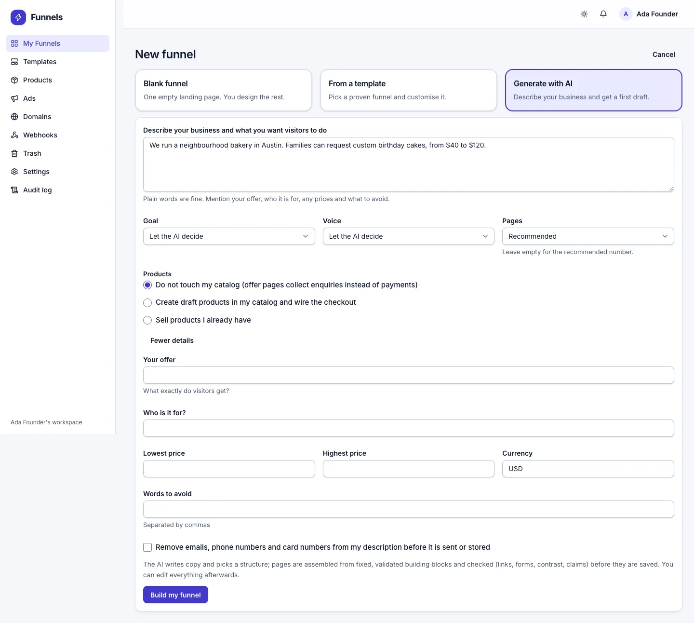 |
| Build progress at 390 px, dark | 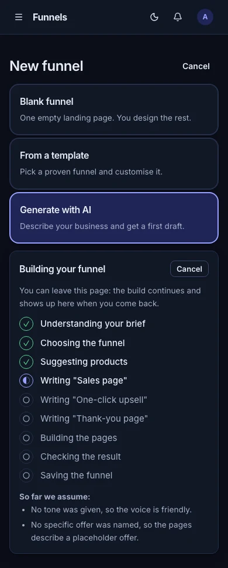 |
| Build result with plan, assumptions, products, checks | 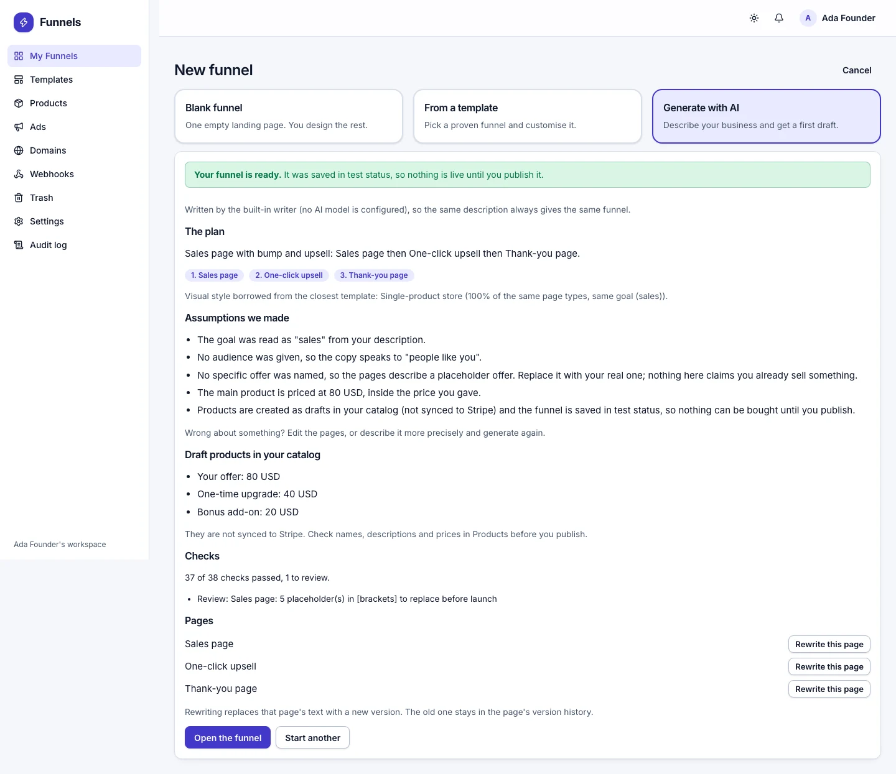 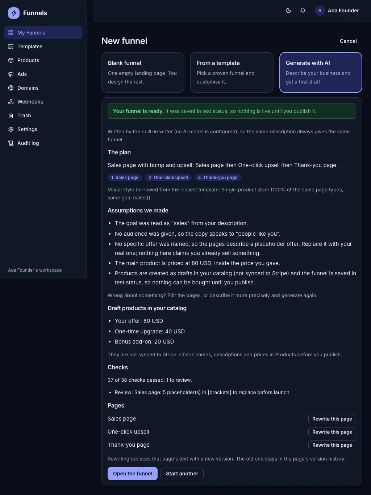 |
| Builder AI assistant, proposal and preview | 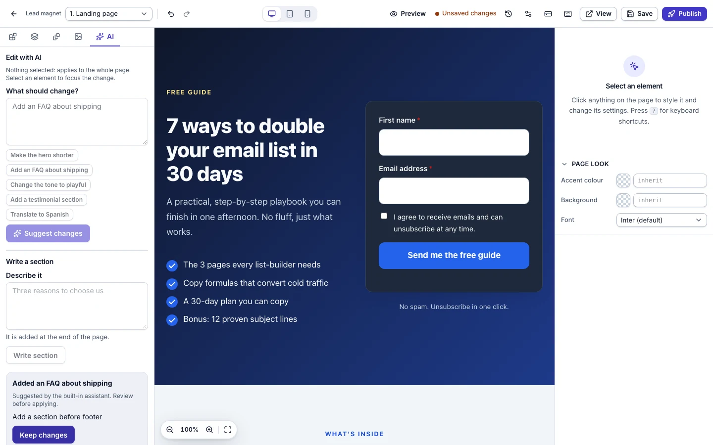 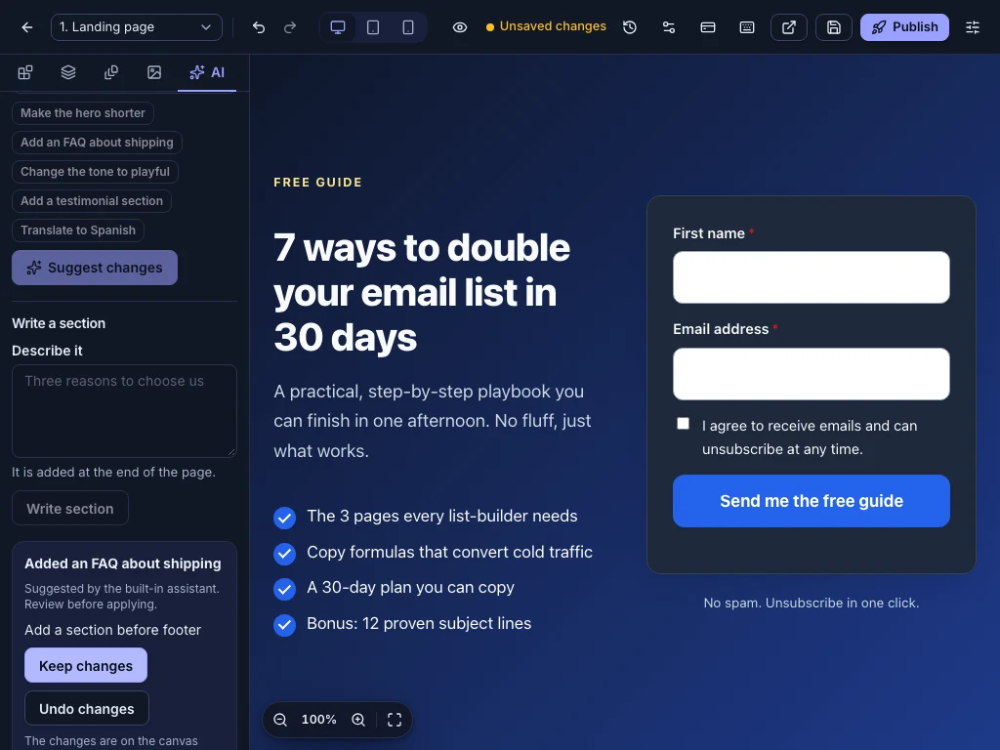 |
| Builder, Google reviews block settings | 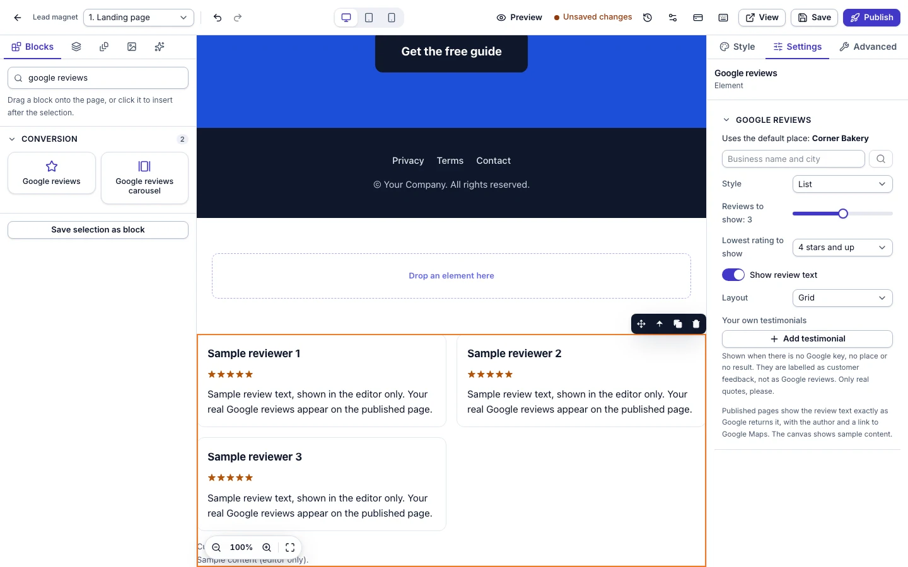 |
| Settings, Google reviews | 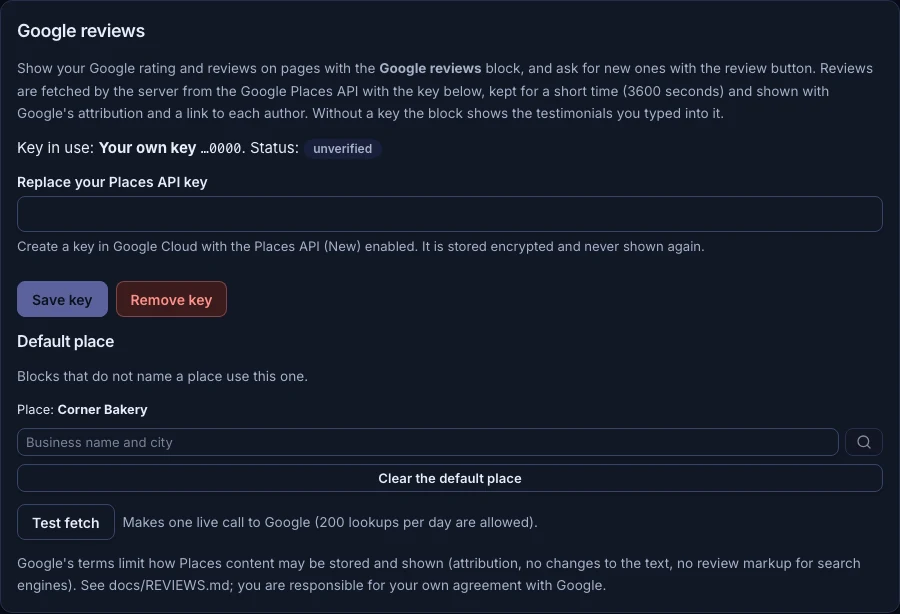 |
| Settings, identity pepper import | 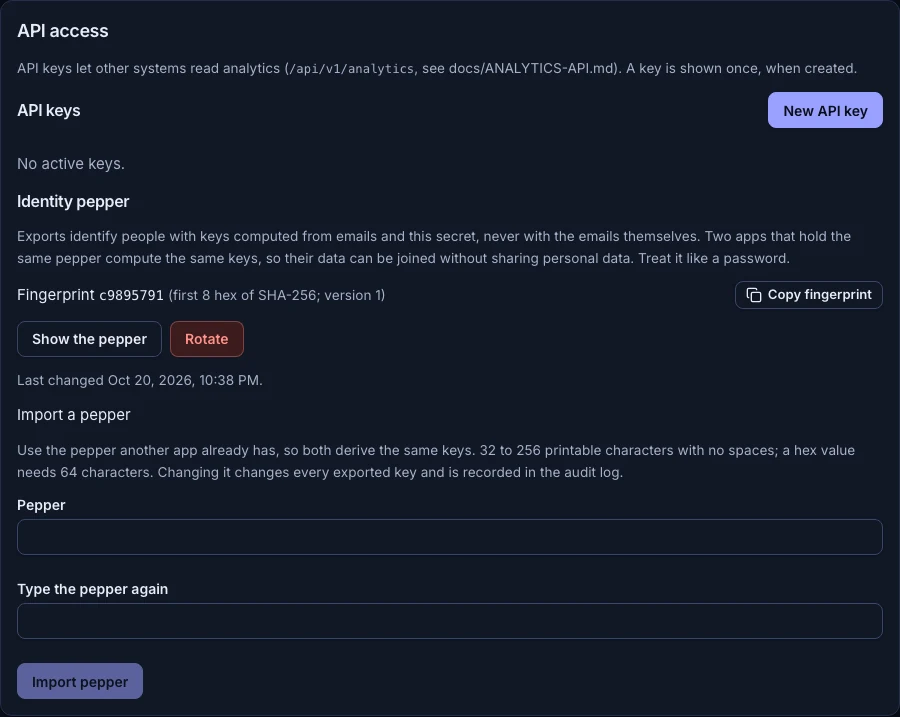 |
